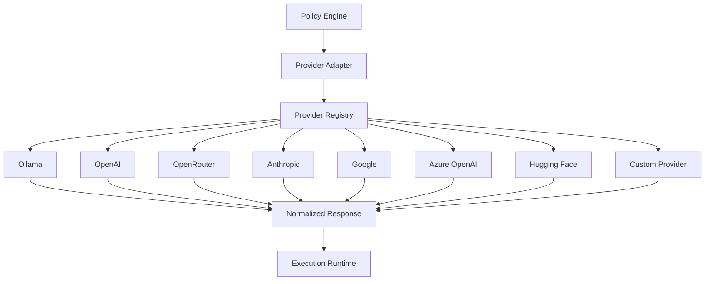
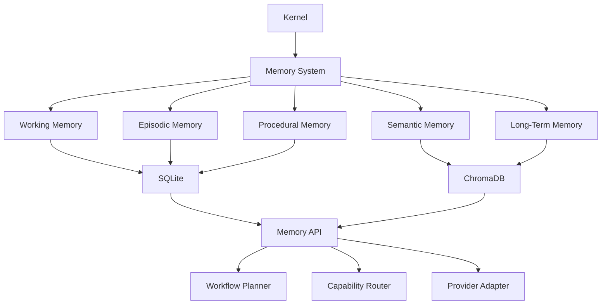
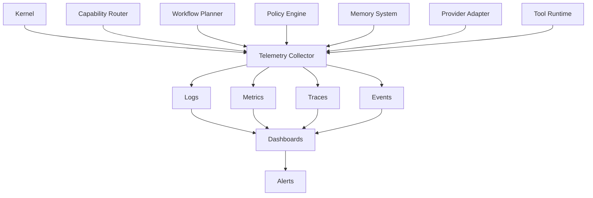

Hermes AIOS Progress

Based on the approved architecture sequence completed so far:

✅ Phase 0 — Project Foundation
✅ Phase 1 — Step 1
✅ Phase 1 — Step 2 — SYSTEM_OVERVIEW.md
✅ Phase 1 — Step 3A
✅ Phase 1 — Step 3B
✅ Step 3B.1 — Hermes Kernel
✅ Step 3B.2 — Capability Router
✅ Step 3B.3 — Workflow Planner
✅ Step 3B.4 — Policy Engine

The next approved deliverable is:

Phase 1 — Step 3B.5
docs/architecture/03B_5_PROVIDER_ADAPTER.md

This document defines one of the most important architectural boundaries in Hermes AIOS: all AI providers (local and cloud) communicate with the rest of the system through a single standardized interface. This keeps the Kernel, Router, Planner, and future components independent of any specific model vendor.

---
title: Provider Adapter
version: 1.0
status: Approved Draft
phase: Phase 1
step: 3B.5
owner: Hermes AIOS
last_updated: 2026-07-07
---

# Provider Adapter

## Executive Summary

The Provider Adapter is the abstraction layer between Hermes AIOS and all inference providers. It exposes a unified provider interface so that the rest of the system never depends on provider-specific SDKs, APIs, or protocols.

Whether execution is performed by a local Ollama model, a cloud OpenAI model, an OpenRouter endpoint, or a future custom inference server, the interaction always occurs through the Provider Adapter.

---

# Objectives

The Provider Adapter is responsible for:

- Provider abstraction
- Standard request formatting
- Response normalization
- Authentication
- Streaming support
- Capability discovery
- Health monitoring
- Failover handling
- Load balancing
- Provider lifecycle management

---

# Architectural Position

```
Kernel
   │
Capability Router
   │
Workflow Planner
   │
Policy Engine
   │
Provider Adapter
   │
Inference Backend
```

---

# Design Principles

The Provider Adapter must be:

- Provider-independent
- Model-independent
- Transport-independent
- Extensible
- Observable
- Fault tolerant
- Configuration-driven

No upstream component should know which provider is executing a request.

---

# Responsibilities

The Provider Adapter:

- Receives authorized execution requests
- Selects configured provider instances
- Translates Hermes requests into provider-specific formats
- Executes inference
- Normalizes responses
- Reports telemetry
- Returns standardized results

---

# Standard Provider Interface

Every provider implements the same interface.

```text
initialize()

health_check()

discover_capabilities()

generate()

stream()

embed()

rerank()

tool_call()

cancel()

shutdown()
```

Additional optional methods may be added through interface versioning.

---

# Request Lifecycle

```
Execution Request
        │
        ▼
Provider Adapter
        │
        ▼
Authentication
        │
        ▼
Provider Selection
        │
        ▼
Request Translation
        │
        ▼
Provider API
        │
        ▼
Response Translation
        │
        ▼
Normalized Response
```

---

# Request Schema

The Provider Adapter accepts a provider-neutral request object.

Example fields:

- Request ID
- Workflow ID
- Capability
- Preferred Model
- Constraints
- Context
- Memory References
- Tool Calls
- Streaming Flag
- Timeout
- Metadata

---

# Response Schema

Every provider returns a normalized response.

Example:

- Response ID
- Provider
- Model
- Finish Reason
- Tokens Used
- Latency
- Output
- Tool Results
- Errors
- Metadata

---

# Capability Discovery

Each provider advertises supported capabilities.

Example:

| Capability | Supported |
|------------|-----------|
| Chat | ✓ |
| Reasoning | ✓ |
| Embeddings | ✓ |
| Vision | ✗ |
| Audio | ✗ |
| Image Generation | ✗ |
| Tool Calling | ✓ |
| Streaming | ✓ |

The Capability Router consumes this information during planning.

---

# Provider Registry

The adapter maintains a runtime registry.

Example:

```
Provider Registry

├── Ollama
├── OpenAI
├── OpenRouter
├── Anthropic
├── Google
├── Azure OpenAI
├── Hugging Face
└── Custom Provider
```

Providers can be enabled or disabled through configuration.

---

# Authentication

Supported authentication mechanisms include:

- API Key
- OAuth
- Bearer Token
- Local Socket
- Unix Domain Socket
- mTLS
- Environment Variables
- Secret Store Integration

Credentials are never embedded in architecture code.

---

# Streaming

Providers supporting token streaming expose a unified streaming interface.

Features:

- Incremental tokens
- Partial tool calls
- Cancellation
- Timeout handling
- Backpressure support

---

# Failover Strategy

When execution fails:

1. Retry same provider
2. Switch provider instance
3. Select alternate provider
4. Reduce capability requirements
5. Escalate to Workflow Planner

---

# Health Monitoring

Each provider periodically reports:

- Availability
- Average latency
- Error rate
- Queue depth
- Active requests
- Throughput
- Last successful request

Unhealthy providers are removed from selection until recovery.

---

# Load Balancing

Supported strategies:

- Round Robin
- Least Latency
- Least Cost
- Highest Capability
- Weighted Routing
- User Preference

Selection policy is configurable.

---

# Configuration

Provider definitions live in configuration files rather than source code.

Example fields:

- Provider Name
- Endpoint
- Authentication Method
- Enabled
- Priority
- Cost Weight
- Timeout
- Supported Capabilities

---

# Error Handling

Standardized error categories:

- Authentication Error
- Network Error
- Timeout
- Rate Limit
- Invalid Request
- Provider Unavailable
- Unsupported Capability
- Internal Provider Error

Errors are normalized before returning upstream.

---

# Observability

The Provider Adapter publishes telemetry to the Observability layer.

Metrics include:

- Request count
- Success rate
- Failure rate
- Latency
- Tokens consumed
- Cost estimate
- Streaming duration
- Provider utilization

---

# Mermaid Diagram



---

# Architecture Decisions

## Provider Independence

Business logic never depends on provider SDKs.

## Capability-Driven Routing

Routing decisions are based on capabilities rather than provider names.

## Configuration over Code

Providers are configured through external configuration files.

## Standardized Contracts

All providers implement the same interface and response schema.

## Observability First

Every request generates standardized metrics for monitoring and optimization.

---

# Future Enhancements

Planned improvements include:

- Automatic provider benchmarking
- Dynamic capability discovery
- Cost-aware provider ranking
- Multi-provider parallel execution
- Geographic endpoint selection
- Provider sandbox testing
- Runtime plugin loading
- Self-healing provider recovery

---

# Cross References

Previous:

- `03B_1_HERMES_KERNEL.md`
- `03B_2_CAPABILITY_ROUTER.md`
- `03B_3_WORKFLOW_PLANNER.md`
- `03B_4_POLICY_ENGINE.md`

Next:

- `03B_6_MEMORY_SYSTEM.md`
Git Commands
git add docs/architecture/03B_5_PROVIDER_ADAPTER.md
git commit -m "docs(architecture): add Provider Adapter architecture"
git push origin main
Progress

Completed:

✅ 3B.1 — Hermes Kernel
✅ 3B.2 — Capability Router
✅ 3B.3 — Workflow Planner
✅ 3B.4 — Policy Engine
✅ 3B.5 — Provider Adapter
Repository Status
Phase 0  ████████████████████ 100%

Phase 1
├── System Overview          ✅
├── Core Components          ✅
│   ├── Hermes Kernel        ✅
│   ├── Capability Router    ✅
│   ├── Workflow Planner     ✅
│   ├── Policy Engine        ✅
│   ├── Provider Adapter     ✅
│   └── Memory System        ⏳ Next

Next planned deliverable: Phase 1 – Step 3B.6 — Memory System, which will specify Hermes AIOS's unified memory architecture (working, episodic, semantic, procedural, and long-term memory), retrieval pipeline, storage backends (including SQLite and ChromaDB as established in your project baseline), memory lifecycle, consolidation, and governance. This component is a major architectural milestone because it underpins personalization, learning, and agent continuity.

Hermes AIOS Progress

Based on the approved documentation sequence, the current completed architecture is:

✅ Phase 0 — Project Foundation
✅ Phase 1 — Step 1
✅ Phase 1 — Step 2 — SYSTEM_OVERVIEW.md
✅ Phase 1 — Step 3A
✅ Phase 1 — Step 3B
✅ 03B_1_HERMES_KERNEL.md
✅ 03B_2_CAPABILITY_ROUTER.md
✅ 03B_3_WORKFLOW_PLANNER.md
✅ 03B_4_POLICY_ENGINE.md
✅ 03B_5_PROVIDER_ADAPTER.md

The next planned deliverable is the Memory System, one of the foundational pillars of Hermes AIOS. This document establishes the architecture for memory management, leveraging the long-term project baseline you previously established (SQLite + ChromaDB, capability-based orchestration, provider independence, and modular design).

Phase 1 — Step 3B.6
docs/architecture/03B_6_MEMORY_SYSTEM.md
---
title: Memory System
version: 1.0
status: Approved Draft
phase: Phase 1
step: 3B.6
owner: Hermes AIOS
last_updated: 2026-07-07
---

# Memory System

## Executive Summary

The Memory System provides Hermes AIOS with persistent, structured, and searchable knowledge across conversations, workflows, and long-running tasks. It enables continuity, personalization, learning, and context retrieval while remaining independent of any specific language model or provider.

Hermes separates memory into distinct layers optimized for different retention periods, retrieval methods, and operational requirements.

---

# Objectives

The Memory System is responsible for:

- Maintaining conversation continuity
- Storing long-term knowledge
- Persisting workflow state
- Managing user preferences
- Recording procedural knowledge
- Supporting semantic retrieval
- Enabling checkpoint recovery
- Providing provider-independent memory services

---

# Architectural Position

```
User
   │
   ▼
Kernel
   │
Capability Router
   │
Workflow Planner
   │
Policy Engine
   │
Memory System
   │
Provider Adapter
```

Memory is consulted throughout the execution lifecycle but remains a dedicated subsystem.

---

# Design Principles

- Memory is model-independent.
- Storage engines are replaceable.
- Retrieval is capability-driven.
- Context windows remain bounded.
- Long-term persistence is durable.
- Sensitive data is policy-governed.
- Components interact through well-defined interfaces.

---

# Memory Layers

Hermes defines five logical memory layers.

## 1. Working Memory

Purpose:

- Active conversation state
- Current workflow variables
- Temporary reasoning context

Characteristics:

- Short-lived
- Fast access
- Automatically discarded

---

## 2. Episodic Memory

Stores completed interactions.

Examples:

- Conversations
- Completed workflows
- User sessions
- Agent decisions
- Execution history

Supports historical recall and learning.

---

## 3. Semantic Memory

Stores facts and concepts.

Examples:

- User preferences
- Project architecture
- Documentation
- Knowledge base
- Domain information

Semantic memory is optimized for retrieval rather than chronological history.

---

## 4. Procedural Memory

Stores reusable processes.

Examples:

- Workflow templates
- Agent strategies
- Coding patterns
- Planning sequences
- Automation recipes

This layer enables consistent execution of recurring tasks.

---

## 5. Long-Term Memory

Persistent storage across sessions.

Contains:

- Indexed documents
- Vector embeddings
- User-approved knowledge
- Project history
- Persistent metadata

Retention policies determine archival and pruning.

---

# Storage Architecture

Hermes separates logical memory from physical storage.

Recommended default backends:

### SQLite

Responsibilities:

- Structured metadata
- Workflow state
- Configuration
- Relationships
- Audit records

Advantages:

- Lightweight
- ACID-compliant
- Embedded
- Easy backup

---

### ChromaDB

Responsibilities:

- Vector embeddings
- Semantic similarity search
- Retrieval-augmented generation (RAG)

Advantages:

- Fast vector search
- Local deployment
- Embedding-agnostic
- Provider-independent

---

# Memory Interfaces

All memory providers implement a common interface.

```text
initialize()

store()

retrieve()

update()

delete()

search()

embed()

checkpoint()

archive()

shutdown()
```

---

# Memory Lifecycle

```
User Request
      │
      ▼
Working Memory

      │
      ▼
Semantic Retrieval

      │
      ▼
Workflow Execution

      │
      ▼
Checkpoint

      │
      ▼
Long-Term Storage

      │
      ▼
Consolidation
```

---

# Retrieval Pipeline

```
Request
    │
    ▼
Intent Analysis
    │
    ▼
Memory Query
    │
    ▼
Hybrid Search
    │
    ▼
Ranking
    │
    ▼
Context Assembly
    │
    ▼
Workflow Execution
```

Hermes supports hybrid retrieval combining structured queries and semantic vector search.

---

# Context Assembly

The Memory System assembles context from:

- Current conversation
- Relevant episodic memories
- Semantic facts
- Workflow templates
- User preferences
- Retrieved documents

The resulting context is optimized to fit model context limits.

---

# Consolidation

Periodic consolidation improves efficiency.

Processes include:

- Duplicate detection
- Summarization
- Metadata enrichment
- Embedding regeneration
- Archiving
- Expiration

---

# Checkpointing

Long-running workflows create checkpoints containing:

- Workflow ID
- Task state
- Variables
- Tool outputs
- Memory references
- Timestamp

Checkpoints support resumption after interruptions.

---

# Privacy & Governance

Memory operations are subject to the Policy Engine.

Rules include:

- User-controlled retention
- Sensitive data redaction
- Provider restrictions
- Local-only storage options
- Encryption at rest
- Audit logging

---

# Memory Categories

| Layer | Retention | Storage |
|--------|-----------|----------|
| Working | Minutes | In-memory |
| Episodic | Days–Years | SQLite |
| Semantic | Persistent | SQLite + ChromaDB |
| Procedural | Persistent | SQLite |
| Long-Term | Persistent | SQLite + ChromaDB |

---

# Integration Points

### Receives Input From

- Kernel
- Capability Router
- Workflow Planner
- Provider Adapter
- Tool Runtime

### Provides Services To

- Workflow Planner
- Capability Router
- Execution Runtime
- Observability
- Future Learning Modules

---

# Mermaid Diagram



---

# Architecture Decisions

## Logical vs Physical Separation

Logical memory layers are independent of storage engines, allowing future replacement of SQLite or ChromaDB without affecting higher-level components.

## Hybrid Retrieval

Hermes combines structured SQL queries with vector similarity search to improve retrieval accuracy and performance.

## Provider Independence

No language model owns or directly manages memory; all interactions occur through the Memory API.

## Policy-Driven Access

Every read and write operation is validated by the Policy Engine.

## Extensibility

Additional storage backends (e.g., PostgreSQL, Qdrant, Milvus) can be added by implementing the Memory Provider interface.

---

# Future Enhancements

- Memory importance scoring
- Automatic knowledge graph generation
- Temporal reasoning
- Cross-device synchronization
- Distributed memory clusters
- Embedding version management
- Personalized retrieval ranking
- Adaptive memory consolidation

---

# Cross References

Previous:

- `03B_1_HERMES_KERNEL.md`
- `03B_2_CAPABILITY_ROUTER.md`
- `03B_3_WORKFLOW_PLANNER.md`
- `03B_4_POLICY_ENGINE.md`
- `03B_5_PROVIDER_ADAPTER.md`

Next:

- `03B_7_OBSERVABILITY.md`
Git Commands
git add docs/architecture/03B_6_MEMORY_SYSTEM.md
git commit -m "docs(architecture): add Memory System architecture"
git push origin main
Progress
Completed
✅ 3B.1 — Hermes Kernel
✅ 3B.2 — Capability Router
✅ 3B.3 — Workflow Planner
✅ 3B.4 — Policy Engine
✅ 3B.5 — Provider Adapter
✅ 3B.6 — Memory System
Architecture Completion
Phase 1
├── Core Components
│   ├── Hermes Kernel          ✅
│   ├── Capability Router      ✅
│   ├── Workflow Planner       ✅
│   ├── Policy Engine          ✅
│   ├── Provider Adapter       ✅
│   ├── Memory System          ✅
│   ├── Observability          ⏳ Next
│   ├── Tool Runtime           ◻ Planned
│   ├── Event Bus              ◻ Planned
│   └── Plugin Framework       ◻ Planned
Next Planned Deliverable

Phase 1 – Step 3B.7 — Observability, which will define Hermes AIOS's telemetry architecture, structured logging, tracing, metrics collection, distributed workflow visibility, Langfuse integration, performance analytics, cost tracking, and operational dashboards. This document will complete another foundational subsystem before moving on to the Tool Runtime and Event Bus.

Hermes AIOS Progress

Based on the approved sequence and the progress visible in this project, the current architecture documentation is complete through:

✅ Phase 0 — Project Foundation
✅ Phase 1 — Step 1
✅ Phase 1 — Step 2 — System Overview
✅ Phase 1 — Step 3A
✅ Phase 1 — Step 3B.1 — Hermes Kernel
✅ Phase 1 — Step 3B.2 — Capability Router
✅ Phase 1 — Step 3B.3 — Workflow Planner
✅ Phase 1 — Step 3B.4 — Policy Engine
✅ Phase 1 — Step 3B.5 — Provider Adapter
✅ Phase 1 — Step 3B.6 — Memory System

The next planned deliverable is:

Phase 1 — Step 3B.7
docs/architecture/03B_7_OBSERVABILITY.md
---
title: Observability
version: 1.0
status: Approved Draft
phase: Phase 1
step: 3B.7
owner: Hermes AIOS
last_updated: 2026-07-07
---

# Observability

## Executive Summary

The Observability subsystem provides complete visibility into Hermes AIOS. It collects logs, metrics, traces, events, and execution telemetry across every architectural layer, enabling debugging, performance optimization, auditing, and operational monitoring.

Observability is a cross-cutting concern that integrates with every subsystem while remaining independent of business logic.

---

# Objectives

The Observability subsystem is responsible for:

- Structured logging
- Distributed tracing
- Metrics collection
- Workflow visualization
- Performance analysis
- Cost tracking
- Provider monitoring
- Error reporting
- Audit support
- Operational dashboards

---

# Architectural Position

```
                  Observability
                         ▲
                         │
 ┌─────────────── Hermes AIOS Core ───────────────┐
 │                                                │
 │  Kernel                                        │
 │  Capability Router                             │
 │  Workflow Planner                              │
 │  Policy Engine                                 │
 │  Memory System                                 │
 │  Provider Adapter                              │
 │  Tool Runtime                                  │
 └────────────────────────────────────────────────┘
```

Every component emits telemetry to the Observability subsystem.

---

# Design Principles

- Provider-independent
- Low overhead
- Structured telemetry
- Correlation by workflow ID
- Configurable retention
- Privacy-aware logging
- Extensible exporters
- Real-time monitoring

---

# Core Components

## Logging Service

Collects structured application logs.

Each log entry includes:

- Timestamp
- Component
- Severity
- Workflow ID
- Request ID
- Message
- Metadata

Supported levels:

- TRACE
- DEBUG
- INFO
- WARN
- ERROR
- FATAL

---

## Metrics Collector

Captures quantitative measurements.

Examples:

- Request count
- Success rate
- Failure rate
- Average latency
- Token usage
- Memory consumption
- CPU utilization
- GPU utilization
- Queue depth
- Active workflows

---

## Distributed Tracing

Each workflow receives a unique trace.

Example:

```
Workflow

↓

Kernel

↓

Capability Router

↓

Workflow Planner

↓

Policy Engine

↓

Provider Adapter

↓

Model

↓

Response
```

Every span records:

- Start time
- End time
- Duration
- Parent span
- Status
- Metadata

---

## Event Collector

Captures significant system events.

Examples:

- Workflow started
- Workflow completed
- Tool executed
- Provider switched
- Policy denied
- Retry initiated
- Checkpoint created

Events feed dashboards and alerts.

---

## Cost Monitor

Tracks resource consumption.

Metrics include:

- Token usage
- Estimated API cost
- Local inference time
- GPU hours
- CPU time
- Storage growth

Supports cost-aware routing in future releases.

---

## Provider Monitor

Maintains provider health.

Collected data:

- Availability
- Latency
- Error rate
- Throughput
- Queue length
- Timeout frequency

Provider statistics are consumed by the Capability Router and Provider Adapter.

---

## Performance Analyzer

Analyzes execution characteristics.

Reports include:

- Slow workflows
- Bottlenecks
- Retry frequency
- Long-running tasks
- Memory pressure
- Scheduling efficiency

---

# Telemetry Pipeline

```
Hermes Components
        │
        ▼
Telemetry Collector
        │
        ▼
Processing Pipeline
        │
        ▼
Storage
        │
        ▼
Dashboards
        │
        ▼
Alerts
```

---

# Log Schema

Example fields:

- Log ID
- Timestamp
- Workflow ID
- Component
- Severity
- Message
- Metadata
- Trace ID
- Span ID

Structured formats such as JSON are recommended for interoperability.

---

# Metric Categories

| Category | Examples |
|----------|----------|
| Workflow | Duration, completion rate |
| Provider | Latency, failures |
| Model | Token usage, throughput |
| Runtime | CPU, memory, GPU |
| Storage | Database size, retrieval latency |
| Networking | Requests, bandwidth |

---

# Tracing Model

Every request generates:

- One trace
- Multiple spans
- Parent-child relationships

Example:

```
Trace

├── Kernel
├── Router
├── Planner
├── Policy
├── Memory
├── Provider
└── Runtime
```

---

# Dashboard Views

Recommended dashboards include:

- System Health
- Active Workflows
- Provider Status
- Resource Utilization
- Cost Overview
- Memory Operations
- Tool Usage
- Error Trends
- Workflow Timeline

---

# Alerts

Examples:

- Provider unavailable
- Workflow timeout
- High error rate
- Excessive retries
- Memory pressure
- Storage nearing capacity
- Policy failures
- Queue backlog

Alerts are configurable by severity and destination.

---

# Langfuse Integration

Hermes AIOS supports integration with Langfuse for LLM-specific observability.

Capabilities include:

- Prompt tracing
- Response evaluation
- Token accounting
- Latency analysis
- Model comparison
- User feedback tracking

The integration remains optional and does not replace the internal telemetry model.

---

# Storage

Telemetry storage should support:

- Configurable retention
- Compression
- Export
- Archival
- Querying
- Aggregation

Storage backends may include SQLite for lightweight deployments and external systems for larger installations.

---

# Security & Privacy

Observability must respect Policy Engine decisions.

Requirements:

- Sensitive data redaction
- Configurable retention
- Role-based access
- Audit logging
- Encryption at rest
- Encryption in transit

---

# Integration Points

### Receives Telemetry From

- Hermes Kernel
- Capability Router
- Workflow Planner
- Policy Engine
- Memory System
- Provider Adapter
- Tool Runtime
- Plugin Framework

### Provides Data To

- Administration UI
- Performance Analyzer
- Audit System
- Future Learning Modules

---

# Mermaid Diagram



---

# Architecture Decisions

## Unified Telemetry

All components emit telemetry using a shared schema to simplify analysis and correlation.

## Trace-Centric Design

Workflow IDs and Trace IDs are propagated end-to-end, enabling complete execution visibility.

## Pluggable Exporters

Telemetry exporters are configurable, allowing integration with systems such as Langfuse, OpenTelemetry collectors, or custom backends.

## Minimal Performance Impact

Telemetry collection is asynchronous wherever possible to avoid delaying workflow execution.

## Privacy by Default

Sensitive content is redacted or excluded according to Policy Engine rules before storage or export.

---

# Future Enhancements

- OpenTelemetry-native exporters
- Predictive anomaly detection
- AI-assisted log analysis
- Distributed cluster monitoring
- Real-time workflow replay
- Capacity forecasting
- Automatic performance tuning
- SLA reporting

---

# Cross References

Previous:

- `03B_1_HERMES_KERNEL.md`
- `03B_2_CAPABILITY_ROUTER.md`
- `03B_3_WORKFLOW_PLANNER.md`
- `03B_4_POLICY_ENGINE.md`
- `03B_5_PROVIDER_ADAPTER.md`
- `03B_6_MEMORY_SYSTEM.md`

Next:

- `03B_8_TOOL_RUNTIME.md`
Git Commands
git add docs/architecture/03B_7_OBSERVABILITY.md
git commit -m "docs(architecture): add Observability architecture"
git push origin main
Progress
Completed
✅ 3B.1 — Hermes Kernel
✅ 3B.2 — Capability Router
✅ 3B.3 — Workflow Planner
✅ 3B.4 — Policy Engine
✅ 3B.5 — Provider Adapter
✅ 3B.6 — Memory System
✅ 3B.7 — Observability
Architecture Roadmap
Phase 1
├── Core Components
│   ├── Hermes Kernel          ✅
│   ├── Capability Router      ✅
│   ├── Workflow Planner       ✅
│   ├── Policy Engine          ✅
│   ├── Provider Adapter       ✅
│   ├── Memory System          ✅
│   ├── Observability          ✅
│   ├── Tool Runtime           ⏳ Next
│   ├── Event Bus              ◻ Planned
│   ├── Plugin Framework       ◻ Planned
│   └── Configuration System   ◻ Planned
Next Planned Deliverable

Phase 1 – Step 3B.8 — Tool Runtime, which will define the execution environment for built-in and external tools, sandboxing, lifecycle management, permission enforcement, streaming I/O, concurrency, and integration with the Workflow Planner and Policy Engine. This document will complete the execution layer before progressing to the Event Bus and Plugin Framework.


