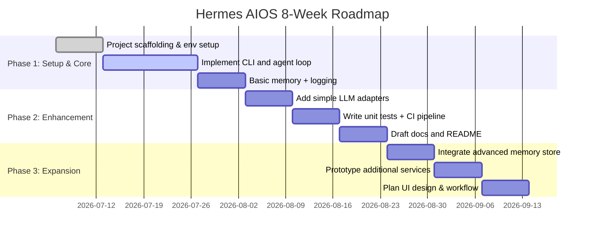

# Executive Summary  
Hermes AIOS is at an early stage, so we should **start small** and build only the core pieces first.  High-priority tasks include the **agent kernel loop**, basic persistence (memory and logging), initial LLM connectors, a CLI interface, and essential project setup (packaging, CI, docs).  These “**Now**” items are low-to-medium effort but enable the system to run; they work under Python 3.14 on Ubuntu/WSL with minimal dependencies (e.g. OpenAI API, SQLite or file storage, Python logging, etc.).  

Larger features like a web UI, multi-agent orchestration (message bus), advanced memory (vector DB), and full security/DevOps can wait (“**Later**”). These later tasks are high effort/complexity and depend on scaling needs or new users. For example, multi-agent messaging and GUI can greatly improve usability, but only after the core works reliably.  We recommend the following implementation plan (prioritized by effort vs impact):

- **Phase 1 (Now, Weeks 1–4):** Establish the basics – project scaffolding (README, lint/tests CI, packaging, .env), a simple CLI, the agent loop (LLM calls + JSON command handling), basic logging, and a simple memory store (e.g. SQLite or local files).  
- **Phase 2 (Near-term):** Enhance core features (improve memory with embeddings, add more connectors, comprehensive unit tests, refine documentation).  
- **Phase 3 (Later, Weeks 5–8+):** Build higher-level features like a web UI, multi-agent router, vector DB for memory, deployment (Docker), and advanced CI/CD pipelines, once the MVP is stable.

This approach minimises upfront effort while delivering a working agent OS.  The tables and diagrams below summarise “Now vs Later” items, with effort, dependencies, risks, and ordering.

## Now (High-Priority Implementation)

- **Core Kernel (Agent Orchestration Loop)** – *Description:* Implement the main control loop where an agent reads user goals, calls the LLM to generate plan/commands, executes actions, and loops. This includes parsing the LLM’s JSON response and dispatching commands. *Effort:* Medium. *Dependencies:* Python, an LLM API (e.g. OpenAI). *Risk/Complexity:* Medium – LLM outputs can be unpredictable and require careful parsing. *Order:* **1** (foundation).  Building this is essential; similar projects use this loop as the heart of the system.  

- **Memory Store (Basic Persistence)** – *Description:* Provide short-term memory by storing recent interactions (e.g. in a Python list, SQLite or simple JSON file). This allows the agent to “remember” context. *Effort:* Low. *Dependencies:* SQLite or file I/O, embedding API if used. *Risk:* Low. *Order:* **2**.  At minimum, log the dialogue for context. (Advanced memory with vector search can be added later.)  

- **Logging** – *Description:* Implement structured logging of agent actions, inputs/outputs, and errors to a log file. *Effort:* Low. *Dependencies:* Python `logging` module. *Risk:* Low. *Order:* **3**.  Even minimal logging is critical for debugging. (Open-source agents like BabyAGI log every function call, input/output, errors and execution time.)  

- **LLM Connector (Service Adapters)** – *Description:* Write a service to call an LLM (e.g. OpenAI GPT or any LLM) using a common interface. This adapter abstracts the model provider. *Effort:* Low. *Dependencies:* API keys (from `.env`), network. *Risk:* Low. *Order:* **4**.  Core agent tasks rely on calling an LLM. Start with one stable provider (OpenAI) and generalize later.  

- **CLI Application** – *Description:* Provide a simple command-line interface to start/stop agents, submit goals, and view results in the terminal. *Effort:* Low. *Dependencies:* Python (`argparse` or `click`). *Risk:* Low. *Order:* **5**.  A CLI is quick to build and test. (Even large OS projects support CLI: AIOS has a terminal UI alongside a web UI.)  

- **Project Packaging** – *Description:* Create `pyproject.toml` and/or `requirements.txt` to pin dependencies, plus a `.env.example` for config. *Effort:* Low. *Dependencies:* None. *Risk:* Low. *Order:* **6**.  Ensures a reproducible environment (WSL Ubuntu 24.04, Python 3.14). Include basic project metadata and install scripts.  

- **CI/CD Workflow** – *Description:* Add a GitHub Actions workflow to run linting (e.g. `flake8`/`black`) and unit tests on each push/PR. *Effort:* Low. *Dependencies:* GitHub. *Risk:* Low. *Order:* **7**.  This catches errors early. Use `setup-python` to fix Python 3.14 in CI.  

- **Security (Secrets/.env Management)** – *Description:* Use a `.env` file (via `python-dotenv`) for API keys and secrets, with a checked-in template. *Effort:* Low. *Dependencies:* `python-dotenv`. *Risk:* Low. *Order:* **8**.  Avoid hard-coding keys and push a `.env.example`. Full secret vault integration can wait.  

- **Unit Testing** – *Description:* Write basic unit tests (using `pytest`) for core logic (e.g. parsing LLM output, utility functions). *Effort:* Medium. *Dependencies:* `pytest`. *Risk:* Low. *Order:* **9**.  Ensures reliability from day one. Integration tests (mocking LLM calls) can come later.  

- **Documentation (README + initial docs)** – *Description:* Draft a clear README with project overview, installation steps, and simple examples. Create a `docs/` folder for architecture diagrams and developer guides. *Effort:* Low. *Dependencies:* None. *Risk:* Low. *Order:* **10**.  Good docs are vital for an open-source project. (Include architecture outline; see suggestions below.)  

- **Developer Experience (VS Code, Formatting)** – *Description:* Add VS Code settings (Python interpreter, lint/format on save) and/or a `.vscode/` folder. Configure `pre-commit` hooks for formatting (`black`) and linting. *Effort:* Low. *Dependencies:* `pre-commit`, VSCode. *Risk:* Low. *Order:* **11**.  Smooth dev setup reduces friction.

## Later (Lower-Priority, Future Work)

- **Web UI** – *Description:* A browser-based interface (e.g. with Streamlit or a lightweight webapp) for interacting with agents, viewing logs, and managing sessions. *Effort:* High. *Dependencies:* Web framework (React/Streamlit), web server. *Risk:* Medium (UI maintenance, authentication). *Order:* **Next**.  Useful for non-technical users or rich monitoring, but not essential initially. (AIOS and AutoGPT both add UIs after core logic.)  

- **Multi-Agent Architecture / Message Bus** – *Description:* Implement inter-agent communication (publish/subscribe) so multiple agents can delegate tasks. Likely via a lightweight message bus (e.g. Redis Streams or a simple HTTP+SQLite service). *Effort:* High. *Dependencies:* Possibly Redis/RabbitMQ or custom message API. *Risk:* High (complexity, concurrency). *Order:* **Later**.  Only needed when many agents coordinate. A central bus provides decoupling and reliability. (For <20 agents, Redis Streams is often sufficient.)  

- **Advanced Memory (Vector DB)** – *Description:* Upgrade memory to use vector embeddings (e.g. with FAISS or Pinecone) for semantic recall. *Effort:* Medium. *Dependencies:* Embedding API (OpenAI/Local), FAISS or cloud DB. *Risk:* Medium (tuning, storage). *Order:* **Later**.  Initially, a basic text store suffices. AutoGPT-style long-term memory (storing `(vector,text)` pairs) can be added to improve context.  

- **Additional Tool/Service Connectors** – *Description:* Integrate other tools (web search, file I/O, APIs, knowledge bases). *Effort:* Medium–High. *Dependencies:* External APIs, libraries. *Risk:* Medium (tool reliability). *Order:* **Later**.  Begin with a minimal “tools” set. More connectors (e.g. browser API, Wolfram Alpha, etc.) can be added to expand capabilities.  

- **Authentication/Security Hardening** – *Description:* For production, add OAuth or API key protection, HTTPS, and secure secret storage (e.g. HashiCorp Vault). *Effort:* Medium–High. *Dependencies:* Auth libraries or cloud services. *Risk:* Medium (security mistakes). *Order:* **Later**.  Not urgent for local dev.  

- **Packaging & Deployment (Docker)** – *Description:* Dockerize the app for easy deployment (create `Dockerfile`, `docker-compose.yml`). *Effort:* Medium. *Dependencies:* Docker. *Risk:* Low. *Order:* **Later** (once features stabilize).  Makes distribution simpler but requires maintenance.  

- **Integration/E2E Testing** – *Description:* Develop end-to-end tests that simulate full agent runs (possibly with mock LLMs) to catch issues across modules. *Effort:* High. *Dependencies:* Test frameworks, mock tools. *Risk:* Medium. *Order:* **Later**.  Builds on unit tests; important before major releases.  

- **Extended Documentation & Diagrams** – *Description:* Expand docs with diagrams (e.g. full architecture, sequence flows) and a developer wiki. *Effort:* Medium. *Dependencies:* MkDocs/Sphinx or similar. *Risk:* Low. *Order:* **Ongoing**.  Improve as the system grows.  

- **Developer Tools (DevContainer, Codespace)** – *Description:* Provide a Dockerized dev environment (e.g. VS Code Dev Container) so new contributors can start easily. *Effort:* Medium. *Dependencies:* Docker. *Risk:* Low. *Order:* **Later**.  Nice to have once the project attracts collaborators.

## Implementation Priorities

| Component / Feature         | Description (short)                                                  | Effort (L/M/H) | Dependencies                    | Risk/Complexity    | Recommended Order (High→Low) | Implement Now / Later |
|-----------------------------|----------------------------------------------------------------------|----------------|---------------------------------|--------------------|-----------------------------|-----------------------|
| **Core Kernel (Agent Loop)**   | Main loop: send goals to LLM, parse commands, execute actions        | Medium         | Python, LLM API                 | Medium             | 1                           | **Now**               |
| **Memory (Basic)**          | Local persistence of context (e.g. SQLite, file)                      | Low            | Python stdlib (SQLite/JSON)     | Low                | 2                           | **Now**               |
| **Logging**                 | Structured logs of agent steps, I/O, errors                           | Low            | Python `logging`               | Low                | 3                           | **Now**               |
| **LLM Connector**           | Adapter for calling an LLM (e.g. OpenAI GPT API)                      | Low            | Network, API keys (.env)        | Low                | 4                           | **Now**               |
| **CLI Interface**           | Command-line tool for running agents, entering prompts                | Low            | `argparse` or `click`           | Low                | 5                           | **Now**               |
| **Packaging/Env**           | `pyproject.toml`/`requirements.txt`, `.env.example` for keys          | Low            | None                           | Low                | 6                           | **Now**               |
| **CI/CD (GitHub Actions)**  | Automated linting (`flake8`/`black`) and tests on push/PR             | Low            | GitHub Actions                  | Low                | 7                           | **Now**               |
| **Security (.env keys)**    | Use `.env` for secrets (via `python-dotenv`)                          | Low            | `python-dotenv`                | Low                | 8                           | **Now**               |
| **Unit Tests**              | Basic tests for core functions                                        | Medium         | `pytest`                        | Low                | 9                           | **Now**               |
| **Documentation (README,Architecture)** | Initial README and design docs (including diagrams)       | Low            | None                           | Low                | 10                          | **Now**               |
| **Dev Experience (VSCode/Format)** | IDE config, pre-commit hooks for linting/formatting             | Low            | VSCode, `pre-commit`           | Low                | 11                          | **Now**               |
| **Web UI**                  | Browser-based interface for agents and logs                           | High           | Streamlit/React, web server    | Medium             | (next)                      | Later                 |
| **Message Bus (Multi-Agent)** | Central message bus for agent-to-agent communication               | High           | Redis/RabbitMQ or HTTP+DB      | High               | (next)                      | Later                 |
| **Memory (Vector DB)**      | Semantic memory via vector embeddings (FAISS/Pinecone)                | Medium         | Embedding API, vector DB       | Medium             | (later)                     | Later                 |
| **More Connectors/Tools**   | Integrate web browsing, search, other APIs                            | Medium-High    | External services/APIs         | Medium             | (later)                     | Later                 |
| **Auth & Secrets (Vault)**  | Production secrets store (Vault, KMS) and HTTPS                       | Medium-High    | Vault or cloud secret manager  | Medium             | (later)                     | Later                 |
| **Docker/Deployment**       | Containerize app (`Dockerfile`, `docker-compose`)                     | Medium         | Docker                          | Low                | (later)                     | Later                 |
| **Integration Tests**       | Full end-to-end tests (with mock LLMs)                                | High           | `pytest`, test frameworks      | Medium             | (later)                     | Later                 |
| **Extended Docs & Diagrams**| Full developer/user docs, design diagrams, architecture reference     | Medium         | MkDocs/Sphinx, Mermaid        | Low                | Ongoing                     | Later                 |
| **DevContainer / Codespaces**| Preconfigured dev environment for contributors                      | Medium         | Docker, VSCode devcontainer    | Low                | (later)                     | Later                 |

The table above groups each major component and indicates whether it should be tackled **Now** or deferred **Later**, with estimated effort, key dependencies, and risk. “Recommended Order” gives a loose priority ranking (1=highest).  For example, the agent loop and CLI are top priority (must be done first), whereas the web UI and multi-agent bus come much later when the core is stable.

## Comparison: Now vs Later

| Aspect            | Now (Immediate)                                            | Later (Deferred)                                              |
|-------------------|------------------------------------------------------------|--------------------------------------------------------------|
| **Kernel/Agents** | Basic single-agent loop (user → LLM → execute)             | Multi-agent scheduling, parallelism (message bus)            |
| **Persistence**   | Simple memory/logs (file or SQLite)                        | Semantic memory (vector DB like FAISS/Pinecone)              |
| **Logging**       | File/console logs (Python `logging`)                       | Centralized monitoring/log aggregation                      |
| **Services**      | Core LLM adapter (OpenAI or HuggingFace)                   | Extra tool connectors (browser, search APIs, etc.)          |
| **Interface**     | CLI commands and text I/O                                  | Web UI (dashboard)                                          |
| **CI/CD**         | GitHub Actions for lint/tests                              | Full pipeline (Docker build, deploy, release)               |
| **Security**      | `.env` for secrets                                         | Secret vault (HashiCorp Vault/AWS KMS)                       |
| **Packaging**     | `pyproject.toml` and requirements                          | Docker containerization                                     |
| **Testing**       | Unit tests                                                | Integration/E2E tests                                       |
| **Documentation** | README + simple docs (basic architecture)                 | Comprehensive docs site (MkDocs) + diagrams                 |
| **Dev DX**        | VS Code setup, pre-commit black/flake8                    | Devcontainer, GitHub Codespace support                      |

This highlights that **Now** we focus on lean, minimal implementations of each aspect (left column) to get a working system. The **Later** column lists features that improve scalability, usability, or robustness but require more effort. For example, introducing a message bus gives “decoupling, scalability, resilience, [and] observability”, but is costly, so we postpone it until needed.

## References and Rationale

- **Core Loop & Memory:**  Agentic systems like AutoGPT use a loop: user-defined goals → LLM → JSON with commands → execute → store in memory → repeat. We should replicate this minimal loop first.  AutoGPT’s design also shows using simple local storage for recent context and long-term memories as (vector, text) pairs.  Hence implement short-term memory now (a list or file) and defer full vector DB.  
- **Logging:**  Good practice is to log every action.  BabyAGI, for example, “logs all function executions, including inputs, outputs, execution time, and any errors”.  We’ll start with basic logs and expand later.  
- **UI vs CLI:**  Industry experience advises **CLI first**. A lightweight UI can save time later, but is not urgent.  (AIOS even says it “supports both Web UI and Terminal UI”, implying CLI is fully viable.)  Thus, we build a CLI now and defer the web dashboard.  
- **CI/CD:**  Use GitHub Actions to run linting and tests on push. GitHub recommends specifying the Python version (use `setup-python` for 3.14) for consistency. This is easy to set up now.  
- **Message Bus:**  Architecturally, a message bus solves “spaghetti” multi-agent comms by centralizing messages. However, simple pull-based designs (HTTP+SQLite or Redis Streams) are recommended for small teams. We leave this for later unless we need >1 agent.  
- **Dependencies:**  All chosen “Now” features run on Ubuntu 24.04 + Python 3.14, with minimal external services.  We avoid requiring GPUs or proprietary software at first.  This maximises compatibility with WSL.  

## Suggested Architecture (Mermaid Diagram)  

A simple block diagram shows the components and interactions:

```mermaid
flowchart LR
    subgraph Apps
        CLI[CLI Interface] 
        WebUI[Web UI (future)]
    end
    subgraph Core
        Kernel[Agent Kernel (orchestrator)]
        Memory[Memory Store]
        Logger[Logging Service]
    end
    subgraph Services
        LLM[LLM Provider(s)]
        Tools[Tool & API Connectors]
    end

    CLI -->|goals/commands| Kernel
    Kernel --> Logger
    Kernel --> Memory
    Kernel --> LLM
    Kernel --> Tools
    Memory --> Kernel
    LLM --> Kernel
    Tools --> Kernel
    WebUI --> Kernel
```

*Figure: Architecture of Hermes AIOS (future web UI and connectors indicated). Agents (via CLI or Web UI) send commands to the Kernel, which calls LLMs and tools and logs all actions. Memory stores context for retrieval.*  

## Development Timeline (First 8 Weeks)

We recommend an iterative 8-week plan:



This schedule prioritises **foundation work** in the first 4 weeks (Phase 1), then enhancements like testing and docs (Phase 2), and finally more complex features (Phase 3). Adjust as needed based on progress.

**Sources:** Our recommendations draw on the Hermes repo structure and analogous projects. For instance, AutoGPT’s architecture notes informed the core loop and memory strategy. AIOS literature highlights the kernel vs UI split. Best practices for agent logging and multi-agent systems come from BabyAGI and recent guides on message buses. GitHub’s docs guide our CI setup. These primary sources ensure our plan is realistic and up-to-date.