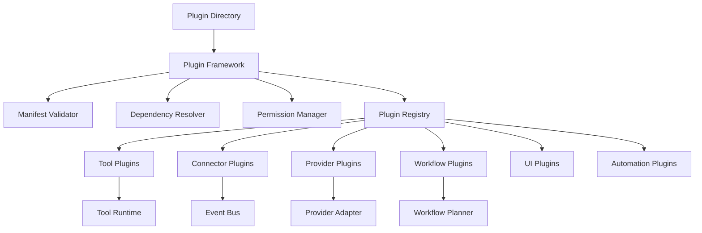

# Plugin Framework

## Executive Summary

The Plugin Framework provides Hermes AIOS with a secure, versioned, and extensible mechanism for adding new capabilities without modifying the core system. Plugins package tools, workflows, providers, connectors, UI extensions, and automation modules behind stable interfaces.

The framework enables a modular ecosystem while preserving the stability and security of the Hermes Kernel.

---

# Objectives

The Plugin Framework is responsible for:

- Runtime plugin discovery
- Installation and removal
- Dependency resolution
- Version compatibility
- Lifecycle management
- Permission enforcement
- Sandboxed execution
- API compatibility
- Digital signature verification
- Plugin observability

---

# Architectural Position

```
                     Plugin Framework
                           ▲
                           │
 ┌─────────────────────────────────────────────┐
 │ Kernel                                      │
 │ Capability Router                           │
 │ Workflow Planner                            │
 │ Policy Engine                               │
 │ Memory System                               │
 │ Provider Adapter                            │
 │ Tool Runtime                                │
 │ Event Bus                                   │
 └─────────────────────────────────────────────┘
```

---

# Design Principles

- Core remains minimal
- Plugins are optional
- Stable public APIs
- Backward compatibility
- Least-privilege permissions
- Sandboxed execution
- Configuration over code
- Versioned interfaces

---

# Responsibilities

The framework:

- Discovers plugins
- Validates manifests
- Resolves dependencies
- Loads plugins
- Registers capabilities
- Monitors plugin health
- Unloads plugins safely
- Reports lifecycle events

---

# Plugin Types

Hermes supports multiple plugin categories.

## Tool Plugins

Provide executable tools.

Examples:

- PDF Processor
- OCR Engine
- Image Editor
- Shell Extensions

---

## Connector Plugins

Integrate external systems.

Examples:

- GitHub
- Slack
- Gmail
- Google Drive
- Jira
- Notion
- Discord

---

## Provider Plugins

Add inference providers.

Examples:

- Ollama
- OpenAI
- OpenRouter
- Anthropic
- Hugging Face

---

## Workflow Plugins

Provide reusable execution plans.

Examples:

- Research Pipeline
- Documentation Generator
- CI/CD Assistant
- Data Analysis

---

## UI Plugins

Extend future Hermes interfaces.

Examples:

- Dashboards
- Widgets
- Inspectors
- Visualization Panels

---

## Automation Plugins

Provide scheduled or event-driven capabilities.

Examples:

- Backup Manager
- Health Monitor
- Project Tracker

---

# Plugin Manifest

Each plugin includes a manifest.

Example fields:

```yaml
id: hermes.github
name: GitHub Connector
version: 1.2.0
api_version: 1
author: Hermes Community
license: MIT
permissions:
  - network
  - secrets
dependencies:
  - hermes.core>=1.0
capabilities:
  - repository
  - issues
entrypoint: plugin.py
```

---

# Lifecycle

```
Discover
    │
Validate
    │
Verify Signature
    │
Resolve Dependencies
    │
Load
    │
Initialize
    │
Register
    │
Execute
    │
Update
    │
Unload
```

---

# Plugin Registry

Maintains metadata including:

- Plugin ID
- Name
- Version
- Status
- Health
- Dependencies
- Capabilities
- Permissions
- API Version
- Signature Status

---

# Dependency Resolution

Supports:

- Semantic versioning
- Optional dependencies
- Required dependencies
- Conflict detection
- Circular dependency prevention

Failed dependency checks prevent plugin activation.

---

# Permission Model

Plugins request explicit permissions.

Examples:

- Filesystem
- Network
- Shell
- Clipboard
- Camera
- Microphone
- Secrets
- Database
- GPU

The Policy Engine evaluates all requests before activation.

---

# Security

Security controls include:

- Manifest validation
- Digital signatures
- Integrity verification
- Sandboxed execution
- Least-privilege access
- API restrictions
- Resource quotas
- Audit logging

Unsigned plugins can be disabled by policy.

---

# Version Compatibility

Compatibility is determined by:

- Core API version
- Plugin API version
- Capability contracts
- Configuration schema

Major API changes require explicit compatibility declarations.

---

# Hot Reload

Supported during development.

Capabilities:

- Reload without restart
- State preservation (where supported)
- Configuration refresh
- Failure rollback

Production environments may disable hot reload.

---

# Event Integration

The Plugin Framework integrates with the Event Bus.

Published events include:

- Plugin Installed
- Plugin Updated
- Plugin Removed
- Plugin Loaded
- Plugin Failed
- Plugin Disabled

---

# Observability

Metrics include:

- Installed plugins
- Active plugins
- Load time
- Failure count
- Resource usage
- Invocation frequency

---

# Configuration

Example:

```yaml
plugins:
  directory: ./plugins
  auto_discover: true
  verify_signatures: true
  sandbox: true
  allow_unsigned: false
  hot_reload: false
```

---

# Mermaid Diagram



---

# Architecture Decisions

## Minimal Core

Features that are not essential to the Kernel are implemented as plugins whenever practical.

## Stable Contracts

Plugins interact only through public APIs to avoid tight coupling with internal implementation details.

## Security First

Every plugin undergoes manifest validation, permission checks, and optional signature verification before activation.

## Extensibility

New plugin categories can be introduced without changing the framework's loading mechanism.

## Event-Driven Integration

Plugins communicate through the Event Bus for asynchronous coordination and loose coupling.

---

# Future Enhancements

- Plugin marketplace
- Automatic updates
- Trust levels
- Remote plugin repositories
- Enterprise policy packs
- Dependency graph visualization
- Plugin testing SDK
- Live diagnostics

---

# Cross References

Previous:

- `03B_8_TOOL_RUNTIME.md`
- `03B_9_EVENT_BUS.md`

Next:

- `03B_11_CONFIGURATION_SYSTEM.md`
