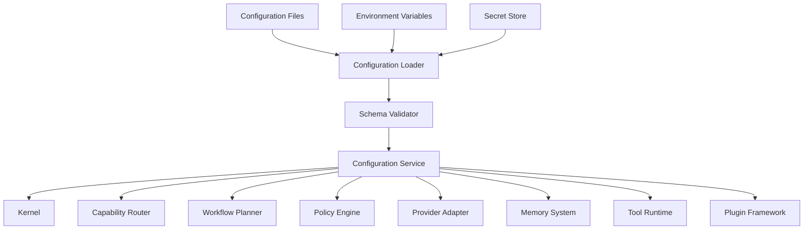

# Configuration System

## Executive Summary

The Configuration System provides centralized, versioned, and validated configuration management for Hermes AIOS. It enables every subsystem to consume configuration through a common service while supporting multiple configuration sources, environment-specific overrides, secure secret handling, and runtime updates.

Configuration is treated as data rather than code, allowing Hermes AIOS to adapt to different deployment environments without recompilation.

---

# Objectives

The Configuration System is responsible for:

- Centralized configuration management
- Schema validation
- Configuration versioning
- Layered configuration loading
- Environment overrides
- Secret references
- Dynamic reload
- Change notification
- Audit logging
- Configuration export/import

---

# Architectural Position

```
                   Configuration System
                           ▲
                           │
 ┌────────────────────────────────────────────┐
 │ Kernel                                     │
 │ Capability Router                          │
 │ Workflow Planner                           │
 │ Policy Engine                              │
 │ Memory System                              │
 │ Provider Adapter                           │
 │ Tool Runtime                               │
 │ Event Bus                                  │
 │ Plugin Framework                           │
 └────────────────────────────────────────────┘
```

Every subsystem retrieves configuration through the Configuration Service rather than reading files directly.

---

# Design Principles

- Single source of truth
- Configuration as data
- Immutable defaults
- Layered overrides
- Secure secret management
- Versioned schemas
- Hot reload where safe
- Strong validation

---

# Responsibilities

The Configuration System:

- Loads configuration
- Merges configuration layers
- Validates schemas
- Resolves secret references
- Publishes configuration changes
- Maintains configuration history
- Provides read APIs
- Coordinates safe reloads

---

# Configuration Layers

Configuration is merged in the following order:

1. Built-in defaults
2. System configuration
3. Environment configuration
4. Deployment configuration
5. User configuration
6. Runtime overrides

Later layers override earlier values unless explicitly marked immutable.

---

# Configuration Sources

Supported sources include:

- YAML
- TOML
- JSON
- Environment variables
- Command-line arguments
- Secret stores
- Remote configuration services (future)

The system normalizes all sources into a common internal representation.

---

# Configuration Domains

## Core

- Kernel
- Scheduling
- Runtime limits

## Providers

- Endpoints
- Authentication
- Priorities
- Capability metadata

## Memory

- SQLite
- ChromaDB
- Retention policies
- Embedding settings

## Security

- Permissions
- Encryption
- Audit policies
- Access controls

## Observability

- Logging
- Metrics
- Tracing
- Exporters

## Plugins

- Discovery paths
- Signature requirements
- Hot reload
- Permissions

---

# Configuration Schema

Every configuration domain defines:

- Version
- Required fields
- Optional fields
- Data types
- Validation rules
- Default values
- Deprecation notices

Validation occurs before activation.

---

# Secrets Management

Secrets are never stored directly in configuration files.

Supported secret sources:

- Environment variables
- OS credential stores
- External secret managers
- Encrypted configuration files

Example:

```yaml
providers:
  openai:
    api_key: ${OPENAI_API_KEY}
```

The Configuration System resolves secret references at runtime.

---

# Runtime Reload

Certain configuration changes may be applied without restarting Hermes.

Examples:

- Logging level
- Provider priorities
- Feature flags
- Rate limits

Changes affecting core architecture may require a controlled restart.

---

# Validation Pipeline

```
Load
   │
Parse
   │
Merge Layers
   │
Resolve Secrets
   │
Validate Schema
   │
Policy Review
   │
Activate
```

Invalid configurations are rejected before becoming active.

---

# Configuration API

Core operations:

```text
load()

reload()

get(key)

set(key)

validate()

watch()

export()

import()

rollback()
```

Subsystems access configuration through this API rather than reading storage directly.

---

# Change Notifications

Configuration updates generate events on the Event Bus.

Examples:

- Configuration Loaded
- Configuration Updated
- Reload Started
- Reload Completed
- Validation Failed
- Rollback Executed

Subscribers can react without polling.

---

# Versioning

Configuration uses semantic versioning.

Each schema records:

- Major version
- Minor version
- Patch version

Migration tooling can transform older schemas into newer versions where possible.

---

# Rollback

Every successful activation creates a configuration snapshot.

Rollback restores:

- Previous values
- Version metadata
- Activation timestamp
- Validation status

Rollback operations are audited.

---

# Security

Security controls include:

- Read/write permissions
- Secret isolation
- Audit logging
- Integrity checks
- Optional signature verification
- Encryption at rest
- Encryption in transit

---

# Observability

Metrics include:

- Active configuration version
- Reload duration
- Validation failures
- Rollback count
- Secret resolution failures
- Configuration drift

---

# Example Directory Structure

```
config/
├── defaults.yaml
├── development.yaml
├── production.yaml
├── providers.yaml
├── memory.yaml
├── security.yaml
├── observability.yaml
├── plugins.yaml
└── feature_flags.yaml
```

---

# Mermaid Diagram



---

# Architecture Decisions

## Layered Configuration

Multiple configuration layers allow flexible deployments while preserving deterministic behavior.

## Central Access

Subsystems never access configuration files directly; all reads occur through the Configuration Service.

## Secrets by Reference

Sensitive credentials remain outside version-controlled configuration files.

## Schema Validation

Invalid configuration is detected before activation to avoid runtime instability.

## Event-Driven Updates

Configuration changes are propagated through the Event Bus, enabling coordinated reloads.

---

# Future Enhancements

- Remote configuration synchronization
- Fleet-wide configuration management
- Policy-based configuration enforcement
- Live configuration editor
- Drift detection
- Automated schema migrations
- Feature rollout strategies
- Configuration recommendations

---

# Cross References

Previous:

- `03B_7_OBSERVABILITY.md`
- `03B_8_TOOL_RUNTIME.md`
- `03B_9_EVENT_BUS.md`
- `03B_10_PLUGIN_FRAMEWORK.md`

Next:

- `04_INFRASTRUCTURE_OVERVIEW.md`
