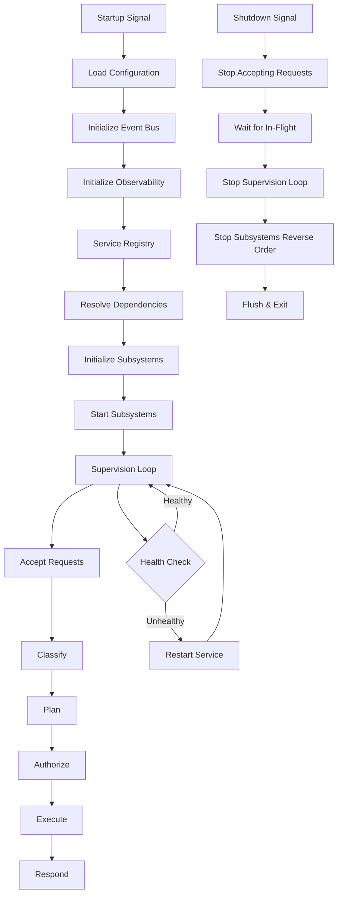

# Hermes Kernel

## Executive Summary

The Hermes Kernel is the core orchestrator of the entire Hermes AIOS runtime. It owns the application lifecycle, bootstrap sequence, service registry, dependency injection, request lifecycle, supervision loop, and graceful shutdown.

Every other subsystem — the Capability Router, Workflow Planner, Policy Engine, Provider Adapter, Memory System, Observability, Tool Runtime, Event Bus, Plugin Framework, and Configuration System — is registered with and orchestrated by the Kernel. No subsystem starts, stops, or handles requests outside the Kernel's supervision.

The Kernel is intentionally minimal in logic but maximal in coordination. It does not make routing decisions, enforce policy, or perform inference. It ensures that every other component is initialized in the correct order, stays healthy, and shuts down cleanly.

---

# Objectives

The Hermes Kernel is responsible for:

- Application lifecycle management
- Bootstrap and initialization
- Service registry management
- Dependency injection
- Request lifecycle orchestration
- Supervision loop
- Graceful shutdown
- Signal handling
- Health aggregation
- Startup ordering

---

# Architectural Position

```
Hermes Kernel
   │
   ├── Service Registry
   ├── Lifecycle Manager
   ├── Request Handler
   └── Supervision Loop
         │
         ├── Capability Router
         ├── Workflow Planner
         ├── Policy Engine
         ├── Provider Adapter
         ├── Memory System
         ├── Observability
         ├── Tool Runtime
         ├── Event Bus
         ├── Plugin Framework
         └── Configuration System
```

---

# Design Principles

The Hermes Kernel must be:

- Minimal — coordination only, no business logic
- Deterministic — startup and shutdown order is explicit and reproducible
- Resilient — a failing subsystem triggers supervision, not a crash
- Observable — lifecycle events are published at every stage
- Configurable — service registration is configuration-driven
- Single-threaded bootstrap — initialization is sequential to guarantee ordering

No subsystem should start before its dependencies are ready.

---

# Responsibilities

The Hermes Kernel:

- Reads configuration at startup
- Initializes the Configuration System first
- Registers all subsystems in the Service Registry
- Resolves dependency ordering
- Brings each subsystem online in order
- Accepts incoming requests
- Routes requests through the request lifecycle stages
- Monitors subsystem health through the Supervision Loop
- Initiates graceful shutdown on signal or error
- Ensures all subsystems stop in reverse dependency order

---

# Core Components

## Service Registry

The Service Registry is the central catalog of all active subsystems.

Each entry contains:

- Service Name
- Instance Reference
- Dependencies
- Lifecycle State
- Health Status
- Priority
- Startup Order
- Shutdown Order

Services register themselves during bootstrap. The Kernel queries the registry to resolve initialization order and to locate services during request handling.

```
Service Registry

├── Configuration System    [Running]
├── Event Bus               [Running]
├── Capability Router       [Running]
├── Workflow Planner        [Running]
├── Policy Engine           [Running]
├── Provider Adapter        [Running]
├── Memory System           [Running]
├── Observability           [Running]
├── Tool Runtime            [Running]
└── Plugin Framework        [Running]
```

---

## Lifecycle Manager

The Lifecycle Manager governs the state transitions of every registered service.

States:

```
Unregistered → Registered → Initializing → Ready → Running → Degraded → Stopping → Stopped
```

Responsibilities:

- Trigger initialization in dependency order
- Transition services between states
- Broadcast state changes on the Event Bus
- Halt startup if a critical service fails
- Initiate shutdown in reverse dependency order

The Lifecycle Manager does not contain service-specific logic. It calls each service's `initialize()`, `start()`, `stop()`, and `shutdown()` methods in the correct sequence.

---

## Request Handler

The Request Handler is the entry point for all incoming requests. It owns the request lifecycle pipeline.

```
Request Received
      │
      ▼
   Classify    (Capability Router)
      │
      ▼
    Plan       (Workflow Planner)
      │
      ▼
   Authorize   (Policy Engine)
      │
      ▼
   Execute     (Provider Adapter / Tool Runtime)
      │
      ▼
   Respond     (Normalized Response)
```

The Request Handler:

- Assigns a request ID
- Attaches request context and metadata
- Delegates classification to the Capability Router
- Delegates planning to the Workflow Planner
- Delegates authorization to the Policy Engine
- Delegates execution to the Provider Adapter or Tool Runtime
- Collects the response and returns it to the caller
- Publishes request lifecycle events to the Event Bus

---

## Supervision Loop

The Supervision Loop continuously monitors all registered services.

Responsibilities:

- Poll health check endpoints at configurable intervals
- Detect degraded or failed services
- Trigger restart for recoverable services
- Escalate unrecoverable failures
- Publish health events to the Event Bus
- Feed health data to the Observability layer

```
Supervision Loop

  ┌──────────┐
  │  Tick     │
  └─────┬────┘
        │
        ▼
  ┌──────────┐
  │ Health    │
  │ Check All │
  └─────┬────┘
        │
        ▼
  ┌──────────┐     ┌──────────┐
  │ Healthy?  │──No─►  Restart  │
  └─────┬────┘     └──────────┘
        │ Yes
        ▼
  ┌──────────┐
  │  Sleep    │
  └─────┬────┘
        │
        ▼
     Repeat
```

---

# Bootstrap Sequence

```
1. Load Configuration
2. Initialize Event Bus
3. Initialize Observability
4. Initialize Service Registry
5. Register all subsystems
6. Resolve dependency order
7. Initialize subsystems in order
8. Start subsystems in order
9. Start Supervision Loop
10. Accept Requests
```

---

# Shutdown Sequence

```
1. Stop accepting new requests
2. Wait for in-flight requests to complete (with timeout)
3. Stop Supervision Loop
4. Stop subsystems in reverse dependency order
5. Flush Event Bus
6. Flush Observability
7. Release resources
8. Exit
```

---

# Configuration

The Kernel's configuration defines registered services, dependency order, and supervision parameters.

```yaml
kernel:
  request_timeout: 120s
  shutdown_grace_period: 30s
  supervision:
    enabled: true
    interval: 10s
    restart_attempts: 3
    restart_backoff: 5s
  services:
    - name: configuration_system
      priority: 1
      critical: true
    - name: event_bus
      priority: 2
      critical: true
      depends_on:
        - configuration_system
    - name: observability
      priority: 3
      critical: true
      depends_on:
        - event_bus
    - name: capability_router
      priority: 4
      critical: true
      depends_on:
        - configuration_system
        - event_bus
    - name: workflow_planner
      priority: 5
      critical: true
      depends_on:
        - capability_router
    - name: policy_engine
      priority: 6
      critical: true
      depends_on:
        - configuration_system
    - name: provider_adapter
      priority: 7
      critical: true
      depends_on:
        - policy_engine
        - configuration_system
    - name: memory_system
      priority: 8
      critical: false
      depends_on:
        - event_bus
    - name: tool_runtime
      priority: 9
      critical: false
      depends_on:
        - provider_adapter
    - name: plugin_framework
      priority: 10
      critical: false
      depends_on:
        - event_bus
        - configuration_system
```

---

# Mermaid Diagram



---

# Architecture Decisions

## Single Orchestrator

One Kernel instance owns the entire lifecycle. No distributed coordination in Phase 1.

## Sequential Bootstrap

Initialization is strictly sequential to guarantee dependency ordering. Parallel startup is a future enhancement.

## Coordination Over Logic

The Kernel coordinates — it does not route, plan, authorize, or execute. This keeps the Kernel stable and low-churn.

## Supervision Over Polling

A dedicated supervision loop provides deterministic health monitoring and automatic recovery.

## Reverse-Order Shutdown

Shutdown mirrors startup in reverse to ensure no service is stopped while a dependent still needs it.

---

# Future Enhancements

Planned improvements include:

- Parallel subsystem initialization with dependency barriers
- Hot-reload of subsystems without full restart
- Distributed kernel mode for multi-node deployments
- Plug-and-play service registration via annotations
- Dynamic dependency graph visualization
- Per-service circuit breakers
- Kernel-level rate limiting
- Request coalescing for batch workloads

---

# Cross References

Next:

- `03B_2_CAPABILITY_ROUTER.md`
