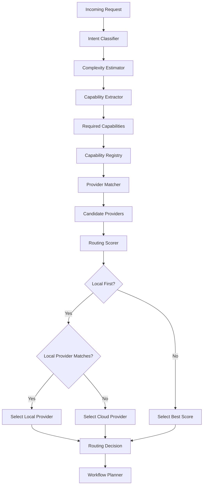

# Capability Router

## Executive Summary

The Capability Router is the request classification and routing layer of Hermes AIOS. It routes requests by capability rather than by model name, ensuring that the system selects the best provider for each request based on what the request actually needs — reasoning, vision, code generation, tool calling, embeddings — rather than hardcoding provider or model choices.

Every incoming request passes through the Capability Router after the Kernel accepts it. The Router classifies intent, estimates complexity, extracts required capabilities, discovers matching providers, scores them, and selects the optimal execution target. It defaults to a local-first strategy when a local provider satisfies the required capabilities.

---

# Objectives

The Capability Router is responsible for:

- Intent classification
- Complexity estimation
- Capability extraction
- Provider discovery
- Provider scoring
- Local-first routing strategy
- Routing transparency
- Fallback selection
- Routing telemetry

---

# Architectural Position

```
Hermes Kernel
   │
Request Handler
   │
Capability Router
   │
Workflow Planner
   │
Policy Engine
   │
Provider Adapter
```

---

# Design Principles

The Capability Router must be:

- Capability-driven — never route by model name
- Local-first — prefer local providers when capabilities match
- Transparent — routing decisions are logged and explainable
- Stateless — each request is routed independently
- Configurable — scoring weights and strategy are configuration-driven
- Extensible — new capability types can be added without code changes

No upstream component should hardcode provider or model names.

---

# Responsibilities

The Capability Router:

- Receives the raw request from the Kernel's Request Handler
- Classifies the request intent
- Estimates request complexity
- Extracts required capabilities from the request
- Queries the Capability Registry for matching providers
- Scores and ranks matching providers
- Applies the local-first strategy
- Returns the routing decision to the Kernel
- Publishes routing telemetry to the Observability layer

---

# Core Components

## Intent Classifier

The Intent Classifier determines what the user is trying to accomplish.

Supported intent categories:

| Intent | Description |
|--------|-------------|
| Chat | Conversational exchange |
| Reasoning | Multi-step logical inference |
| Code Generation | Source code production |
| Code Analysis | Source code review or explanation |
| Summarization | Text condensation |
| Translation | Language-to-language conversion |
| Embedding | Vector representation generation |
| Vision | Image understanding |
| Audio | Audio processing |
| Image Generation | Visual content creation |
| Tool Use | External tool invocation |
| Reranking | Relevance scoring of documents |

The classifier uses lightweight heuristics, keyword matching, and optionally a small local model for classification.

---

## Complexity Estimator

The Complexity Estimator assesses how demanding the request is.

Factors:

- Input token count
- Expected output length
- Number of tool calls
- Context window requirement
- Reasoning depth
- Multi-turn dependency
- Vision or multi-modal input size

Output:

| Complexity | Description |
|------------|-------------|
| Low | Simple chat, short response |
| Medium | Reasoning, moderate context |
| High | Deep reasoning, large context, multi-tool |
| Critical | Maximum capability, lowest latency acceptable |

Complexity influences provider scoring — high-complexity requests favor providers with larger context windows and stronger reasoning capabilities.

---

## Capability Registry

The Capability Registry maintains a real-time map of what each provider can do.

Example:

| Provider | Chat | Reasoning | Vision | Code | Embedding | Tool Use | Streaming |
|----------|------|-----------|--------|------|-----------|----------|-----------|
| Ollama | ✓ | ✓ | ✗ | ✓ | ✓ | ✓ | ✓ |
| OpenAI | ✓ | ✓ | ✓ | ✓ | ✓ | ✓ | ✓ |
| OpenRouter | ✓ | ✓ | ✓ | ✓ | ✗ | ✓ | ✓ |
| Anthropic | ✓ | ✓ | ✗ | ✓ | ✗ | ✓ | ✓ |
| Google | ✓ | ✓ | ✓ | ✓ | ✓ | ✓ | ✓ |

The registry is populated from the Provider Adapter's capability discovery and refreshed periodically.

---

## Provider Matcher

The Provider Matcher takes the required capabilities and queries the Capability Registry for all providers that satisfy every required capability.

```
Required Capabilities: [Chat, Reasoning, Tool Use]
        │
        ▼
   Provider Matcher
        │
        ▼
   Matching Providers: [Ollama, OpenAI, OpenRouter, Anthropic, Google]
```

Providers that lack any required capability are excluded from the candidate set.

---

## Routing Scorer

The Routing Scorer ranks the matching providers and selects the best one.

Scoring factors:

| Factor | Weight | Description |
|--------|--------|-------------|
| Local Preference | High | Local providers receive a bonus |
| Latency | Medium | Lower latency scores higher |
| Cost | Medium | Lower cost scores higher |
| Capability Match | High | Exact match scores higher than superset |
| Health | High | Healthy providers score higher |
| Load | Low | Less loaded providers score higher |
| User Preference | Medium | User-configured preferences apply |

The scorer normalizes each factor to a 0–1 range and computes a weighted sum.

```
Score = (local_bonus × w_local)
      + (latency_norm × w_latency)
      + (cost_norm × w_cost)
      + (capability_match × w_capability)
      + (health_norm × w_health)
      + (load_norm × w_load)
      + (user_pref × w_user)
```

The highest-scoring provider is selected. If scores are tied, local providers win.

---

# Local-First Strategy

The Capability Router defaults to local-first routing.

Rules:

1. If a local provider satisfies all required capabilities → select local
2. If multiple local providers match → select by score among local only
3. If no local provider matches → fall back to cloud providers
4. If user explicitly requests a cloud provider → respect the preference

This strategy minimizes cost, latency, and data egress by default.

---

# Routing Decision

The routing decision returned to the Kernel includes:

- Request ID
- Classified Intent
- Estimated Complexity
- Required Capabilities
- Candidate Providers
- Selected Provider
- Selected Model
- Selection Reason
- Fallback Providers
- Routing Score
- Timestamp

---

# Configuration

```yaml
capability_router:
  local_first: true
  classification_model: local-small
  scoring_weights:
    local_bonus: 0.30
    latency: 0.15
    cost: 0.15
    capability_match: 0.20
    health: 0.15
    load: 0.05
  fallback_strategy: cloud
  respect_user_preference: true
  registry_refresh_interval: 60s
```

---

# Mermaid Diagram



---

# Architecture Decisions

## Capability Over Model Name

Routing by capability decouples request intent from provider selection, enabling transparent provider substitution.

## Local-First Default

Minimizes cost and latency by default while allowing explicit cloud override.

## Stateless Routing

Each request is routed independently. No sticky sessions or routing history in Phase 1.

## Weighted Scoring

A transparent, configurable scoring formula makes routing decisions explainable and tunable.

## Registry-Driven Discovery

The Capability Registry is the single source of truth for provider capabilities, refreshed from the Provider Adapter.

---

# Future Enhancements

Planned improvements include:

- Learned routing models trained on historical routing outcomes
- Multi-provider parallel execution for redundant inference
- Cost-aware routing budgets per user or per session
- Capability negotiation with providers at request time
- Predictive latency estimation
- Routing A/B testing framework
- Per-tenant routing policies
- Dynamic capability registration from plugins

---

# Cross References

Previous:

- `03B_1_HERMES_KERNEL.md`

Next:

- `03B_3_WORKFLOW_PLANNER.md`
