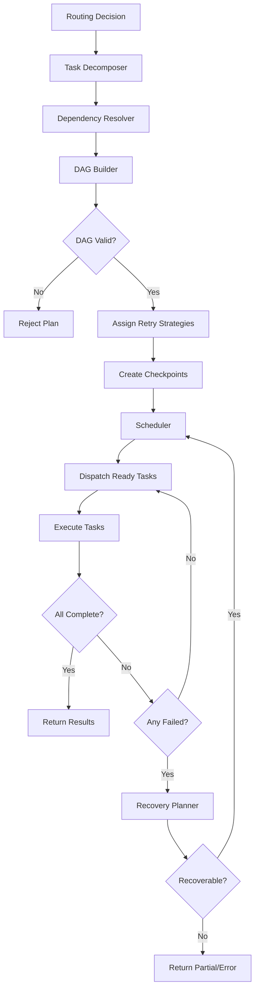

# Workflow Planner

## Executive Summary

The Workflow Planner transforms a classified, routed request into a concrete execution plan. It decomposes the request into discrete tasks, resolves dependencies between them, builds a Directed Acyclic Graph (DAG) representing the execution order, schedules tasks for parallel or sequential execution, and manages checkpoints and recovery planning.

Every request that requires more than a single inference call passes through the Workflow Planner. The Planner ensures that multi-step operations — such as retrieve-then-generate, multi-tool orchestration, or chained reasoning — are executed in the correct order with maximum parallelism and robust failure handling.

---

# Objectives

The Workflow Planner is responsible for:

- Task decomposition
- Dependency resolution
- Execution graph construction (DAG)
- Parallelization
- Retry strategy
- Checkpoint creation
- Recovery planning
- Execution scheduling
- Plan validation

---

# Architectural Position

```
Hermes Kernel
   │
Request Handler
   │
Capability Router
   │
Workflow Planner
   │
Policy Engine
   │
Provider Adapter
```

---

# Design Principles

The Workflow Planner must be:

- DAG-based — every plan is a directed acyclic graph
- Maximally parallel — independent tasks execute concurrently
- Checkpointable — every task boundary is a recovery point
- Idempotent — re-executing a task produces the same result
- Declarative — plans describe what to do, not how to do it
- Recoverable — failed tasks can be retried or replanned

No execution should be a black box. Every step is visible, checkpointed, and recoverable.

---

# Responsibilities

The Workflow Planner:

- Receives the routing decision from the Capability Router
- Decomposes the request into discrete tasks
- Identifies task dependencies
- Builds the execution DAG
- Validates the DAG for cycles and missing dependencies
- Assigns retry strategies per task
- Creates checkpoints at each task boundary
- Schedules tasks respecting dependency order
- Monitors execution progress
- Triggers recovery planning on failure
- Returns the completed plan or error to the Kernel

---

# Core Components

## Task Decomposer

The Task Decomposer breaks a request into indivisible units of work.

Task types:

| Task Type | Description |
|-----------|-------------|
| Inference | Single LLM call |
| Tool Call | External tool invocation |
| Retrieval | Memory or knowledge retrieval |
| Embedding | Vector generation |
| Transformation | Data format conversion |
| Aggregation | Combine multiple results |
| Validation | Verify output correctness |
| Routing | Sub-request routing |

Example decomposition:

```
User Request: "Summarize the attached PDF and translate the summary to French."

Decomposition:
  Task 1: Extract text from PDF          [Transformation]
  Task 2: Summarize extracted text        [Inference]
  Task 3: Translate summary to French     [Inference]
```

---

## DAG Builder

The DAG Builder constructs the execution graph from the decomposed tasks and their dependencies.

```
Task 1: Extract Text
   │
   ▼
Task 2: Summarize
   │
   ▼
Task 3: Translate
```

For parallelizable tasks:

```
Task 1: Retrieve Document A ─┐
Task 2: Retrieve Document B ──┼──► Task 4: Aggregate
Task 3: Retrieve Document C ─┘
```

The DAG Builder:

- Resolves dependency edges
- Detects and rejects cycles
- Identifies the critical path
- Marks independent tasks for parallel execution
- Assigns task priorities

---

## Scheduler

The Scheduler executes the DAG by dispatching ready tasks to the appropriate executor.

Scheduling rules:

- A task is ready when all its dependencies are complete
- Ready tasks are dispatched immediately
- Independent ready tasks are dispatched in parallel
- Each task is dispatched to the executor matching its type
- Task execution is asynchronous with timeout enforcement

```
DAG Execution

  ┌─────────┐
  │ Task 1   │──Done──►┌─────────┐
  └─────────┘          │ Task 4   │
  ┌─────────┐          │ (Wait)   │
  │ Task 2   │──Done──►└────┬────┘
  └─────────┘               │
  ┌─────────┐               │
  │ Task 3   │──Done─────────┘
  └─────────┘
```

---

## Checkpoint Manager

The Checkpoint Manager persists task results at each boundary, enabling recovery without re-executing completed tasks.

Checkpoint contents:

- Workflow ID
- Task ID
- Task Status
- Input Data
- Output Data
- Timestamp
- Executor Info
- Retry Count

Checkpoints are stored in the Memory System and indexed by Workflow ID.

```
Workflow: wf_abc123

  Checkpoint 1: Task 1 ✓ [Completed]
  Checkpoint 2: Task 2 ✓ [Completed]
  Checkpoint 3: Task 3 ✗ [Failed] → Recovery triggered
```

---

## Recovery Planner

The Recovery Planner handles task failures and produces a revised execution plan.

Recovery strategies:

| Strategy | Description |
|----------|-------------|
| Retry | Re-execute the same task |
| Retry with Backoff | Re-execute with exponential backoff |
| Fallback Provider | Re-execute with a different provider |
| Simplify | Re-execute with reduced complexity |
| Replan | Decompose the failed task differently |
| Escalate | Return partial results with error |

```
Task Failed
     │
     ▼
  Retry Count < Max?
     │ Yes
     ▼
  Retry with Backoff
     │
     ▼
  Still Failed?
     │ Yes
     ▼
  Fallback Provider
     │
     ▼
  Still Failed?
     │ Yes
     ▼
  Replan or Escalate
```

---

# Execution Plan Schema

The Workflow Planner produces a plan object:

- Workflow ID
- Request ID
- Tasks (list)
  - Task ID
  - Task Type
  - Dependencies
  - Executor
  - Input
  - Retry Strategy
  - Timeout
  - Priority
- DAG (edges)
- Checkpoint Policy
- Estimated Duration
- Estimated Cost

---

# Configuration

```yaml
workflow_planner:
  max_parallel_tasks: 8
  default_timeout: 60s
  default_retry_attempts: 3
  default_retry_backoff: 2s
  default_retry_backoff_max: 30s
  checkpoint_enabled: true
  checkpoint_storage: memory_system
  recovery_strategy: retry_then_fallback
  dag_validation: strict
  critical_path_optimization: true
```

---

# Mermaid Diagram



---

# Architecture Decisions

## DAG-Based Plans

A DAG captures dependencies and parallelism in a single, verifiable structure.

## Checkpoint Every Task

Every task boundary is checkpointed, enabling recovery without re-executing completed work.

## Pluggable Recovery

Recovery strategies are per-task and configurable, not hardcoded.

## Maximal Parallelism

Independent tasks execute concurrently. The Scheduler does not serialize unless dependencies require it.

## Strict DAG Validation

Cycles and missing dependencies are rejected at plan time, not at execution time.

---

# Future Enhancements

Planned improvements include:

- Dynamic replanning during execution based on intermediate results
- Cost-aware scheduling that optimizes for budget constraints
- Cross-workflow deduplication of identical tasks
- Predictive duration estimation from historical data
- DAG visualization and debugging tools
- Workflow templates for common patterns
- Long-running workflow support with persistent state
- Workflow composition and nesting

---

# Cross References

Previous:

- `03B_2_CAPABILITY_ROUTER.md`

Next:

- `03B_4_POLICY_ENGINE.md`
