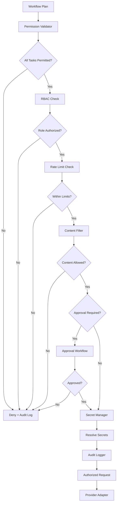

# Policy Engine

## Executive Summary

The Policy Engine is the security enforcement layer of Hermes AIOS. It sits between the Workflow Planner and the Provider Adapter, ensuring that every execution request is authorized, permission-validated, and compliant with system policies before any inference or tool execution occurs.

No request reaches the Provider Adapter or Tool Runtime without passing through the Policy Engine. The Engine validates permissions, enforces role-based access control (RBAC), manages approval workflows for sensitive operations, handles secret management for credentials, and maintains a complete audit log of all authorization decisions.

---

# Objectives

The Policy Engine is responsible for:

- Permission validation
- Role-based access control (RBAC)
- Approval workflows
- Secret management
- Audit logging
- Policy enforcement
- Rate limiting
- Data residency checks
- Content filtering
- Compliance tracking

---

# Architectural Position

```
Hermes Kernel
   │
Request Handler
   │
Capability Router
   │
Workflow Planner
   │
Policy Engine
   │
Provider Adapter
```

---

# Design Principles

The Policy Engine must be:

- Fail-closed — if authorization cannot be determined, deny
- Non-bypassable — no execution path skips the Policy Engine
- Auditable — every decision is logged with full context
- Configurable — policies are configuration-driven, not hardcoded
- Least-privilege — default deny, explicitly grant
- Secret-safe — credentials are never exposed to upstream components

No request executes without explicit authorization.

---

# Responsibilities

The Policy Engine:

- Receives the execution plan from the Workflow Planner
- Validates the requesting user's permissions
- Checks role-based access control for each task
- Triggers approval workflows for sensitive operations
- Resolves secrets required for execution without exposing them upstream
- Enforces rate limits and quotas
- Applies content filtering policies
- Logs every authorization decision to the audit log
- Returns authorized or denied status to the Kernel
- Blocks execution on denial

---

# Core Components

## Permission Validator

The Permission Validator checks whether the requesting user has permission to execute each task in the plan.

Permission model:

```
Permission = (User, Action, Resource, Context)

Examples:
  (alice, inference, any, default)         → Allow
  (bob, tool_call, filesystem, restricted)  → Deny
  (carol, inference, vision_model, default) → Allow
  (dave, tool_call, network, any)           → Deny
```

The validator evaluates each task in the plan against the user's permission set. If any task fails validation, the entire plan is denied with a detailed reason.

---

## Role Manager

The Role Manager maps users to roles and roles to permissions.

```
Users ──► Roles ──► Permissions

  alice ──► admin ──► [all permissions]
  bob   ──► user  ──► [inference, tool_call:filesystem:read]
  carol ──► user  ──► [inference, tool_call:network:get]
  dave  ──► guest ──► [inference:chat]
```

Supported roles:

| Role | Description |
|------|-------------|
| Admin | Full access to all capabilities and tools |
| User | Standard access with configurable tool permissions |
| Guest | Limited to basic chat inference |
| Service | Machine-to-machine access with scoped permissions |

Roles are configurable and can be extended through the Plugin Framework.

---

## Approval Workflow

The Approval Workflow handles requests that require human or automated approval before execution.

Trigger conditions:

| Condition | Example |
|-----------|---------|
| Sensitive tool access | Filesystem write, network access, shell execution |
| High-cost inference | Requests exceeding a cost threshold |
| High-risk operations | Destructive or irreversible actions |
| Quota override | Requests exceeding user quota |
| Custom policy | User-defined triggers |

```
Request Requires Approval
        │
        ▼
   Notify Approver
        │
        ├── Approve ──► Continue Execution
        ├── Deny    ──► Block + Audit
        └── Timeout  ──► Block + Audit
```

Approval can be synchronous (blocking) or asynchronous (queued). Synchronous approval blocks execution until a decision is made or a timeout expires. Asynchronous approval queues the request and resumes execution upon approval.

---

## Secret Manager

The Secret Manager provides credentials to the Provider Adapter and Tool Runtime without exposing them to upstream components.

Supported secret sources:

- Environment Variables
- Configuration Files (encrypted)
- External Secret Stores (HashiCorp Vault, AWS Secrets Manager, etc.)
- Bitwarden Integration
- Local Encrypted Vault

```
Execution Request
      │
      ▼
  Policy Engine
      │
      ▼
  Secret Manager ──► Resolve Credentials
      │
      ▼
  Inject into Provider Request (not visible upstream)
```

Secrets are resolved at execution time and injected directly into the provider request. They are never logged, never returned in responses, and never visible to the Workflow Planner or Capability Router.

---

## Audit Logger

The Audit Logger records every authorization decision and policy action.

Audit log entry:

- Timestamp
- Request ID
- User ID
- Action
- Resource
- Decision (Allow / Deny / Approval Required)
- Reason
- Policy Applied
- Context
- Approver (if applicable)

```
Audit Log

  2026-07-07T10:15:00Z | req_001 | alice | inference | any | Allow | default policy
  2026-07-07T10:16:00Z | req_002 | bob   | tool_call | filesystem:write | Deny | insufficient role
  2026-07-07T10:17:00Z | req_003 | carol | tool_call | network | Approval Required | sensitive tool
  2026-07-07T10:18:00Z | req_003 | carol | tool_call | network | Allow | approved by alice
```

The audit log is append-only, persisted to durable storage, and queryable for compliance reporting.

---

# Policy Evaluation

```
Execution Plan
      │
      ▼
  For each task in plan:
      │
      ├── Permission Check ──► Deny? → Block + Audit
      ├── RBAC Check       ──► Deny? → Block + Audit
      ├── Rate Limit Check ──► Deny? → Block + Audit
      ├── Content Filter   ──→ Deny? → Block + Audit
      └── Approval Needed? ──► Yes? → Trigger Workflow
                                    │
                                    ├── Approved → Continue
                                    └── Denied   → Block + Audit
      │
      ▼
  Resolve Secrets
      │
      ▼
  Log Audit Entry
      │
      ▼
  Return Authorized
```

---

# Configuration

```yaml
policy_engine:
  fail_closed: true
  default_decision: deny
  audit_log:
    enabled: true
    storage: durable
    retention: 90d
  rbac:
    enabled: true
    roles_file: config/roles.yaml
  approval:
    enabled: true
    timeout: 300s
    mode: synchronous
    notifiers:
      - event_bus
  secrets:
    sources:
      - environment
      - local_vault
    injection: runtime
    log_exposure: false
  rate_limiting:
    enabled: true
    default_quota: 100req/hour
    per_user: true
  content_filter:
    enabled: true
    policies:
      - no_pii
      - no_secrets_in_output
```

---

# Mermaid Diagram



---

# Architecture Decisions

## Fail-Closed Default

If the Policy Engine cannot determine authorization, the request is denied. No ambiguous allow.

## Non-Bypassable Enforcement

The Policy Engine sits directly before the Provider Adapter. No code path reaches execution without passing through it.

## Runtime Secret Injection

Secrets are resolved and injected at execution time, never stored in plan objects or passed through upstream components.

## Append-Only Audit Log

Every decision is recorded permanently. The audit log cannot be modified or deleted by application code.

## Configuration-Driven Policies

Policies, roles, and approval triggers are defined in configuration, not in source code, enabling changes without redeployment.

---

# Future Enhancements

Planned improvements include:

- Attribute-based access control (ABAC) alongside RBAC
- Policy DSL for complex conditional rules
- Multi-party approval workflows
- Real-time policy enforcement analytics dashboard
- External secret store auto-rotation
- Content filtering with custom models
- Per-tenant policy isolation
- Policy versioning and rollback
- Compliance report generation (SOC2, GDPR, HIPAA)

---

# Cross References

Previous:

- `03B_3_WORKFLOW_PLANNER.md`

Next:

- `03B_5_PROVIDER_ADAPTER.md`
