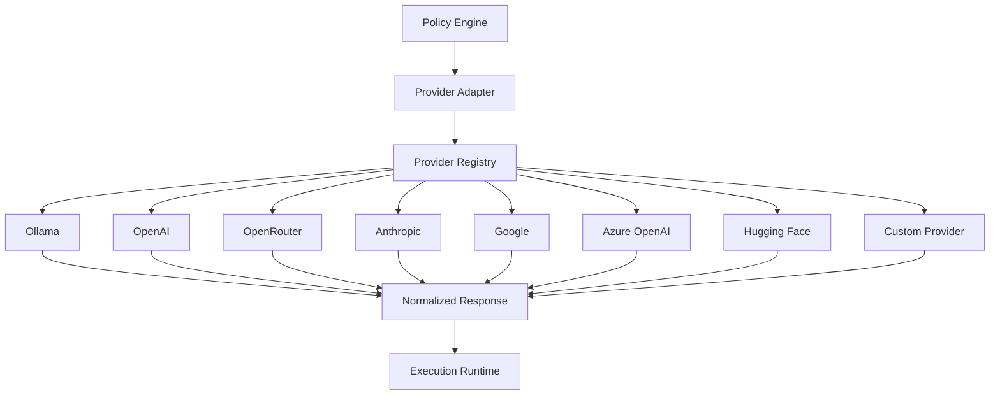

# Provider Adapter

## Executive Summary

The Provider Adapter is the abstraction layer between Hermes AIOS and all inference providers. It exposes a unified provider interface so that the rest of the system never depends on provider-specific SDKs, APIs, or protocols.

Whether execution is performed by a local Ollama model, a cloud OpenAI model, an OpenRouter endpoint, or a future custom inference server, the interaction always occurs through the Provider Adapter.

---

# Objectives

The Provider Adapter is responsible for:

- Provider abstraction
- Standard request formatting
- Response normalization
- Authentication
- Streaming support
- Capability discovery
- Health monitoring
- Failover handling
- Load balancing
- Provider lifecycle management

---

# Architectural Position

```
Kernel
   │
Capability Router
   │
Workflow Planner
   │
Policy Engine
   │
Provider Adapter
   │
Inference Backend
```

---

# Design Principles

The Provider Adapter must be:

- Provider-independent
- Model-independent
- Transport-independent
- Extensible
- Observable
- Fault tolerant
- Configuration-driven

No upstream component should know which provider is executing a request.

---

# Responsibilities

The Provider Adapter:

- Receives authorized execution requests
- Selects configured provider instances
- Translates Hermes requests into provider-specific formats
- Executes inference
- Normalizes responses
- Reports telemetry
- Returns standardized results

---

# Standard Provider Interface

Every provider implements the same interface.

```text
initialize()

health_check()

discover_capabilities()

generate()

stream()

embed()

rerank()

tool_call()

cancel()

shutdown()
```

Additional optional methods may be added through interface versioning.

---

# Request Lifecycle

```
Execution Request
        │
        ▼
Provider Adapter
        │
        ▼
Authentication
        │
        ▼
Provider Selection
        │
        ▼
Request Translation
        │
        ▼
Provider API
        │
        ▼
Response Translation
        │
        ▼
Normalized Response
```

---

# Request Schema

The Provider Adapter accepts a provider-neutral request object.

Example fields:

- Request ID
- Workflow ID
- Capability
- Preferred Model
- Constraints
- Context
- Memory References
- Tool Calls
- Streaming Flag
- Timeout
- Metadata

---

# Response Schema

Every provider returns a normalized response.

Example:

- Response ID
- Provider
- Model
- Finish Reason
- Tokens Used
- Latency
- Output
- Tool Results
- Errors
- Metadata

---

# Capability Discovery

Each provider advertises supported capabilities.

Example:

| Capability | Supported |
|------------|-----------|
| Chat | ✓ |
| Reasoning | ✓ |
| Embeddings | ✓ |
| Vision | ✗ |
| Audio | ✗ |
| Image Generation | ✗ |
| Tool Calling | ✓ |
| Streaming | ✓ |

The Capability Router consumes this information during planning.

---

# Provider Registry

The adapter maintains a runtime registry.

Example:

```
Provider Registry

├── Ollama
├── OpenAI
├── OpenRouter
├── Anthropic
├── Google
├── Azure OpenAI
├── Hugging Face
└── Custom Provider
```

Providers can be enabled or disabled through configuration.

---

# Authentication

Supported authentication mechanisms include:

- API Key
- OAuth
- Bearer Token
- Local Socket
- Unix Domain Socket
- mTLS
- Environment Variables
- Secret Store Integration

Credentials are never embedded in architecture code.

---

# Streaming

Providers supporting token streaming expose a unified streaming interface.

Features:

- Incremental tokens
- Partial tool calls
- Cancellation
- Timeout handling
- Backpressure support

---

# Failover Strategy

When execution fails:

1. Retry same provider
2. Switch provider instance
3. Select alternate provider
4. Reduce capability requirements
5. Escalate to Workflow Planner

---

# Health Monitoring

Each provider periodically reports:

- Availability
- Average latency
- Error rate
- Queue depth
- Active requests
- Throughput
- Last successful request

Unhealthy providers are removed from selection until recovery.

---

# Load Balancing

Supported strategies:

- Round Robin
- Least Latency
- Least Cost
- Highest Capability
- Weighted Routing
- User Preference

Selection policy is configurable.

---

# Configuration

Provider definitions live in configuration files rather than source code.

Example fields:

- Provider Name
- Endpoint
- Authentication Method
- Enabled
- Priority
- Cost Weight
- Timeout
- Supported Capabilities

---

# Error Handling

Standardized error categories:

- Authentication Error
- Network Error
- Timeout
- Rate Limit
- Invalid Request
- Provider Unavailable
- Unsupported Capability
- Internal Provider Error

Errors are normalized before returning upstream.

---

# Observability

The Provider Adapter publishes telemetry to the Observability layer.

Metrics include:

- Request count
- Success rate
- Failure rate
- Latency
- Tokens consumed
- Cost estimate
- Streaming duration
- Provider utilization

---

# Mermaid Diagram



---

# Architecture Decisions

## Provider Independence

Business logic never depends on provider SDKs.

## Capability-Driven Routing

Routing decisions are based on capabilities rather than provider names.

## Configuration over Code

Providers are configured through external configuration files.

## Standardized Contracts

All providers implement the same interface and response schema.

## Observability First

Every request generates standardized metrics for monitoring and optimization.

---

# Future Enhancements

Planned improvements include:

- Automatic provider benchmarking
- Dynamic capability discovery
- Cost-aware provider ranking
- Multi-provider parallel execution
- Geographic endpoint selection
- Provider sandbox testing
- Runtime plugin loading
- Self-healing provider recovery

---

# Cross References

Previous:

- `03B_1_HERMES_KERNEL.md`
- `03B_2_CAPABILITY_ROUTER.md`
- `03B_3_WORKFLOW_PLANNER.md`
- `03B_4_POLICY_ENGINE.md`

Next:

- `03B_6_MEMORY_SYSTEM.md`
