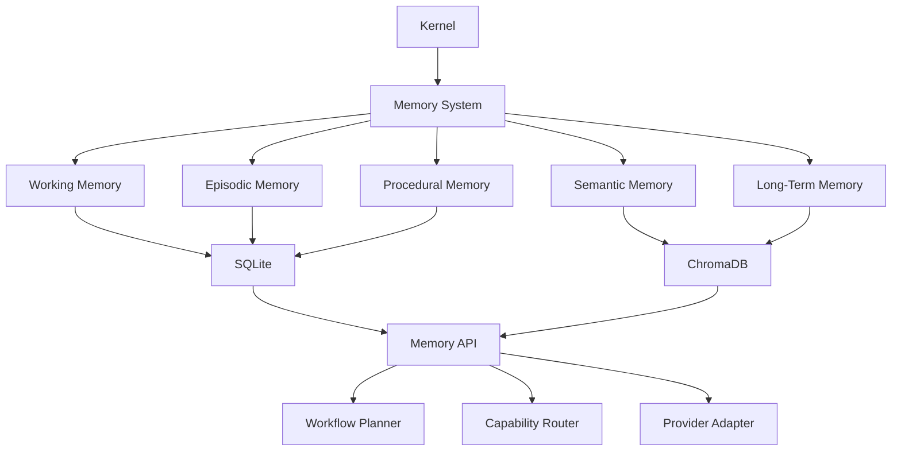

# Memory System

## Executive Summary

The Memory System provides Hermes AIOS with persistent, structured, and searchable knowledge across conversations, workflows, and long-running tasks. It enables continuity, personalization, learning, and context retrieval while remaining independent of any specific language model or provider.

Hermes separates memory into distinct layers optimized for different retention periods, retrieval methods, and operational requirements.

---

# Objectives

The Memory System is responsible for:

- Maintaining conversation continuity
- Storing long-term knowledge
- Persisting workflow state
- Managing user preferences
- Recording procedural knowledge
- Supporting semantic retrieval
- Enabling checkpoint recovery
- Providing provider-independent memory services

---

# Architectural Position

```
User
   │
   ▼
Kernel
   │
Capability Router
   │
Workflow Planner
   │
Policy Engine
   │
Memory System
   │
Provider Adapter
```

Memory is consulted throughout the execution lifecycle but remains a dedicated subsystem.

---

# Design Principles

- Memory is model-independent.
- Storage engines are replaceable.
- Retrieval is capability-driven.
- Context windows remain bounded.
- Long-term persistence is durable.
- Sensitive data is policy-governed.
- Components interact through well-defined interfaces.

---

# Memory Layers

Hermes defines five logical memory layers.

## 1. Working Memory

Purpose:

- Active conversation state
- Current workflow variables
- Temporary reasoning context

Characteristics:

- Short-lived
- Fast access
- Automatically discarded

---

## 2. Episodic Memory

Stores completed interactions.

Examples:

- Conversations
- Completed workflows
- User sessions
- Agent decisions
- Execution history

Supports historical recall and learning.

---

## 3. Semantic Memory

Stores facts and concepts.

Examples:

- User preferences
- Project architecture
- Documentation
- Knowledge base
- Domain information

Semantic memory is optimized for retrieval rather than chronological history.

---

## 4. Procedural Memory

Stores reusable processes.

Examples:

- Workflow templates
- Agent strategies
- Coding patterns
- Planning sequences
- Automation recipes

This layer enables consistent execution of recurring tasks.

---

## 5. Long-Term Memory

Persistent storage across sessions.

Contains:

- Indexed documents
- Vector embeddings
- User-approved knowledge
- Project history
- Persistent metadata

Retention policies determine archival and pruning.

---

# Storage Architecture

Hermes separates logical memory from physical storage.

Recommended default backends:

### SQLite

Responsibilities:

- Structured metadata
- Workflow state
- Configuration
- Relationships
- Audit records

Advantages:

- Lightweight
- ACID-compliant
- Embedded
- Easy backup

---

### ChromaDB

Responsibilities:

- Vector embeddings
- Semantic similarity search
- Retrieval-augmented generation (RAG)

Advantages:

- Fast vector search
- Local deployment
- Embedding-agnostic
- Provider-independent

---

# Memory Interfaces

All memory providers implement a common interface.

```text
initialize()

store()

retrieve()

update()

delete()

search()

embed()

checkpoint()

archive()

shutdown()
```

---

# Memory Lifecycle

```
User Request
      │
      ▼
Working Memory

      │
      ▼
Semantic Retrieval

      │
      ▼
Workflow Execution

      │
      ▼
Checkpoint

      │
      ▼
Long-Term Storage

      │
      ▼
Consolidation
```

---

# Retrieval Pipeline

```
Request
    │
    ▼
Intent Analysis
    │
    ▼
Memory Query
    │
    ▼
Hybrid Search
    │
    ▼
Ranking
    │
    ▼
Context Assembly
    │
    ▼
Workflow Execution
```

Hermes supports hybrid retrieval combining structured queries and semantic vector search.

---

# Context Assembly

The Memory System assembles context from:

- Current conversation
- Relevant episodic memories
- Semantic facts
- Workflow templates
- User preferences
- Retrieved documents

The resulting context is optimized to fit model context limits.

---

# Consolidation

Periodic consolidation improves efficiency.

Processes include:

- Duplicate detection
- Summarization
- Metadata enrichment
- Embedding regeneration
- Archiving
- Expiration

---

# Checkpointing

Long-running workflows create checkpoints containing:

- Workflow ID
- Task state
- Variables
- Tool outputs
- Memory references
- Timestamp

Checkpoints support resumption after interruptions.

---

# Privacy & Governance

Memory operations are subject to the Policy Engine.

Rules include:

- User-controlled retention
- Sensitive data redaction
- Provider restrictions
- Local-only storage options
- Encryption at rest
- Audit logging

---

# Memory Categories

| Layer | Retention | Storage |
|--------|-----------|----------|
| Working | Minutes | In-memory |
| Episodic | Days–Years | SQLite |
| Semantic | Persistent | SQLite + ChromaDB |
| Procedural | Persistent | SQLite |
| Long-Term | Persistent | SQLite + ChromaDB |

---

# Integration Points

### Receives Input From

- Kernel
- Capability Router
- Workflow Planner
- Provider Adapter
- Tool Runtime

### Provides Services To

- Workflow Planner
- Capability Router
- Execution Runtime
- Observability
- Future Learning Modules

---

# Mermaid Diagram



---

# Architecture Decisions

## Logical vs Physical Separation

Logical memory layers are independent of storage engines, allowing future replacement of SQLite or ChromaDB without affecting higher-level components.

## Hybrid Retrieval

Hermes combines structured SQL queries with vector similarity search to improve retrieval accuracy and performance.

## Provider Independence

No language model owns or directly manages memory; all interactions occur through the Memory API.

## Policy-Driven Access

Every read and write operation is validated by the Policy Engine.

## Extensibility

Additional storage backends (e.g., PostgreSQL, Qdrant, Milvus) can be added by implementing the Memory Provider interface.

---

# Future Enhancements

- Memory importance scoring
- Automatic knowledge graph generation
- Temporal reasoning
- Cross-device synchronization
- Distributed memory clusters
- Embedding version management
- Personalized retrieval ranking
- Adaptive memory consolidation

---

# Cross References

Previous:

- `03B_1_HERMES_KERNEL.md`
- `03B_2_CAPABILITY_ROUTER.md`
- `03B_3_WORKFLOW_PLANNER.md`
- `03B_4_POLICY_ENGINE.md`
- `03B_5_PROVIDER_ADAPTER.md`

Next:

- `03B_7_OBSERVABILITY.md`
