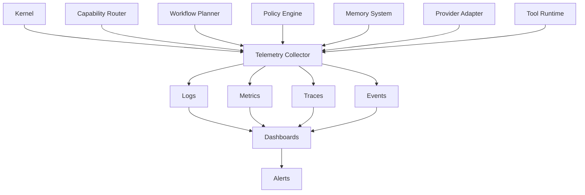

# Observability

## Executive Summary

The Observability subsystem provides complete visibility into Hermes AIOS. It collects logs, metrics, traces, events, and execution telemetry across every architectural layer, enabling debugging, performance optimization, auditing, and operational monitoring.

Observability is a cross-cutting concern that integrates with every subsystem while remaining independent of business logic.

---

# Objectives

The Observability subsystem is responsible for:

- Structured logging
- Distributed tracing
- Metrics collection
- Workflow visualization
- Performance analysis
- Cost tracking
- Provider monitoring
- Error reporting
- Audit support
- Operational dashboards

---

# Architectural Position

```
                  Observability
                         ▲
                         │
 ┌─────────────── Hermes AIOS Core ───────────────┐
 │                                                │
 │  Kernel                                        │
 │  Capability Router                             │
 │  Workflow Planner                              │
 │  Policy Engine                                 │
 │  Memory System                                 │
 │  Provider Adapter                              │
 │  Tool Runtime                                  │
 └────────────────────────────────────────────────┘
```

Every component emits telemetry to the Observability subsystem.

---

# Design Principles

- Provider-independent
- Low overhead
- Structured telemetry
- Correlation by workflow ID
- Configurable retention
- Privacy-aware logging
- Extensible exporters
- Real-time monitoring

---

# Core Components

## Logging Service

Collects structured application logs.

Each log entry includes:

- Timestamp
- Component
- Severity
- Workflow ID
- Request ID
- Message
- Metadata

Supported levels:

- TRACE
- DEBUG
- INFO
- WARN
- ERROR
- FATAL

---

## Metrics Collector

Captures quantitative measurements.

Examples:

- Request count
- Success rate
- Failure rate
- Average latency
- Token usage
- Memory consumption
- CPU utilization
- GPU utilization
- Queue depth
- Active workflows

---

## Distributed Tracing

Each workflow receives a unique trace.

Example:

```
Workflow

↓

Kernel

↓

Capability Router

↓

Workflow Planner

↓

Policy Engine

↓

Provider Adapter

↓

Model

↓

Response
```

Every span records:

- Start time
- End time
- Duration
- Parent span
- Status
- Metadata

---

## Event Collector

Captures significant system events.

Examples:

- Workflow started
- Workflow completed
- Tool executed
- Provider switched
- Policy denied
- Retry initiated
- Checkpoint created

Events feed dashboards and alerts.

---

## Cost Monitor

Tracks resource consumption.

Metrics include:

- Token usage
- Estimated API cost
- Local inference time
- GPU hours
- CPU time
- Storage growth

Supports cost-aware routing in future releases.

---

## Provider Monitor

Maintains provider health.

Collected data:

- Availability
- Latency
- Error rate
- Throughput
- Queue length
- Timeout frequency

Provider statistics are consumed by the Capability Router and Provider Adapter.

---

## Performance Analyzer

Analyzes execution characteristics.

Reports include:

- Slow workflows
- Bottlenecks
- Retry frequency
- Long-running tasks
- Memory pressure
- Scheduling efficiency

---

# Telemetry Pipeline

```
Hermes Components
        │
        ▼
Telemetry Collector
        │
        ▼
Processing Pipeline
        │
        ▼
Storage
        │
        ▼
Dashboards
        │
        ▼
Alerts
```

---

# Log Schema

Example fields:

- Log ID
- Timestamp
- Workflow ID
- Component
- Severity
- Message
- Metadata
- Trace ID
- Span ID

Structured formats such as JSON are recommended for interoperability.

---

# Metric Categories

| Category | Examples |
|----------|----------|
| Workflow | Duration, completion rate |
| Provider | Latency, failures |
| Model | Token usage, throughput |
| Runtime | CPU, memory, GPU |
| Storage | Database size, retrieval latency |
| Networking | Requests, bandwidth |

---

# Tracing Model

Every request generates:

- One trace
- Multiple spans
- Parent-child relationships

Example:

```
Trace

├── Kernel
├── Router
├── Planner
├── Policy
├── Memory
├── Provider
└── Runtime
```

---

# Dashboard Views

Recommended dashboards include:

- System Health
- Active Workflows
- Provider Status
- Resource Utilization
- Cost Overview
- Memory Operations
- Tool Usage
- Error Trends
- Workflow Timeline

---

# Alerts

Examples:

- Provider unavailable
- Workflow timeout
- High error rate
- Excessive retries
- Memory pressure
- Storage nearing capacity
- Policy failures
- Queue backlog

Alerts are configurable by severity and destination.

---

# Langfuse Integration

Hermes AIOS supports integration with Langfuse for LLM-specific observability.

Capabilities include:

- Prompt tracing
- Response evaluation
- Token accounting
- Latency analysis
- Model comparison
- User feedback tracking

The integration remains optional and does not replace the internal telemetry model.

---

# Storage

Telemetry storage should support:

- Configurable retention
- Compression
- Export
- Archival
- Querying
- Aggregation

Storage backends may include SQLite for lightweight deployments and external systems for larger installations.

---

# Security & Privacy

Observability must respect Policy Engine decisions.

Requirements:

- Sensitive data redaction
- Configurable retention
- Role-based access
- Audit logging
- Encryption at rest
- Encryption in transit

---

# Integration Points

### Receives Telemetry From

- Hermes Kernel
- Capability Router
- Workflow Planner
- Policy Engine
- Memory System
- Provider Adapter
- Tool Runtime
- Plugin Framework

### Provides Data To

- Administration UI
- Performance Analyzer
- Audit System
- Future Learning Modules

---

# Mermaid Diagram



---

# Architecture Decisions

## Unified Telemetry

All components emit telemetry using a shared schema to simplify analysis and correlation.

## Trace-Centric Design

Workflow IDs and Trace IDs are propagated end-to-end, enabling complete execution visibility.

## Pluggable Exporters

Telemetry exporters are configurable, allowing integration with systems such as Langfuse, OpenTelemetry collectors, or custom backends.

## Minimal Performance Impact

Telemetry collection is asynchronous wherever possible to avoid delaying workflow execution.

## Privacy by Default

Sensitive content is redacted or excluded according to Policy Engine rules before storage or export.

---

# Future Enhancements

- OpenTelemetry-native exporters
- Predictive anomaly detection
- AI-assisted log analysis
- Distributed cluster monitoring
- Real-time workflow replay
- Capacity forecasting
- Automatic performance tuning
- SLA reporting

---

# Cross References

Previous:

- `03B_1_HERMES_KERNEL.md`
- `03B_2_CAPABILITY_ROUTER.md`
- `03B_3_WORKFLOW_PLANNER.md`
- `03B_4_POLICY_ENGINE.md`
- `03B_5_PROVIDER_ADAPTER.md`
- `03B_6_MEMORY_SYSTEM.md`

Next:

- `03B_8_TOOL_RUNTIME.md`
