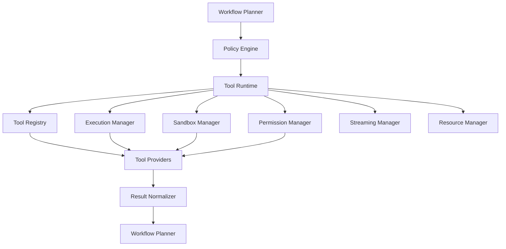

# Tool Runtime

## Executive Summary

The Tool Runtime is the execution environment responsible for invoking built-in capabilities, external tools, connectors, scripts, and future plugins. It provides a secure, policy-aware, observable, and provider-independent runtime that allows AI workflows to interact with the operating system and external services without embedding execution logic into language models.

The Tool Runtime is the bridge between reasoning and action.

---

# Objectives

The Tool Runtime is responsible for:

- Executing tools
- Managing tool lifecycle
- Enforcing permissions
- Sandboxing execution
- Handling streaming input/output
- Managing concurrency
- Capturing execution results
- Publishing telemetry
- Supporting cancellation
- Recovering from failures

---

# Architectural Position

```
User
   │
Kernel
   │
Capability Router
   │
Workflow Planner
   │
Policy Engine
   │
Tool Runtime
   │
Tool Providers
```

The Tool Runtime executes only workflows that have been authorized by the Policy Engine.

---

# Design Principles

- Tool-agnostic
- Provider-independent
- Secure by default
- Least-privilege execution
- Deterministic interfaces
- Observable execution
- Extensible architecture
- Configuration-driven

---

# Responsibilities

The Tool Runtime:

- Receives execution plans
- Resolves tool references
- Validates permissions
- Creates execution environments
- Executes tools
- Streams outputs
- Handles failures
- Returns normalized results

---

# Core Components

## Tool Registry

Maintains metadata for all available tools.

Each entry contains:

- Tool ID
- Name
- Version
- Provider
- Supported capabilities
- Required permissions
- Input schema
- Output schema
- Health status

---

## Execution Manager

Coordinates tool invocation.

Responsibilities:

- Allocate runtime
- Start execution
- Track state
- Handle completion
- Record execution metadata

---

## Sandbox Manager

Creates isolated execution environments.

Isolation may include:

- Process isolation
- Filesystem restrictions
- Network controls
- Resource quotas
- Temporary workspaces

---

## Permission Manager

Validates requested operations against Policy Engine decisions.

Examples:

- Read files
- Write files
- Execute commands
- Network access
- Clipboard access
- Device access

---

## Streaming Manager

Supports real-time communication.

Capabilities:

- Incremental stdout
- Incremental stderr
- Streaming tool output
- Cancellation
- Progress updates

---

## Resource Manager

Controls runtime resources.

Monitors:

- CPU
- Memory
- Disk
- GPU
- Execution time
- Open handles

---

## Result Normalizer

Every tool returns a common response format.

Example:

- Execution ID
- Status
- Exit code
- Output
- Errors
- Artifacts
- Metrics
- Duration

---

# Tool Lifecycle

```
Discovery
    │
Registration
    │
Validation
    │
Authorization
    │
Execution
    │
Streaming
    │
Completion
    │
Cleanup
```

---

# Execution Pipeline

```
Workflow Planner
        │
        ▼
Tool Runtime
        │
        ▼
Tool Registry
        │
        ▼
Permission Validation
        │
        ▼
Sandbox Creation
        │
        ▼
Tool Execution
        │
        ▼
Result Normalization
        │
        ▼
Workflow Continuation
```

---

# Supported Tool Types

| Category | Examples |
|----------|----------|
| File System | Read, write, search |
| Shell | Bash, PowerShell |
| Python | Scripts, notebooks |
| HTTP | REST APIs |
| Database | SQLite, PostgreSQL |
| AI Models | Local and cloud inference |
| Productivity | Calendar, Email |
| Web | Browser automation |
| Media | Image, audio, video |
| Future Plugins | User-installed extensions |

---

# Concurrency Model

The runtime supports:

- Sequential execution
- Parallel execution
- Dependency-aware scheduling
- Cancellation
- Retry orchestration

Concurrency limits are configurable.

---

# Failure Handling

Failure categories include:

- Tool unavailable
- Timeout
- Permission denied
- Invalid input
- Runtime exception
- Resource exhaustion
- External dependency failure

Recovery strategies:

- Retry
- Alternate tool
- Workflow rollback
- Checkpoint resume
- Graceful degradation

---

# Security

Security controls include:

- Sandboxed execution
- Least-privilege permissions
- Signed tool verification
- Resource limits
- Audit logging
- Secret isolation
- Temporary credential injection

---

# Observability

The Tool Runtime publishes:

- Execution duration
- Success/failure
- Resource usage
- Exit codes
- Tool version
- Invocation count
- Error details

These metrics integrate with the Observability subsystem.

---

# Configuration

Example configuration:

```yaml
runtime:
  max_parallel_tasks: 8
  default_timeout: 300s
  sandbox_enabled: true
  allow_network: false
  allow_shell: true
  max_memory_mb: 1024
```

---

# Mermaid Diagram



---

# Architecture Decisions

## Unified Execution Interface

All tools expose a consistent execution contract regardless of implementation language or provider.

## Sandboxing by Default

Tools execute in isolated environments unless explicitly configured otherwise.

## Policy Enforcement

No tool executes without prior authorization from the Policy Engine.

## Normalized Results

Execution results are standardized, simplifying workflow orchestration and observability.

## Extensibility

New tools are added through the Tool Registry without modifying the runtime core.

---

# Future Enhancements

- Distributed tool execution
- Remote execution agents
- GPU-aware scheduling
- WASM sandbox support
- Marketplace integration
- Tool version pinning
- Automatic dependency management
- Hot-reload for development

---

# Cross References

Previous:

- `03B_4_POLICY_ENGINE.md`
- `03B_5_PROVIDER_ADAPTER.md`
- `03B_6_MEMORY_SYSTEM.md`
- `03B_7_OBSERVABILITY.md`

Next:

- `03B_9_EVENT_BUS.md`
