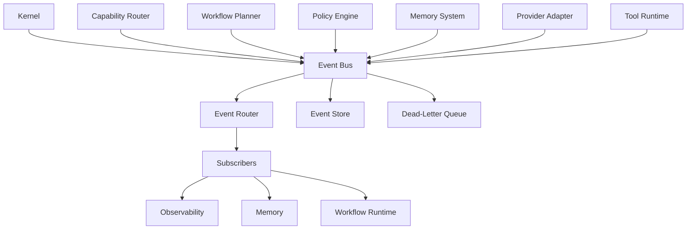

# Event Bus

## Executive Summary

The Event Bus is the asynchronous communication backbone of Hermes AIOS. It enables loosely coupled interaction between core components by allowing them to publish and subscribe to events rather than calling each other directly.

This design improves modularity, scalability, resilience, and extensibility while supporting future distributed deployments.

---

# Objectives

The Event Bus is responsible for:

- Event publication
- Event subscription
- Event routing
- Delivery guarantees
- Event persistence
- Retry handling
- Dead-letter processing
- Event replay
- Workflow notifications
- Cross-component communication

---

# Architectural Position

```
                 Event Bus
                     ▲
                     │
 ┌────────────────────────────────────┐
 │ Kernel                             │
 │ Capability Router                  │
 │ Workflow Planner                   │
 │ Policy Engine                      │
 │ Memory System                      │
 │ Provider Adapter                   │
 │ Tool Runtime                       │
 │ Observability                      │
 └────────────────────────────────────┘
```

All components communicate through events when asynchronous coordination is appropriate.

---

# Design Principles

- Event-driven architecture
- Loose coupling
- High reliability
- Ordered delivery where required
- Schema versioning
- Idempotent processing
- Observable event flow
- Provider independence

---

# Core Components

## Event Publisher

Responsible for:

- Creating events
- Validating schemas
- Assigning metadata
- Publishing to topics

---

## Event Router

Routes events to subscribers.

Supports:

- Topic-based routing
- Type-based routing
- Filtered subscriptions
- Broadcast delivery

---

## Subscription Manager

Maintains subscriber registrations.

Capabilities:

- Dynamic registration
- Priority subscriptions
- Durable subscriptions
- Temporary subscriptions

---

## Event Store

Persists selected events for:

- Audit
- Replay
- Debugging
- Recovery
- Analytics

Retention policies are configurable.

---

## Retry Manager

Handles temporary delivery failures.

Strategies include:

- Immediate retry
- Exponential backoff
- Delayed retry
- Alternate consumer
- Dead-letter queue

---

## Dead-Letter Queue

Stores events that cannot be processed successfully.

Typical causes:

- Invalid schema
- Subscriber failure
- Permission denial
- Processing timeout
- Unsupported version

---

# Event Lifecycle

```
Publish
    │
Validate
    │
Route
    │
Deliver
    │
Process
    │
Acknowledge
    │
Archive
```

---

# Standard Event Schema

Every event includes:

- Event ID
- Event Type
- Timestamp
- Source Component
- Correlation ID
- Workflow ID
- Payload
- Metadata
- Schema Version
- Priority

---

# Event Categories

| Category | Examples |
|----------|----------|
| Workflow | Started, Completed, Failed |
| Tool | Invoked, Completed, Failed |
| Memory | Stored, Retrieved, Archived |
| Policy | Approved, Denied |
| Provider | Healthy, Unavailable |
| Runtime | Started, Stopped |
| System | Boot, Shutdown |
| User | Request Received |

---

# Delivery Modes

Supported modes:

- Fire-and-forget
- At-least-once
- Exactly-once (where supported)
- Ordered delivery
- Broadcast

The mode is configurable per event type.

---

# Correlation

Events belonging to the same workflow share a common Correlation ID.

Example:

```
Workflow A

├── Request Received
├── Plan Generated
├── Tool Executed
├── Memory Updated
└── Workflow Completed
```

This enables complete end-to-end tracing.

---

# Event Replay

The Event Store supports replay for:

- Debugging
- Recovery
- Testing
- Analytics
- State reconstruction

Replay respects current policy and authorization rules.

---

# Security

The Event Bus enforces:

- Event authentication
- Publisher authorization
- Subscriber authorization
- Payload validation
- Sensitive data redaction
- Encryption in transit
- Audit logging

---

# Observability

Metrics include:

- Events published
- Events delivered
- Delivery latency
- Failed deliveries
- Retry count
- Dead-letter size
- Active subscribers
- Queue depth

These metrics integrate with the Observability subsystem.

---

# Configuration

Example:

```yaml
event_bus:
  transport: in-process
  persistence: sqlite
  durable_subscriptions: true
  retry_attempts: 5
  retry_backoff: exponential
  dead_letter_enabled: true
  replay_enabled: true
```

Future deployments may replace the transport layer with external brokers while preserving the same interface.

---

# Mermaid Diagram



---

# Architecture Decisions

## In-Process First

The initial implementation uses an in-process event bus for simplicity and performance. External message brokers can be introduced later without changing component contracts.

## Versioned Schemas

Every event schema is versioned to support backward compatibility during upgrades.

## Reliable Delivery

Critical events are persisted and retried according to configurable policies.

## Loose Coupling

Components communicate through events whenever synchronous responses are not required.

## Policy Integration

Event publication and subscription are governed by the Policy Engine to prevent unauthorized communication.

---

# Future Enhancements

- Distributed message broker support
- Priority queues
- Scheduled events
- Event sourcing
- Stream processing
- Multi-node replication
- Cross-device synchronization
- Event compression

---

# Cross References

Previous:

- `03B_5_PROVIDER_ADAPTER.md`
- `03B_6_MEMORY_SYSTEM.md`
- `03B_7_OBSERVABILITY.md`
- `03B_8_TOOL_RUNTIME.md`

Next:

- `03B_10_PLUGIN_FRAMEWORK.md`
