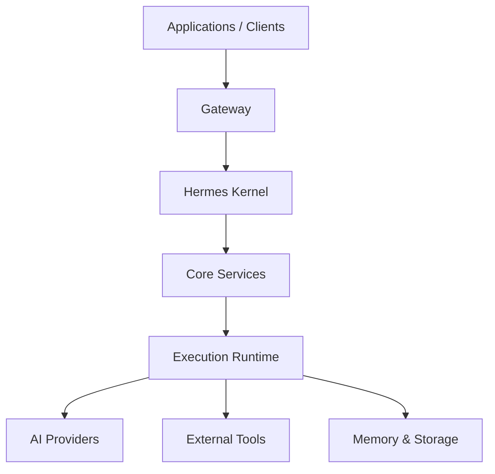

# Hermes AIOS — System Overview

> **Purpose**
>
> This document defines the official architectural baseline for Hermes AIOS.
>
> It establishes the system philosophy, architectural principles, component responsibilities, execution model, and long-term direction of the platform.
>
> Every architecture decision should be evaluated against the principles defined in this document.

---

# Document Status

| Field | Value |
|--------|-------|
| Status | Production Baseline |
| Version | 1.0.0 |
| Architecture Stability | Stable |
| Breaking Changes | Major Version Only |
| Review Required | Architecture Team |
| Implementation Reference | Yes |

---

# Intended Audience

This document is intended for:

- Project maintainers
- Core developers
- Contributors
- Plugin developers
- Infrastructure engineers
- AI engineers
- Security reviewers
- Documentation contributors

It should be considered required reading before making architectural changes.

---

# Scope

This document describes the high-level architecture of Hermes AIOS.

Included:

- system philosophy
- layered architecture
- core components
- orchestration
- routing
- execution flow
- memory architecture
- provider abstraction
- policy enforcement
- observability
- extensibility

Not included:

- API specifications
- implementation details
- deployment procedures
- coding standards
- testing strategy
- infrastructure configuration

Those topics are documented separately.

---

# Repository Location

```text
docs/
└── architecture/
    ├── SYSTEM_OVERVIEW.md
    ├── COMPONENTS.md
    ├── MEMORY.md
    ├── ROUTING.md
    ├── EXECUTION_ENGINE.md
    ├── POLICY_ENGINE.md
    ├── PROVIDERS.md
    ├── OBSERVABILITY.md
    ├── SECURITY.md
    └── ...
```

---

# Related Documents

| Document | Purpose |
|----------|---------|
| COMPONENTS.md | Detailed component descriptions |
| MEMORY.md | Memory architecture |
| ROUTING.md | Capability routing |
| EXECUTION_ENGINE.md | Workflow execution |
| POLICY_ENGINE.md | Safety and policy enforcement |
| PROVIDERS.md | Provider abstraction |
| OBSERVABILITY.md | Metrics and tracing |
| SECURITY.md | Security architecture |

---

# Architecture Layers

The Hermes architecture follows a layered design.



---

# Architecture Documentation Structure

```text
SYSTEM OVERVIEW
│
├── Philosophy
├── Principles
├── Goals
├── Layered Architecture
├── Components
├── Request Flow
├── Data Flow
├── Provider Model
├── Memory
├── Safety
├── Extensibility
├── Future Roadmap
└── Revision History
```

---

# Documentation Principles

Hermes documentation follows several principles.

## Single Source of Truth

Each topic should have one authoritative document.

Avoid duplicated documentation whenever possible.

---

## Architecture Before Implementation

Documentation describes intended architecture rather than current implementation.

Implementation should converge toward architecture.

---

## Provider Independence

Provider-specific information belongs in provider documentation.

Architecture documents remain provider neutral.

---

## Living Documentation

Documentation evolves alongside architecture.

Changes should be version controlled.

---

## Diagram First

Where practical, diagrams should explain systems before prose.

Every major subsystem should include at least one architectural diagram.

---

# Versioning Policy

Hermes documentation follows Semantic Versioning.

| Change | Version Increment |
|---------|-------------------|
| Typographical corrections | Patch |
| Clarifications | Patch |
| New architecture section | Minor |
| New subsystem | Minor |
| Breaking architecture changes | Major |

Example:

```
1.0.0
│ │ │
│ │ └── Patch
│ └──── Minor
└────── Major
```

---

# Architecture Change Process

Every architectural change should follow:

```text
Proposal

    ↓

Architecture Review

    ↓

Discussion

    ↓

Approval

    ↓

Implementation

    ↓

Documentation Update

    ↓

Release
```

No implementation should become canonical before documentation is updated.

---

# Markdown Standards

All architecture documentation should use:

- ATX headings
- fenced code blocks
- Mermaid diagrams
- tables where appropriate
- relative links
- consistent terminology

Avoid:

- duplicated explanations
- provider-specific assumptions
- implementation leakage
- undocumented diagrams

---

# Terminology

| Term | Definition |
|------|------------|
| Provider | Service supplying AI models |
| Model | Individual LLM or multimodal model |
| Capability | A measurable skill of a model |
| Workflow | Planned sequence of tasks |
| Agent | Autonomous execution unit |
| Tool | Executable external capability |
| Memory | Persistent knowledge subsystem |
| Session | User interaction context |

---

# Document Lifecycle

Architecture documentation progresses through:

```text
Draft
    ↓
Review
    ↓
Production Baseline
    ↓
Revision
    ↓
Next Release
```

---

# Revision History

| Version | Date | Author | Changes |
|----------|------|--------|----------|
| 1.0.0 | 2026-07-06 | Tariq Anjum | Initial production baseline |

---

# Approval

This document becomes the official architectural baseline once merged into the main branch.

Subsequent architecture work should reference this document rather than redefining foundational concepts.