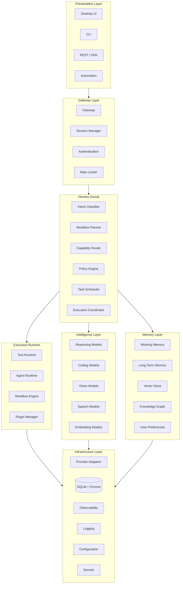
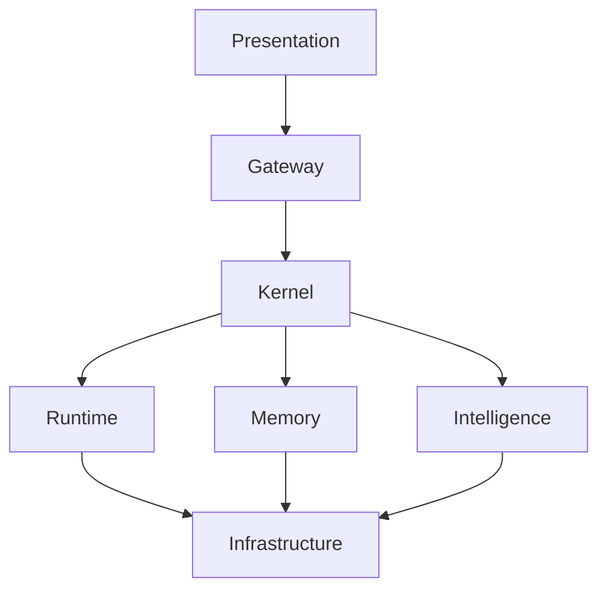
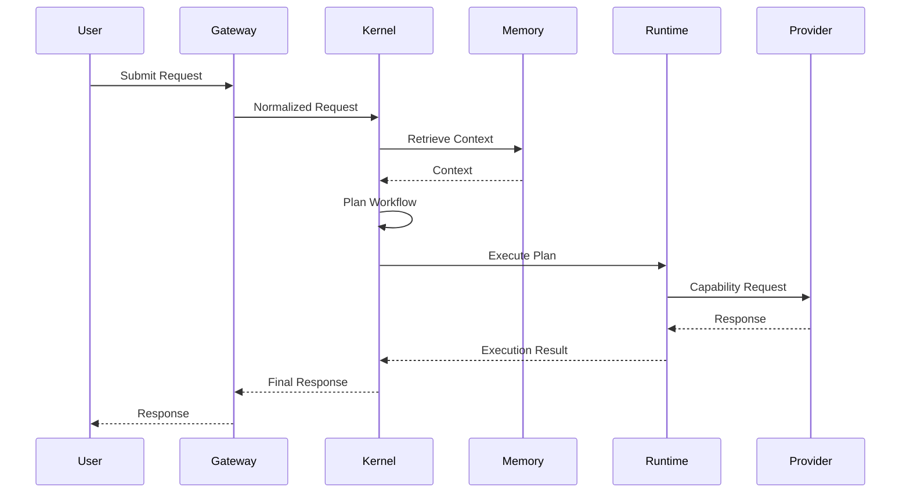

---

title: "Layered Architecture"
document: "SYSTEM_OVERVIEW"
section: "02_LAYERED_ARCHITECTURE"
version: "1.0.0"
status: "Production Baseline"
classification: "Architecture"
owner: "Hermes AIOS Project"
last_updated: "2026-07-06"
--------------------------

# Layered Architecture

## Executive Summary

Hermes AIOS is organized as a layered architecture that separates user interaction, orchestration, execution, intelligence, memory, and infrastructure into independent concerns.

Each layer owns a well-defined responsibility and communicates only through stable interfaces. This separation allows individual components to evolve independently while preserving the overall architecture.

The architecture follows five guiding rules:

1. Separation of concerns
2. Stable interfaces
3. Provider independence
4. Capability-driven orchestration
5. Progressive extensibility

---

# Architectural Goals

The layered architecture is designed to achieve the following objectives:

* modular development
* independent deployment
* provider abstraction
* scalable orchestration
* fault isolation
* maintainability
* observability
* future extensibility

---

# Complete System Architecture

---

# Layer Responsibilities

## 1. Presentation Layer

The Presentation Layer provides interfaces through which users and external systems interact with Hermes AIOS.

Typical interfaces include:

* Desktop application
* Web interface
* Command-line interface
* REST API
* SDKs
* Automation platforms

Responsibilities:

* request submission
* authentication initiation
* response rendering
* user interaction

This layer contains **no business logic**.

---

## 2. Gateway Layer

The Gateway Layer provides a secure entry point into the system.

Responsibilities include:

* authentication
* authorization
* session lifecycle
* rate limiting
* request normalization
* protocol translation
* API versioning

The Gateway isolates client implementations from internal architecture.

---

## 3. Hermes Kernel

The Kernel is the cognitive control center of Hermes AIOS.

It is responsible for determining *what* should happen, not *how* it is executed.

Core services include:

* Intent Classification
* Complexity Estimation
* Workflow Planning
* Capability Routing
* Model Selection
* Policy Evaluation
* Task Scheduling
* Execution Coordination

The Kernel never performs provider-specific inference directly.

---

## 4. Intelligence Layer

The Intelligence Layer exposes cognitive capabilities through interchangeable models.

Capabilities may include:

* reasoning
* coding
* mathematics
* planning
* retrieval
* summarization
* translation
* speech
* vision

Models are selected dynamically according to capability requirements.

Providers remain hidden behind abstraction layers.

---

## 5. Execution Runtime

The Runtime converts plans into executable actions.

Responsibilities include:

* tool execution
* workflow execution
* agent lifecycle
* retries
* parallel execution
* dependency resolution
* sandbox management

Execution remains isolated from planning.

---

## 6. Memory Layer

Memory is a permanent architectural subsystem rather than an optional feature.

Subsystems include:

* Working Memory
* Session Memory
* Long-Term Memory
* Vector Storage
* Knowledge Graph
* User Preferences
* Project Context

Memory survives individual model executions.

---

## 7. Infrastructure Layer

The Infrastructure Layer provides technical services required by higher layers.

Examples include:

* provider adapters
* databases
* telemetry
* logging
* configuration
* secrets management
* storage

Infrastructure must remain replaceable.

---

# Dependency Rules

Dependencies flow downward only.

Lower layers must never depend on higher layers.

---

# Layer Communication Rules

Each layer communicates through explicit interfaces.

| Source       | Destination  | Communication              |
| ------------ | ------------ | -------------------------- |
| Presentation | Gateway      | API                        |
| Gateway      | Kernel       | Internal Service Interface |
| Kernel       | Runtime      | Execution Contracts        |
| Kernel       | Memory       | Memory API                 |
| Kernel       | Intelligence | Capability Interface       |
| Runtime      | Providers    | Provider Adapter           |
| Runtime      | Tools        | Tool Interface             |

Direct access outside these interfaces is prohibited.

---

# Architectural Boundaries

Hermes separates responsibilities into independent domains.

| Domain         | Responsibility                 |
| -------------- | ------------------------------ |
| Planning       | Decide what should happen      |
| Routing        | Decide who should perform work |
| Execution      | Perform work                   |
| Memory         | Preserve knowledge             |
| Policy         | Validate safety                |
| Providers      | Supply intelligence            |
| Infrastructure | Support execution              |

This separation reduces coupling and simplifies maintenance.

---

# Request Lifecycle

---

# Architectural Characteristics

The layered design provides:

* independent scalability
* easier testing
* provider flexibility
* simplified maintenance
* predictable dependencies
* improved fault isolation
* stronger security boundaries

---

# Design Rationale

Hermes intentionally separates orchestration from execution.

This allows:

* planners to evolve independently
* providers to be replaced without architectural changes
* tools to be added through plugins
* memory implementations to change without affecting workflows
* execution engines to improve independently of planning logic

The result is a stable architecture that can evolve over many years while minimizing disruptive redesign.

---

# Future Evolution

The architecture has been designed to accommodate future capabilities, including:

* distributed orchestration
* swarm agents
* robotics
* edge deployments
* federated memory
* multimodal reasoning
* enterprise governance
* hardware acceleration
* custom provider ecosystems

These capabilities can be introduced by extending existing layers rather than creating new architectural foundations.

---

# Cross References

* `00_METADATA.md`
* `01_EXECUTIVE_SUMMARY.md`
* `03_CORE_COMPONENTS.md`
* `04_REQUEST_FLOW.md`
* `05_DATA_FLOW.md`
* `06_POLICY_ENGINE.md`
* `07_MEMORY_ARCHITECTURE.md`
* `08_PROVIDER_ABSTRACTION.md`
* `09_OBSERVABILITY.md`

---

# Revision History

| Version | Date       | Changes                               |
| ------- | ---------- | ------------------------------------- |
| 1.0.0   | 2026-07-06 | Initial layered architecture baseline |
