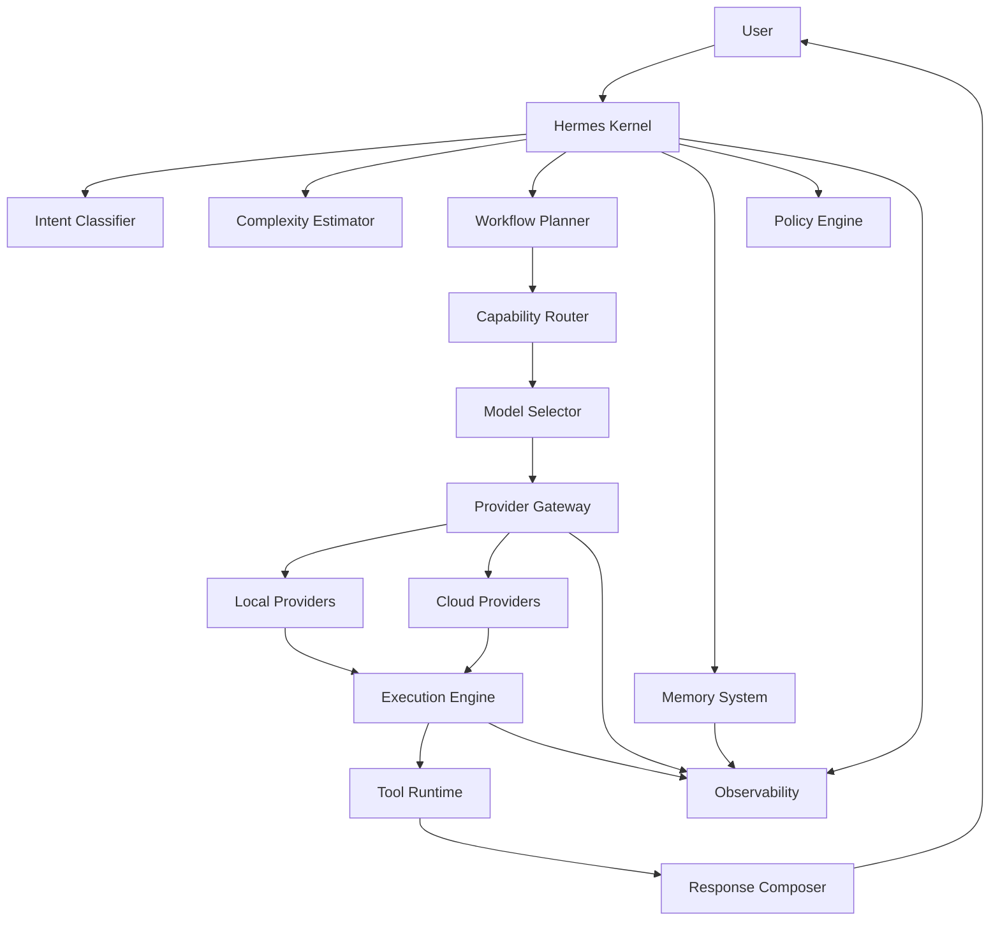

# Core Components

**Document ID:** HERMES-ARCH-003
**Document Name:** Core Components
**Version:** 1.0.0 (Draft)
**Status:** Production Baseline (In Progress)
**Owner:** Hermes AIOS Project
**Location:** `docs/architecture/SYSTEM_OVERVIEW/03_CORE_COMPONENTS.md`

---

# Executive Overview

This document defines the core architectural components that collectively form the Hermes AIOS runtime.

Each component has a single, well-defined responsibility and communicates with other components only through stable interfaces. The architecture intentionally avoids tightly coupled modules so that providers, models, storage backends, and execution engines can evolve independently without requiring structural redesign.

The components described here form the architectural contract for Hermes AIOS. Future implementations should conform to this document unless an Architecture Decision Record (ADR) explicitly documents an approved deviation.

---

# Purpose

The objectives of this document are to:

* Define every major subsystem within Hermes AIOS.
* Describe the responsibility of each subsystem.
* Establish ownership boundaries between components.
* Define interaction patterns.
* Minimize coupling between modules.
* Enable independent implementation and testing.
* Provide a stable reference for future architectural decisions.

---

# Architectural Principles

Every component in Hermes AIOS follows the same engineering principles.

## Single Responsibility

Each component exists to solve one problem well.

Responsibilities should never overlap unnecessarily.

---

## Stable Interfaces

Components communicate through documented interfaces.

Internal implementation details remain private.

---

## Loose Coupling

Dependencies between components should be minimized.

Communication should occur through contracts rather than implementation knowledge.

---

## Replaceability

Every component should be replaceable without requiring major changes to the rest of the system.

Examples include:

* AI providers
* databases
* memory backends
* execution engines
* vector stores
* embedding models

---

## Observability

Every important component should expose telemetry.

Telemetry includes:

* metrics
* traces
* logs
* cost information
* execution timing
* health status

---

## Configuration Over Code

Behavior that may reasonably change should be configurable rather than hard-coded.

Examples include:

* provider priorities
* routing thresholds
* retry policies
* cache limits
* model preferences
* memory policies

---

# Component Classification

Hermes AIOS groups components into functional layers.

| Layer          | Responsibility                         |
| -------------- | -------------------------------------- |
| Core           | System coordination                    |
| Intelligence   | Planning, reasoning, orchestration     |
| Memory         | Persistent and working memory          |
| Execution      | Tool execution and workflows           |
| Integration    | External providers and services        |
| Infrastructure | Configuration, security, observability |
| Extension      | Plugins and future capabilities        |

These layers form the logical architecture of Hermes AIOS.

---

# High-Level Component Architecture

```text
                    User
                      │
                      ▼
             ┌──────────────────┐
             │   Hermes Kernel  │
             └──────────────────┘
                      │
          ┌───────────┼────────────┐
          ▼           ▼            ▼
 Intent        Workflow        Policy
Classifier      Planner        Engine
          │           │
          ▼           ▼
 Capability Router
          │
          ▼
   Model Selector
          │
          ▼
   Provider Gateway
          │
   ┌──────┴─────────────┐
   ▼                    ▼
Local Providers     Cloud Providers
          │
          ▼
  Execution Engine
          │
          ▼
 Tool Runtime
          │
          ▼
 Response Builder
          │
          ▼
        User
```

---

# High-Level Component Diagram



---

# Component Categories

The Hermes runtime consists of six primary categories.

## Core Coordination

Responsible for overall system control.

Components:

* Hermes Kernel
* Scheduler
* Event Bus

---

## Intelligence

Responsible for reasoning and orchestration.

Components:

* Intent Classifier
* Complexity Estimator
* Workflow Planner
* Capability Router
* Model Selector

---

## Memory

Responsible for retaining knowledge.

Components:

* Working Memory
* Short-Term Memory
* Long-Term Memory
* Semantic Memory
* Episodic Memory
* Knowledge Store

---

## Execution

Responsible for performing work.

Components:

* Execution Engine
* Tool Runtime
* Skill Registry
* Response Composer

---

## Integration

Responsible for communication with external systems.

Components:

* Provider Gateway
* Provider Adapters
* External APIs
* Connectors

---

## Infrastructure

Responsible for platform services.

Components:

* Policy Engine
* Configuration Manager
* Security Manager
* Cache Manager
* Observability Stack

---

# Component Communication Model

Hermes follows a layered communication model.

A component should communicate only with adjacent architectural layers whenever practical.

```text
Presentation

↓

Kernel

↓

Planning

↓

Routing

↓

Execution

↓

Providers

↓

Infrastructure
```

This minimizes hidden dependencies and simplifies testing.

---

# Cross-Layer Rules

The following rules govern communication.

### Rule 1

Higher layers may invoke lower layers.

Lower layers should never directly invoke higher layers.

---

### Rule 2

Providers never communicate directly with memory.

All state changes pass through the Kernel.

---

### Rule 3

Routing decisions belong exclusively to the Capability Router and Model Selector.

Execution components must not independently choose providers or models.

---

### Rule 4

Policy validation occurs before execution.

Execution components assume requests have already been authorized.

---

### Rule 5

Memory remains provider-independent.

No provider implementation may directly manage persistent user memory.

---

# Design Philosophy for Components

Every Hermes component should satisfy the following quality attributes.

| Attribute       | Requirement                                  |
| --------------- | -------------------------------------------- |
| Modularity      | Independent implementation                   |
| Replaceability  | Easily swapped without architectural changes |
| Testability     | Unit and integration test friendly           |
| Observability   | Metrics, logs, and traces exposed            |
| Scalability     | Horizontal growth supported                  |
| Reliability     | Graceful degradation preferred               |
| Security        | Least-privilege access model                 |
| Configurability | Runtime behavior controlled by configuration |

These attributes are mandatory for every future subsystem introduced into Hermes AIOS.

---

# Document Roadmap

The remainder of this document is organized as follows:

1. Hermes Kernel
2. Intent Classifier
3. Complexity Estimator
4. Workflow Planner
5. Capability Router
6. Model Selector
7. Provider Gateway
8. Provider Adapters
9. Memory System
10. Execution Engine
11. Tool Runtime
12. Policy Engine
13. Response Composer
14. Observability Stack
15. Security Manager
16. Configuration Manager
17. Plugin Framework
18. Scheduler
19. Cache Manager
20. Component Dependencies
21. Future Evolution
22. Revision History

Each component will be documented using a consistent template covering purpose, responsibilities, interfaces, dependencies, failure modes, observability, configuration, security considerations, and future evolution.
