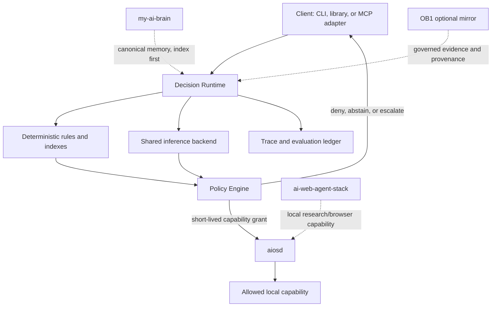
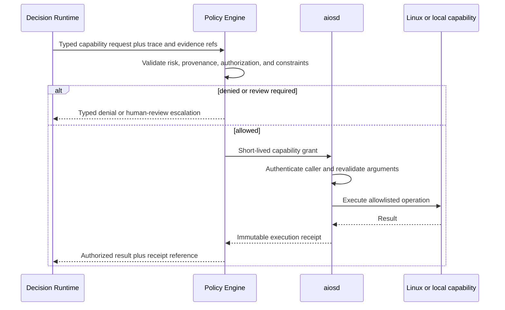
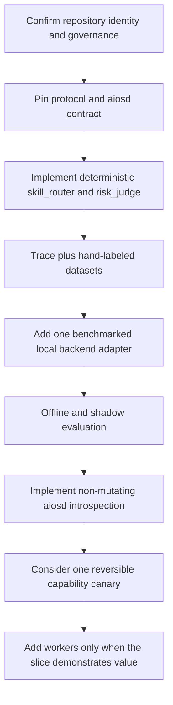

# ZHOOR Decision Architecture v0.2

**Repository authority:** adopted by `adr/ADR-0001-ADOPT-ZHOOR-DIRECTION.md` on 2026-09-23. This document takes precedence over conflicting legacy HERMES architecture and implementation plans.  
**Provenance:** consolidated from the prior ZHOOR architecture review and copied into this repository so the repository remains canonical.  
**Status:** implementation-ready architecture freeze  
**Scope:** ZHOOR decision fabric and its boundaries; no implementation is created by this document.

> **Minimum context. Minimum tokens. Minimum code. Minimum model. Maximum useful work.**

## 1. Purpose and non-goals

ZHOOR is a local-first decision fabric for agents and AIOS clients. It selects bounded actions, evidence, models, skills, and escalation paths. It is **not** an autonomous shell, a memory database, a second inference stack, or a universal prompt wrapper.

The operating rule is:

> Use the cheapest deterministic mechanism that can reliably resolve the current decision. Escalate only when recorded evidence says it cannot.

A model emits advice, classification, extraction, or a score. A model never directly executes a capability.

## 2. Frozen system shape



### 2.1 Boundary ownership

| Component | Owns | Must not own |
|---|---|---|
| Decision Runtime | typed decisions, backend selection, scheduling, trace capture, calibration lookup | authorization or privileged execution |
| Policy Engine | risk rules, evidence requirements, authorization decision, capability-grant issuance | inference or direct OS work |
| `aiosd` | authentication, capability allowlist, argument validation, actual execution, audit receipt | choosing what should happen |
| `my-ai-brain` | canonical durable Markdown memory | runtime state or privileged actions |
| OB1 | optional searchable governed mirror/evidence substrate | canonical local memory authority |
| Web stack | local web research/browser automation capability | policy, authorization, or root/system authority |

## 3. Decision protocol

All workers use one request envelope. Only relevant fields are supplied; the runtime enforces each worker's input budget before a backend sees data.

```yaml
request_id: UUID
worker: skill_router | risk_judge | future-worker
operation: select | score | extract | verify
goal: string
evidence:
  - ref: evidence://sha256/...
    kind: user_input | registry | tool_result | memory | external_document
    trust_tier: untrusted | observed | verified | policy
    source: string
candidates: []
constraints:
  max_choices: 1
  input_token_budget: 800
deadline:
  queue_ms: 25
  execution_ms: 100
policy_ref: policy-version
provenance:
  client: string
  session_ref: string
```

The response has a mandatory result, confidence, evidence references, and disposition:

```yaml
request_id: UUID
result:
  kind: choice | score | extract | verdict
  value: object
confidence:
  raw: 0.0
  calibrated: 0.0
  calibration_ref: worker-model-policy-version
disposition: resolved | abstained | escalated | denied
uncertainty: string | null
evidence_refs: []
backend: deterministic | index | local | remote
latency:
  queue_ms: 0
  load_ms: 0
  inference_ms: 0
trace_id: UUID
```

### 3.1 Four result kinds

| Kind | Contract | Example worker |
|---|---|---|
| `choice` | one or more IDs selected from supplied candidates | skill router |
| `score` | bounded numeric score with defined scale and threshold | risk judge |
| `extract` | schema-validated fields with each field linked to source evidence | extractor |
| `verdict` | `supported`, `unsupported`, or `insufficient`, with evidence references | verifier |

`abstained`, `escalated`, and `denied` are dispositions, not decision kinds. The ambiguous earlier term `Noul` is retired from new protocol versions. A verifier can technically be encoded as a three-option choice, but remains a named `verdict` result because its evidence and safety obligations differ.

## 4. Workers and the minimum slice

Workers are configurations and schemas over a shared runtime—not separate services by default.

### Initial vertical slice

| Worker | Level 0 deterministic path | Level 2 local semantic path | Autonomous effect |
|---|---|---|---|
| `skill_router` | exact intent/tag/capability match against registered skill descriptors | rank supplied candidate descriptors; may abstain | none; returns recommendations only |
| `risk_judge` | hard risk rules based on requested capability and arguments | classify ambiguity or risk signals; may only increase scrutiny | cannot authorize; informs policy only |

The Level 2 columns describe future eligible routing behavior, not components enabled in the initial deterministic slice. The first implemented slice uses deterministic/index paths only. Semantic/model-backed paths remain inactive until their benchmark, evaluation, approval, and shadow gates have passed.

Both workers must emit a trace on every invocation. Neither can issue an executable request during the first slice.

Future workers—capability router, context judge, evidence selector, model router, extractor, verifier—are admitted only after the slice meets its evaluation gates.

### Skill descriptors

Skill retrieval must operate on compact metadata, not every skill body:

```yaml
id: systemd-debugging
description: Diagnose Linux systemd services
capabilities: [inspect_service, read_journal]
requires: [linux]
risk_level: medium
activation: contextual
```

The selected skill content is fetched lazily after policy and routing approve the selection.

## 5. Cost-ordered routing and escalation

```text
Level 0  deterministic rule / schema validation / explicit policy
Level 1  registry or index lookup
Level 2  tiny local semantic backend
Level 3  stronger local or approved remote backend
Level 4  reasoning model with minimal evidence packet
Level 5  human review
```

- A worker declares its allowed levels; policy may prohibit levels for a request.
- A backend failure, missing evidence, invalid schema, deadline failure, or confidence below the **worker- and risk-specific** threshold yields abstention or escalation—not a fabricated answer.
- Cached responses are reusable only when worker version, input/evidence hashes, policy version, candidate registry version, and authorization scope all match.

## 6. Resource lifecycle, deadlines, and concurrency

The first deployment target is one 16 GB Linux machine. Architecture must acknowledge cold-load cost.

### 6.1 Conservative default

1. Keep **at most one** inference backend resident initially.
2. Deterministic and index paths remain concurrent and do not wait on model work.
3. Model work is single-flight by default: one active inference request, with a bounded queue.
4. A request reports `queue_ms`, `load_ms`, and `inference_ms` separately. A cold model never masquerades as a 100 ms operation.
5. On a cold start that cannot meet the total deadline, the runtime chooses an available cheaper route or returns `abstained`/`escalated` before doing work that is guaranteed to miss the deadline.
6. Idle unloading is allowed only after a measured memory/latency benchmark. Initial configuration uses a fixed warm backend or no warm backend—never an assumed free unload/reload cycle.

### 6.2 Scheduler contract

- Queue by `(backend, model, schema compatibility)` with FIFO ordering within a risk class.
- Higher-risk requests may pre-empt **queued**, never in-flight, lower-risk requests.
- Batch only independent requests with the same backend, result schema, policy scope, and compatible deadline. Batching must preserve individual traces.
- Maximum queue depth and wait time are explicit worker configuration. Saturation returns a typed overload abstention.
- Concurrency, warm-pool size, and batching remain measured configuration—not protocol changes.

## 7. Inference boundary

ZHOOR does not build a second inference server while a compatible local service exists. The runtime uses a backend adapter interface; an Ollama HTTP adapter is the initial integration candidate because the local infrastructure already uses Ollama/Vulkan. It must be benchmarked against at least one deterministic/index baseline before adoption.

The runtime implementation language and transport remain open. If Rust is selected, it owns protocol validation, scheduling, policy-client calls, and trace writing; inference stays behind an adapter rather than being embedded prematurely.

## 8. Policy and `aiosd` execution contract

Policy is the authority layer. A worker's calibrated confidence is an input to policy, never permission to act.

### 8.1 Required flow



### 8.2 `aiosd` v1 contract to pin before implementation

`aiosd` exposes a local Unix-domain socket only. It obtains the caller's Linux identity using peer credentials and requires a policy-issued, short-lived, single-operation grant. The grant binds:

- `grant_id`, expiry, policy version, and authenticated client identity;
- capability ID and exact normalized argument hash;
- permitted resource scope; and
- originating decision `trace_id` and decision/evidence hashes.

It accepts only registered typed capabilities. For every request it validates schema, canonicalizes paths beneath an allowlisted root, rejects symlink escapes, applies its own capability/risk rules, executes with least privilege, and emits an append-only receipt. The receipt records grant ID, caller identity, validated capability, argument hash, outcome, timestamps, and safe result reference.

The initial `aiosd` capability must be introspective (`capabilities.describe`) and non-mutating. No mutation, network egress, shell, package install, service control, or privileged capability is eligible for autonomous execution until this contract and its tests exist.

An `aiosd` execution receipt records what was executed and observed; it does not by itself prove required postconditions. Before any execution-capable workflow is eligible for promotion, `SEC-01` must pin the postcondition schema, verification owner, typed verdict/status, required deterministic evidence and linkage, failure/unknown behavior, and how verification affects later policy/state. Any semantic verification remains evidence/advice and cannot substitute for required deterministic safety checks. Detailed design is deferred to `SEC-01`.

Local peer credentials are not a defense against another process operating as the same OS user. ZHOOR's initial threat model is therefore a single trusted local account; stronger multi-user isolation requires separate OS identities and key management, not prompt policy.

## 9. Evidence and adversarial-input policy

Evidence has a content hash, source, time, chain of derivation, and trust tier. Confidence is never evidence trust.

| Trust tier | Meaning | Eligible use |
|---|---|---|
| `untrusted` | user text, web content, tool output not independently validated | context only; cannot satisfy execution policy alone |
| `observed` | runtime/tool observation with an auditable receipt | supports low-risk decisions |
| `verified` | validated against known state, signed source, or approved test oracle | may support policy-defined actions |
| `policy` | local policy/configuration | authorization rules only |

Rules:

- Treat retrieved documents, model-generated claims, and browser content as untrusted by default, including prompt text that asks to bypass safeguards.
- An Evidence Selector can reduce context but cannot raise trust tier.
- Extractors preserve source spans and hashes per field.
- A verifier returns `insufficient` when no eligible evidence supports a claim.
- Policy specifies the minimum trust tier and independent-source requirements for each risk class.

OB1 can provide governed evidence records and recall traces; `my-ai-brain` remains the canonical durable source when the records differ.

## 10. Trace, evaluation, and calibration

Every decision creates a replayable trace with protocol/model/worker/policy versions, normalized input hashes, chosen route, raw and calibrated confidence, evidence references, queue/load/inference latency, result disposition, and any execution receipt. Do not store raw secrets, unrestricted transcripts, or hidden model reasoning in traces.

### 10.1 Ground-truth bootstrap

The first dataset is not synthetic model judging. Build 50–100 hand-labeled cases per initial worker from:

1. deterministic rules and known registry state;
2. operator-labeled real usage traces captured in shadow mode;
3. explicit abstention and adversarial-evidence examples; and
4. later, safely attributable execution outcomes.

Every case records its ground-truth source and policy version. A second model may assist analysis but never defines correctness.

### 10.2 Promotion gates

1. **Offline:** schema validity, primitive correctness, worker accuracy, abstention behavior, ECE/Brier, latency, and cost.
2. **Shadow:** compare recommendations against operator actions; no capability grant.
3. **Replay:** run historical, sanitized traces under candidate changes.
4. **Canary:** only a narrowly scoped, reversible capability after aiosd exists.
5. **Autonomous:** only per capability/risk class after published thresholds are met.

Headline safety metric: **false autonomous action rate**. A strong raw accuracy score cannot bypass a failure in calibration, provenance, policy, or execution enforcement.

## 11. Data and state classes

| Class | Location | Retention rule |
|---|---|---|
| Canonical durable facts and decisions | `my-ai-brain` | Markdown, provenance, index-first retrieval |
| Governed searchable mirror / evidence relationships | optional OB1 | mirror only; use policy and review apply |
| Active task state | ZHOOR session store | compact, bounded, expiry-based |
| Decision traces and evaluation cases | ZHOOR trace/eval store | sanitized, versioned, replayable |

Context compaction is evidence-aware: retain policy-relevant claims and referenced tool results verbatim when needed for replay; otherwise retain a typed summary and hashes. Never indiscriminately summarize material that is required as evidence.

## 12. Build sequence and blockers



| Ticket | Depends on | Done when |
|---|---|---|
| ZH-01 Repository identity | none | **Satisfied:** the canonical ZHOOR-AIOS repository and the adoption workspace define contribution rules |
| ZH-02 Protocol fixtures | ZH-01 | versioned request/response schemas and positive/negative fixtures exist |
| ZH-03 Registry and deterministic slice | ZH-02 | skill router and risk judge run without model dependency |
| ZH-04 Trace/eval harness | ZH-03 | traces replay and 50–100 labeled cases per worker are versioned |
| ZH-05 Backend benchmark | ZH-03, ZH-04 | deterministic/index/local backends compared on accuracy, calibration, memory, cold/warm latency |
| ZH-06 Policy and aiosd contract tests | ZH-02 | peer identity, grant binding, validation, denial, and receipt tests pass |
| ZH-07 Shadow evaluation | ZH-04, ZH-05 | target metrics and failure review documented |
| ZH-08 Canary proposal | ZH-06, ZH-07 | one reversible capability, explicit rollback, and human approval are defined |

## 13. Explicit rejections

- One giant prompt containing all memories, skills, schemas, policies, and transcript.
- A separate permanently loaded model process per logical worker.
- Treating structured output as correctness.
- Treating model agreement or a model judge as ground truth.
- Letting a model, tool adapter, or MCP client bypass `aiosd`.
- Autonomous high-risk actions based only on semantic confidence.
- Building the full generic registry/runtime for eight workers before the two-worker slice has real evaluation traffic.

## 14. Frozen decisions

1. Logical workers; shared, replaceable backends.
2. One runtime for protocol, budgets, cache, telemetry, calibration, and scheduling.
3. Deterministic-to-human cost-ordered escalation.
4. Policy above intelligence and confidence.
5. Evaluation, traceability, and provenance as primary architecture.
6. Four explicit semantic result kinds: Choice, Score, Extract, Verdict.
7. Two-worker initial slice, one resident inference backend maximum by default.
8. A pinned `aiosd` contract before any execution-capable workflow.
