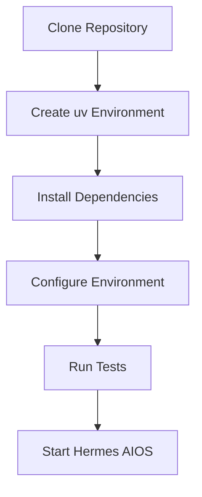

# Development Environment

## Executive Summary

A reproducible development environment is essential for reliable implementation, testing, and debugging. Hermes AIOS standardizes its toolchain to minimize environment-specific issues while supporting local-first AI development.

The environment is designed for Linux-first development while remaining compatible with Windows (via WSL2) and macOS.

---

# Objectives

The development environment shall:

- Be reproducible
- Support local AI inference
- Enable offline development
- Minimize onboarding time
- Standardize tooling
- Support automated quality checks
- Provide deterministic builds
- Integrate with IDE tooling
- Support debugging
- Align with CI/CD

---

# Supported Platforms

Primary:

- Ubuntu LTS
- Kubuntu LTS
- Debian Stable

Supported:

- Windows 11 + WSL2
- macOS (Apple Silicon)
- Other modern Linux distributions

Production CI targets Linux.

---

# Minimum Hardware

| Component | Minimum | Recommended |
|-----------|----------|-------------|
| CPU | 4 cores | 8+ cores |
| RAM | 16 GB | 32–64 GB |
| Storage | 100 GB SSD | 500 GB+ NVMe |
| GPU | Optional | Modern GPU if available |

Hermes AIOS must remain functional on CPU-only systems, with optional acceleration when supported.

---

# Core Toolchain

| Component | Standard |
|----------|----------|
| Python | 3.13+ |
| Package Manager | uv |
| Virtual Environment | uv venv |
| Formatter | Ruff |
| Linter | Ruff |
| Type Checker | BasedPyright |
| Test Framework | Pytest |
| Task Runner | Just (recommended) |
| Git | Latest stable |
| Docker | Optional |
| VS Code | Recommended IDE |

---

# Repository Layout

```
HERMES-AIOS/
├── docs/
├── src/
├── tests/
├── configs/
├── plugins/
├── scripts/
├── tools/
├── examples/
├── assets/
└── .github/
```

Developers should avoid creating new top-level directories without architectural review.

---

# Python Environment

Create the virtual environment:

```bash
uv venv
```

Activate:

### Linux / macOS

```bash
source .venv/bin/activate
```

### Windows (PowerShell)

```powershell
.venv\Scripts\Activate.ps1
```

Install dependencies:

```bash
uv sync
```

All project dependencies are managed through the lockfile.

---

# Environment Variables

Configuration is loaded from environment variables and validated through Pydantic Settings.

Example:

```text
HERMES_ENV=development
HERMES_LOG_LEVEL=INFO
HERMES_CONFIG=configs/development.toml
HERMES_DATA_DIR=.data
```

Secrets are never stored in `.env` files committed to source control.

---

# Local AI Runtime

Recommended local inference:

- Ollama
- Configurable provider adapters
- Local embedding model
- Local reasoning model
- Local coding model

Model selection remains configuration-driven.

---

# Database Services

Primary runtime stores:

| Purpose | Technology |
|----------|------------|
| Metadata | SQLite |
| Vector Search | ChromaDB |

Development data resides within the local project workspace unless configured otherwise.

---

# IDE Configuration

Recommended extensions:

- Python
- Ruff
- BasedPyright
- GitLens
- Markdown
- YAML
- Docker (optional)

Workspace settings should:

- Enable format-on-save
- Run linting automatically
- Highlight type errors
- Use the project virtual environment

---

# Debugging

Supported methods:

- VS Code debugger
- Python debugger
- Structured logging
- Trace identifiers
- Pytest debugging

Developers should reproduce issues with minimal dependencies before escalating.

---

# Local Quality Checks

Before committing:

```bash
ruff check .
ruff format --check .
basedpyright
pytest
```

All checks should pass before creating a pull request.

---

# Development Workflow

```
Clone Repository
        │
Create Virtual Environment
        │
Install Dependencies
        │
Configure Environment
        │
Run Tests
        │
Implement Feature
        │
Run Quality Checks
        │
Commit Changes
```

---

# Dependency Management

Rules:

- Use pinned dependency versions
- Update lockfile with dependency changes
- Review new dependencies
- Remove unused packages
- Prefer well-maintained libraries

Dependency additions require architectural justification when they introduce new infrastructure.

---

# Logging Configuration

Development logging should include:

- Timestamp
- Component
- Severity
- Correlation ID
- Request ID
- Workflow ID (when applicable)

Debug logging is intended for local development only.

---

# Test Data

Development fixtures should:

- Be deterministic
- Avoid production secrets
- Use synthetic data
- Support repeatable execution

Sensitive data must never be committed.

---

# Container Support

Optional development containers may provide:

- Standard toolchain
- Preconfigured dependencies
- Local databases
- Testing environment

Container usage must remain compatible with native development.

---

# Troubleshooting

Common issues:

- Missing virtual environment
- Dependency resolution failures
- Incompatible Python version
- Database initialization errors
- Local model unavailable
- Configuration validation failures

Troubleshooting steps should be documented alongside recurring issues.

---

# Observability

Development metrics include:

- Test execution time
- Lint duration
- Build duration
- Dependency installation time
- Local startup time

These metrics help identify bottlenecks in the development workflow.

---

# Mermaid Environment Setup



---

# Mermaid Development Cycle


---

# Architecture Decisions

## Linux-First Development

Linux provides the primary development and CI target while maintaining compatibility with Windows (WSL2) and macOS.

## Standardized Toolchain

A single, documented toolchain reduces onboarding effort and minimizes environment drift.

## Configuration-Driven Runtime

Behavior is controlled through validated configuration rather than hard-coded values, simplifying testing and deployment.

## Reproducible Environments

Pinned dependencies, lockfiles, and automated environment setup ensure consistent builds across contributors.

## Quality Before Integration

Every change passes formatting, linting, typing, and testing before entering shared branches.

---

# Future Enhancements

- Dev Container support
- Nix-based reproducible environments
- Automated bootstrap script
- Local benchmarking toolkit
- GPU capability detection
- Cross-platform environment validation
- Integrated developer diagnostics
- Self-check command for environment health

---

# Cross References

Previous:

- `docs/development/08_DEVELOPMENT_GUIDE.md`

Next:

- `docs/development/08_2_CODING_STANDARDS.md`
