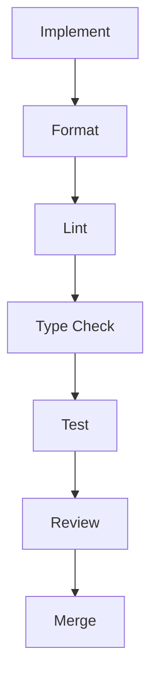
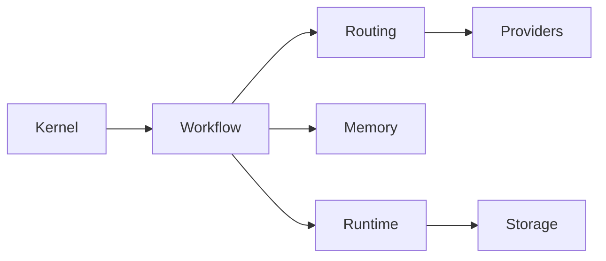

# Coding Standards

## Executive Summary

Hermes AIOS follows a consistent engineering style to maximize readability, maintainability, correctness, and long-term evolution. Every implementation should reflect the architectural principles established in earlier phases while remaining simple, testable, and modular.

These standards apply to all production code, tooling, tests, and examples.

---

# Objectives

The coding standards shall:

- Promote consistency
- Improve maintainability
- Encourage modular design
- Simplify code reviews
- Support static analysis
- Improve testability
- Reduce technical debt
- Enable automated quality checks
- Encourage explicit interfaces
- Preserve architectural boundaries

---

# Engineering Principles

- Readability first
- Explicit over implicit
- Composition over inheritance
- Dependency injection
- Small modules
- Pure functions where practical
- Immutable configuration
- Fail fast
- Secure defaults
- Test-driven mindset

---

# Project Structure

```
src/
├── api/
├── kernel/
├── workflow/
├── routing/
├── providers/
├── runtime/
├── memory/
├── policy/
├── scheduler/
├── storage/
├── observability/
├── plugins/
├── security/
└── shared/
```

Modules expose only stable public interfaces.

---

# Naming Conventions

## Modules

Use lowercase with underscores.

```
workflow_engine.py
provider_adapter.py
```

---

## Classes

Use PascalCase.

```
WorkflowEngine
CapabilityRouter
ProviderAdapter
```

---

## Functions

Use snake_case.

```
execute_workflow()

load_configuration()

resolve_provider()
```

---

## Constants

Use uppercase.

```
DEFAULT_TIMEOUT

MAX_RETRIES
```

---

## Private Members

Prefix with `_`.

```
_internal_cache

_validate_request()
```

---

# Type Hints

Every public function requires explicit type annotations.

Example:

```python
def execute(request: WorkflowRequest) -> WorkflowResult:
    ...
```

Avoid untyped interfaces in production code.

---

# Docstrings

Public APIs require docstrings.

Preferred style:

```python
def route(request: WorkflowRequest) -> WorkflowPlan:
    """
    Build an execution plan for the supplied request.
    """
```

Docstrings describe behavior rather than implementation.

---

# Imports

Import order:

1. Standard library
2. Third-party packages
3. Hermes modules

Example:

```python
import asyncio

from pydantic import BaseModel

from hermes.workflow import WorkflowEngine
```

Wildcard imports are prohibited.

---

# Error Handling

Preferred pattern:

```
Validate
   ↓
Execute
   ↓
Catch
   ↓
Normalize
   ↓
Log
   ↓
Return
```

Rules:

- Raise meaningful exceptions
- Avoid silent failures
- Preserve stack traces
- Never expose secrets
- Use structured error types

---

# Exception Hierarchy

```
HermesError
├── ConfigurationError
├── PolicyError
├── ProviderError
├── WorkflowError
├── MemoryError
├── ToolError
└── SecurityError
```

Subsystems should define specialized exceptions beneath these roots where appropriate.

---

# Logging Standards

Use structured logging.

Every log should include:

- Timestamp
- Component
- Severity
- Correlation ID
- Request ID
- Workflow ID (when available)

Never log:

- API keys
- Passwords
- Tokens
- Secret values
- Personally sensitive information without policy approval

---

# Asynchronous Programming

Use `asyncio` for asynchronous workflows.

Guidelines:

- Prefer async I/O over threads
- Avoid blocking calls
- Support cancellation
- Propagate timeouts
- Cleanly release resources

Background tasks should be explicitly supervised.

---

# Configuration Access

Configuration should:

- Be immutable at runtime unless explicitly reloadable
- Be validated through schemas
- Be injected rather than globally accessed

Magic constants should be avoided.

---

# Dependency Injection

Dependencies are passed through constructors or factories.

Example:

```python
router = CapabilityRouter(
    provider_registry,
    policy_engine,
)
```

Avoid hidden global singletons.

---

# State Management

Prefer immutable state.

Mutable shared state requires:

- Explicit ownership
- Synchronization where necessary
- Clear lifecycle management

---

# Testing Expectations

Each module should include:

- Unit tests
- Integration tests where applicable
- Failure-path tests
- Boundary-condition tests

New functionality should not reduce overall test quality.

---

# Code Complexity

Recommended limits:

- Function length: ~50 lines or fewer
- Class responsibility: single purpose
- Nesting depth: minimize
- Cyclomatic complexity: keep low and justify exceptions

Refactor rather than accumulate complexity.

---

# Security Practices

Developers shall:

- Validate external input
- Escape or sanitize where appropriate
- Use the Secret Manager
- Respect Policy Engine decisions
- Apply least privilege
- Avoid insecure defaults

Security-sensitive changes require review.

---

# Performance Guidelines

Optimize in this order:

1. Correctness
2. Readability
3. Measured performance

Profile before introducing optimization.

---

# Documentation

Every public module should include:

- Purpose
- Public interfaces
- Configuration
- Examples
- Limitations

Architecture documents remain the source of truth for design intent.

---

# Code Review Checklist

Reviewers verify:

- Architectural compliance
- Readability
- Correctness
- Test coverage
- Type safety
- Error handling
- Security implications
- Documentation updates
- Dependency impact

No code is merged without review.

---

# Static Analysis

Required checks:

```bash
ruff check .
ruff format --check .
basedpyright
pytest
```

CI blocks merges when mandatory checks fail.

---

# Mermaid Development Flow



---

# Mermaid Module Dependency



---

# Architecture Decisions

## Explicit Interfaces

Public APIs use typed contracts to improve reliability and simplify integration.

## Composition Over Inheritance

Components collaborate through well-defined interfaces rather than deep inheritance hierarchies.

## Structured Errors

A common exception hierarchy provides consistent error reporting across the platform.

## Deterministic Style

Uniform formatting, naming, and documentation reduce cognitive load and improve maintainability.

## Automated Enforcement

Formatting, linting, typing, and testing are mandatory quality gates rather than optional practices.

---

# Future Enhancements

- Automated architecture conformance checks
- Complexity budget reporting
- API compatibility validation
- Continuous documentation linting
- Security rule enforcement
- Performance regression detection
- Mutation testing
- AI-assisted code review

---

# Cross References

Previous:

- `docs/development/08_1_DEVELOPMENT_ENVIRONMENT.md`

Next:

- `docs/development/08_3_BUILD_SYSTEM.md`
