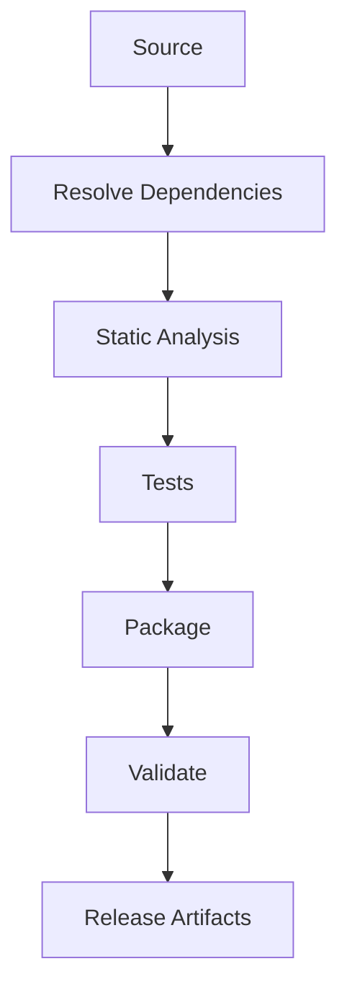
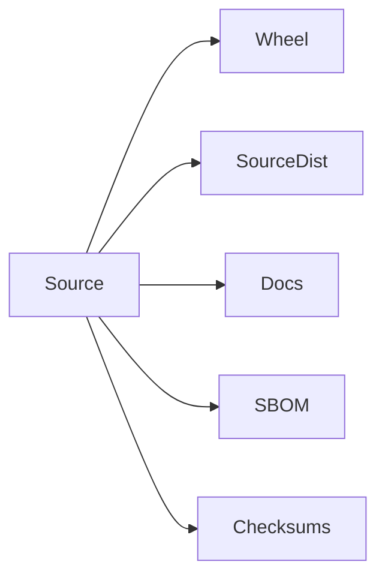

# Build System

## Executive Summary

The Hermes AIOS Build System ensures every build is reproducible, deterministic, verifiable, and suitable for local development, automated testing, and production release. It standardizes project packaging, dependency management, artifact creation, versioning, and build validation.

The build process is platform-independent wherever practical and integrates directly with the CI/CD pipeline.

---

# Objectives

The build system shall:

- Produce reproducible builds
- Support deterministic dependency resolution
- Generate versioned artifacts
- Validate package integrity
- Support local and CI builds
- Minimize build complexity
- Enable automated releases
- Verify build outputs
- Support plugin packaging
- Integrate with quality gates

---

# Design Principles

- Build once, deploy many
- Configuration over scripting
- Reproducibility first
- Immutable artifacts
- Declarative configuration
- Minimal manual steps
- Version everything
- Continuous verification

---

# Build Architecture

```
Source Code
     │
     ▼
Dependency Resolution
     │
     ▼
Static Analysis
     │
     ▼
Unit Tests
     │
     ▼
Package Build
     │
     ▼
Artifact Validation
     │
     ▼
Release Package
```

Each stage must complete successfully before the next begins.

---

# Build Configuration

Primary configuration files:

```
pyproject.toml
uv.lock
ruff.toml
pyrightconfig.json
pytest.ini
```

Optional project-specific configuration:

```
configs/build.toml
```

---

# Project Packaging

The primary package format is:

```
Python Wheel (.whl)
```

Additional deliverables may include:

- Source distribution (`sdist`)
- Plugin packages
- Documentation bundle
- Container images
- Release archives

---

# Dependency Resolution

Dependencies are managed with:

- `uv`
- Locked versions
- Hash validation
- Explicit version constraints

Rules:

- No floating production dependencies
- Lockfile committed
- Transitive dependencies reviewed

---

# Build Profiles

Supported profiles:

| Profile | Purpose |
|----------|---------|
| Development | Local iteration |
| Testing | Automated validation |
| Release | Production artifacts |
| Debug | Diagnostics |
| Benchmark | Performance evaluation |

Profiles alter configuration, not application behavior.

---

# Versioning Strategy

Hermes AIOS follows Semantic Versioning.

Format:

```
MAJOR.MINOR.PATCH
```

Examples:

```
1.0.0
1.2.3
2.0.0
```

Pre-release identifiers:

```
-alpha
-beta
-rc
```

Build metadata may be appended where required.

---

# Artifact Generation

Primary artifacts:

- Python wheel
- Source archive
- Plugin bundles
- Documentation package
- SBOM
- Checksums

Each artifact is versioned and immutable after publication.

---

# Build Validation

Validation includes:

- Dependency verification
- Type checking
- Linting
- Unit testing
- Integration testing (release profile)
- Package inspection
- Checksum generation

Release artifacts are rejected if validation fails.

---

# Reproducible Builds

Requirements:

- Locked dependencies
- Stable build environment
- Deterministic timestamps where supported
- Explicit build configuration
- Version-controlled tooling

Two builds from identical inputs should produce functionally equivalent artifacts.

---

# Plugin Packaging

Plugin bundles contain:

```text
plugin/
├── manifest.yaml
├── package.whl
├── LICENSE
├── README.md
├── SBOM.json
└── checksums.txt
```

Plugin packages are independently versioned.

---

# Release Packaging

Release archive example:

```text
hermes-aios-1.0.0/
├── wheel/
├── docs/
├── plugins/
├── sbom/
├── checksums/
└── release-notes.md
```

Release archives are generated automatically.

---

# Build Metadata

Each build records:

```yaml
version:
commit:
branch:
build_profile:
python_version:
build_time:
tool_versions:
```

Metadata accompanies every published artifact.

---

# Build Security

Build pipeline requirements:

- Verify dependency hashes
- Validate signatures where available
- Generate SBOM
- Scan dependencies
- Protect secrets
- Isolate build environment

Build systems never embed credentials in artifacts.

---

# Failure Handling

Failure categories:

- Dependency resolution
- Compilation
- Packaging
- Validation
- Artifact corruption
- Version conflict

Recovery actions:

- Abort build
- Report structured errors
- Preserve diagnostic logs
- Prevent publication

---

# Observability

Metrics include:

- Build duration
- Cache utilization
- Artifact size
- Dependency resolution time
- Test duration
- Validation failures
- Packaging failures

Metrics integrate with the Observability subsystem.

---

# Mermaid Build Pipeline



---

# Mermaid Artifact Structure



---

# Architecture Decisions

## Reproducible Build Strategy

Build reproducibility is prioritized through locked dependencies, deterministic configuration, and version-controlled tooling.

## Immutable Artifacts

Published artifacts are never modified after release, ensuring traceability and integrity.

## Profile-Based Builds

Different build profiles optimize workflows without changing runtime behavior.

## Integrated Validation

Packaging is inseparable from validation; artifacts that fail quality gates are never published.

## Supply-Chain Awareness

SBOM generation and dependency verification are first-class build outputs, improving transparency and security.

---

# Future Enhancements

- Reproducible container image generation
- Binary reproducibility verification
- Distributed build cache
- Incremental build optimization
- Build provenance attestations
- Sigstore artifact signing
- Automated dependency update validation
- Cross-platform reproducibility testing

---

# Cross References

Previous:

- `docs/development/08_2_CODING_STANDARDS.md`

Next:

- `docs/development/08_4_DEPENDENCY_MANAGEMENT.md`
