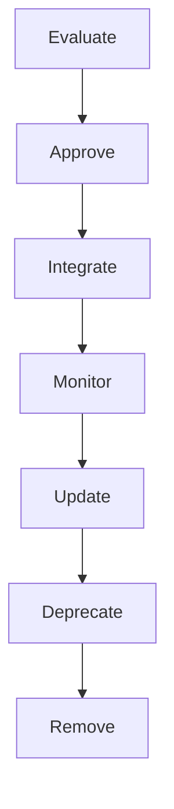

# Dependency Management

## Executive Summary

Hermes AIOS relies on a carefully curated set of external libraries to accelerate development while minimizing operational and security risk. Every dependency is treated as a managed asset with an explicit lifecycle, architectural justification, ownership, and review process.

Dependencies are selected to maximize stability, maintainability, and long-term sustainability rather than feature count.

---

# Objectives

The dependency management process shall:

- Minimize dependency count
- Ensure reproducible builds
- Prevent supply-chain attacks
- Track dependency ownership
- Support automated updates
- Detect vulnerabilities
- Maintain license compliance
- Document architectural rationale
- Enable deterministic upgrades
- Simplify long-term maintenance

---

# Design Principles

- Prefer standard library
- Minimize external dependencies
- Prefer mature projects
- Pin production versions
- Automate verification
- Document justification
- Review regularly
- Remove unused packages

---

# Dependency Categories

Dependencies are classified into:

| Category | Examples |
|----------|----------|
| Runtime | FastAPI, Pydantic |
| AI Runtime | Ollama client, OpenAI-compatible SDK |
| Storage | SQLite libraries, ChromaDB |
| Security | Cryptography libraries |
| Testing | Pytest |
| Development | Ruff, BasedPyright |
| Documentation | MkDocs (future) |
| Build | Hatchling or equivalent backend |

Each dependency belongs to exactly one primary category.

---

# Selection Criteria

New dependencies should satisfy:

- Active maintenance
- Stable release history
- Clear documentation
- Compatible license
- Strong community adoption
- Minimal transitive dependencies
- Security responsiveness
- Architectural alignment

Experimental libraries require explicit approval.

---

# Approval Workflow

```
Proposal
    │
Architecture Review
    │
Security Review
    │
License Review
    │
Technical Evaluation
    │
Approval
    │
Implementation
```

No production dependency is added without documented justification.

---

# Version Strategy

Production dependencies use pinned versions.

Example:

```toml
fastapi ==0.116.0
pydantic ==2.11.0
```

Rules:

- Avoid floating versions
- Lock transitive dependencies
- Record version changes
- Test upgrades before merge

---

# Lockfile Governance

The `uv.lock` file is the authoritative dependency manifest.

Requirements:

- Commit all lockfile updates
- Regenerate after dependency changes
- Review lockfile diffs
- Keep lockfile synchronized with `pyproject.toml`

Manual edits are prohibited.

---

# Dependency Lifecycle

```
Evaluate
    │
Approve
    │
Integrate
    │
Monitor
    │
Update
    │
Deprecate
    │
Remove
```

Each phase is documented and auditable.

---

# Security Management

Dependencies are monitored for:

- Known vulnerabilities
- Malicious packages
- Abandoned maintenance
- Compromised publishers
- Breaking security advisories

Critical vulnerabilities trigger expedited review and remediation.

---

# License Compliance

Accepted licenses include:

- MIT
- Apache-2.0
- BSD variants

Restricted or incompatible licenses require legal and architectural review.

License metadata is retained in the SBOM.

---

# SBOM Integration

Each release generates an SBOM containing:

- Direct dependencies
- Transitive dependencies
- Versions
- Licenses
- Checksums
- Source locations

SBOM generation is mandatory for release builds.

---

# Update Policy

Update priorities:

| Priority | Trigger |
|----------|---------|
| Critical | Security vulnerability |
| High | Breaking upstream fix |
| Medium | Feature improvements |
| Low | Routine maintenance |

Updates are tested before release.

---

# Deprecation Policy

A dependency may be deprecated due to:

- Project abandonment
- Security issues
- License changes
- Better alternatives
- Architectural simplification

Deprecation plans include migration guidance and removal timelines.

---

# Transitive Dependencies

Transitive packages are reviewed for:

- Security posture
- License compatibility
- Maintenance activity
- Size and complexity
- Redundancy

Where practical, unnecessary transitive dependencies should be eliminated.

---

# Internal vs External Libraries

Preference order:

1. Python standard library
2. Existing Hermes modules
3. Mature external library
4. New dependency

Avoid introducing dependencies that duplicate existing functionality.

---

# Dependency Ownership

Each production dependency has:

```yaml
package:
owner:
purpose:
approval_date:
review_cycle:
replacement_plan:
```

Ownership ensures ongoing maintenance responsibility.

---

# Automation

Automated checks include:

- Version validation
- Vulnerability scanning
- License detection
- SBOM generation
- Lockfile verification
- Duplicate dependency detection

Automation complements, but does not replace, architectural review.

---

# Failure Handling

Failure scenarios:

- Missing dependency
- Version conflict
- Vulnerability detected
- License incompatibility
- Lockfile mismatch

Recovery actions:

- Abort build
- Restore previous lockfile
- Escalate for review
- Document remediation
- Re-run validation

---

# Observability

Metrics include:

- Total dependency count
- Direct vs transitive ratio
- Average update age
- Vulnerability count
- License distribution
- Update frequency
- Build reproducibility score

These metrics integrate with the Observability subsystem.

---

# Mermaid Dependency Lifecycle



---

# Mermaid Approval Workflow


---

# Architecture Decisions

## Minimal Dependency Philosophy

Hermes AIOS minimizes external libraries to reduce attack surface, simplify maintenance, and improve long-term stability.

## Pinned Production Dependencies

Exact version pinning and lockfiles ensure deterministic builds and reproducible environments.

## Security-First Governance

Every dependency is continuously monitored for vulnerabilities, publisher trust, and maintenance status.

## Architecture Approval

Introducing a new dependency is considered an architectural change and requires documented review.

## Complete Supply-Chain Visibility

SBOM generation and dependency ownership provide traceability throughout the software lifecycle.

---

# Future Enhancements

- Automated dependency freshness dashboard
- AI-assisted dependency risk scoring
- Continuous CVE monitoring
- Trusted package registry mirrors
- Binary provenance verification
- Dependency health scoring
- Automated migration recommendations
- Organization-wide dependency catalog

---

# Cross References

Previous:

- `docs/development/08_3_BUILD_SYSTEM.md`

Next:

- `docs/development/08_5_TESTING_FRAMEWORK.md`
