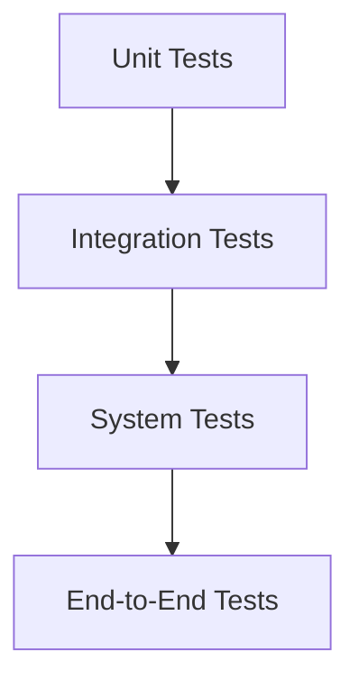
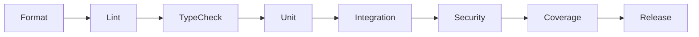

# Testing Framework

## Executive Summary

Testing is a first-class engineering activity in Hermes AIOS. Every architectural component, workflow, provider adapter, policy rule, and plugin is validated through automated testing before integration.

The testing framework emphasizes deterministic, repeatable, and isolated tests while supporting AI-specific evaluation techniques for probabilistic systems.

---

# Objectives

The testing framework shall:

- Validate functional correctness
- Detect regressions
- Verify architectural contracts
- Measure quality
- Support deterministic execution
- Enable rapid feedback
- Test AI-specific behavior
- Verify security requirements
- Support continuous integration
- Minimize production defects

---

# Design Principles

- Test early
- Test automatically
- Test in isolation
- Prefer deterministic inputs
- Mock external systems
- Validate architecture
- Measure coverage
- Keep tests maintainable

---

# Testing Pyramid

```
          End-to-End
        ───────────────
           System
      ──────────────────
         Integration
   ───────────────────────
            Unit
────────────────────────────
```

The majority of tests should be unit tests.

---

# Test Categories

## Unit Tests

Validate:

- Pure functions
- Business logic
- Utilities
- Models
- Validation rules

Characteristics:

- Fast
- Isolated
- Deterministic
- No external dependencies

---

## Integration Tests

Validate interactions between:

- Workflow Engine ↔ Router
- Router ↔ Providers
- Policy ↔ Runtime
- Memory ↔ Storage
- Scheduler ↔ Workflow Engine
- Plugin Framework ↔ Runtime

External services should be mocked unless explicitly under test.

---

## System Tests

System tests validate Hermes AIOS as an integrated application.

Examples:

- Complete workflow execution
- Provider failover
- Memory persistence
- Plugin lifecycle
- Recovery after failure

---

## End-to-End Tests

End-to-end tests validate user-visible behavior.

Example scenarios:

- User submits request
- Workflow generated
- Models selected
- Tools executed
- Memory updated
- Response returned

---

# AI-Specific Testing

Because LLM outputs are probabilistic, evaluation includes:

- Structured output validation
- Schema conformance
- Policy compliance
- Capability selection correctness
- Workflow generation quality
- Hallucination guardrails
- Response completeness

Golden datasets should be maintained for regression testing.

---

# Provider Testing

Provider adapters shall support:

- Mock responses
- Timeout simulation
- Rate-limit simulation
- Invalid response testing
- Retry verification
- Failover validation

Cloud providers are not required for routine automated tests.

---

# Tool Runtime Testing

Validate:

- Tool registration
- Permission enforcement
- Sandboxing
- Timeouts
- Resource limits
- Failure recovery

Dangerous operations are simulated rather than executed.

---

# Memory Testing

Verify:

- Retrieval accuracy
- Persistence
- Embedding generation
- Index updates
- Context assembly
- Retention policies

Test data should be deterministic.

---

# Security Testing

Security tests include:

- Authentication
- Authorization
- Secret access
- Input validation
- Plugin isolation
- Data protection
- Audit generation

Security regressions block releases.

---

# Performance Testing

Measure:

- Workflow latency
- Routing latency
- Memory retrieval time
- Tool execution time
- Provider selection time
- Startup time

Performance thresholds are version controlled.

---

# Load Testing

Representative workloads include:

- Concurrent workflows
- Parallel provider requests
- Large memory stores
- Multiple plugin execution
- Event bus throughput

Stress tests should identify graceful degradation behavior.

---

# Regression Testing

Every resolved defect receives:

- Reproduction test
- Automated regression test
- Documentation update (if applicable)

Regression suites execute before release.

---

# Test Data Management

Rules:

- Synthetic datasets only
- No production secrets
- Version-controlled fixtures
- Deterministic sample workflows
- Stable provider mocks

Test fixtures should be reusable across modules.

---

# Coverage Requirements

Minimum expectations:

| Category | Target |
|----------|--------|
| Unit | ≥90% |
| Integration | Critical paths |
| System | Core workflows |
| End-to-End | Representative scenarios |

Coverage metrics inform review but do not replace quality assessment.

---

# Continuous Testing

Every pull request executes:

```
Format
   │
Lint
   │
Type Check
   │
Unit Tests
   │
Integration Tests
   │
Security Tests
   │
Coverage Report
```

Failures block merging.

---

# Failure Handling

Failure categories:

- Test failure
- Environment failure
- Mock configuration error
- Timeout
- Coverage regression

Responses:

- Stop pipeline
- Preserve artifacts
- Publish diagnostics
- Notify maintainers

---

# Observability

Metrics include:

- Test duration
- Pass/fail rate
- Flaky test count
- Coverage percentage
- Performance regression count
- Security test failures

Metrics integrate with the Observability subsystem.

---

# Mermaid Testing Pyramid



---

# Mermaid CI Test Flow



---

# Architecture Decisions

## Automated-by-Default

All practical tests execute automatically within the CI pipeline to reduce manual effort and improve consistency.

## Deterministic Test Design

Tests use controlled inputs, stable fixtures, and mocked dependencies wherever feasible to ensure repeatable results.

## AI-Aware Validation

LLM behavior is validated through schemas, policy conformance, capability selection, and benchmark datasets rather than exact text matching.

## Layered Verification

The testing pyramid balances rapid feedback from unit tests with confidence provided by higher-level integration and end-to-end scenarios.

## Security and Performance as Quality Gates

Security regressions and defined performance regressions are treated as release-blocking defects.

---

# Future Enhancements

- AI benchmark dashboards
- Mutation testing
- Chaos engineering
- Property-based testing
- Continuous performance benchmarking
- Differential testing across model providers
- Automated prompt regression analysis
- Architecture conformance test suite

---

# Cross References

Previous:

- `docs/development/08_4_DEPENDENCY_MANAGEMENT.md`

Next:

- `docs/development/08_6_CI_CD_PIPELINE.md`
