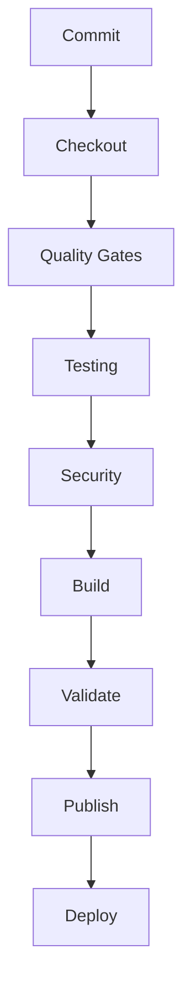
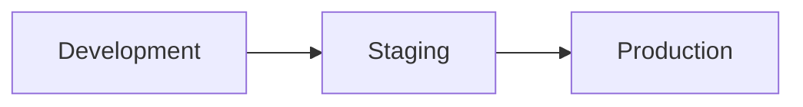

# CI/CD Pipeline

## Executive Summary

Hermes AIOS adopts an automation-first delivery model. Every code change is validated through an immutable CI/CD pipeline that enforces formatting, static analysis, testing, security scanning, artifact verification, and release policies before deployment.

The pipeline is deterministic, reproducible, and aligned with the architecture, security, and development standards defined in previous phases.

---

# Objectives

The CI/CD pipeline shall:

- Automate quality verification
- Prevent defective releases
- Produce reproducible artifacts
- Enforce security controls
- Support progressive delivery
- Enable rapid feedback
- Reduce manual release work
- Preserve auditability
- Support rollback
- Remain platform-independent

---

# Design Principles

- Pipeline as Code
- Fail Fast
- Immutable Artifacts
- Automated Verification
- Least Privilege
- Reproducible Builds
- Security by Default
- Continuous Feedback

---

# Pipeline Overview

```
Developer Commit
        │
        ▼
Source Checkout
        │
        ▼
Dependency Resolution
        │
        ▼
Formatting
        │
        ▼
Linting
        │
        ▼
Type Checking
        │
        ▼
Unit Tests
        │
        ▼
Integration Tests
        │
        ▼
Security Scans
        │
        ▼
Package Build
        │
        ▼
Artifact Validation
        │
        ▼
Publish Artifacts
        │
        ▼
Deployment Promotion
```

---

# Pipeline Triggers

Supported triggers:

- Pull request
- Push to protected branches
- Release tag
- Manual workflow dispatch
- Scheduled maintenance workflows

Each trigger executes an appropriate subset of pipeline stages.

---

# Build Stages

## Stage 1 – Source Validation

Tasks:

- Checkout repository
- Validate branch policy
- Verify commit metadata
- Restore build cache

Failure blocks pipeline execution.

---

## Stage 2 – Quality Gates

Execute:

```text
ruff format --check
ruff check
basedpyright
```

Quality gates must succeed before testing begins.

---

## Stage 3 – Automated Testing

Execute:

- Unit tests
- Integration tests
- System tests (release builds)
- Regression suites

Coverage reports are generated for every run.

---

## Stage 4 – Security Validation

Checks include:

- Dependency vulnerability scan
- Secret detection
- License verification
- SBOM generation
- Plugin verification
- Configuration validation

Critical findings block releases.

---

## Stage 5 – Packaging

Generate:

- Python wheel
- Source distribution
- Documentation bundle
- Plugin artifacts
- Checksums

Artifacts are immutable after publication.

---

## Stage 6 – Artifact Validation

Verify:

- Checksums
- Package integrity
- Metadata
- Version consistency
- Reproducibility indicators

Only validated artifacts are promoted.

---

## Stage 7 – Publication

Publish to:

- Internal artifact repository
- Release storage
- Documentation site
- Plugin registry (future)

Publication occurs only from approved release workflows.

---

# Deployment Environments

| Environment | Purpose |
|-------------|---------|
| Development | Daily integration |
| Staging | Pre-release validation |
| Production | Official releases |

Promotion between environments is explicit and auditable.

---

# Branch Protection

Protected branches require:

- Successful pipeline
- Required reviews
- No unresolved security findings
- Up-to-date branch
- Signed commits (recommended)

Direct commits to `main` are prohibited.

---

# Secrets in CI

CI secrets:

- Stored in platform secret management
- Never echoed in logs
- Scoped to minimum permissions
- Rotated regularly
- Audited on access

Secrets are unavailable to untrusted pull requests.

---

# Build Caching

Cacheable assets:

- Python packages
- Virtual environments
- Static analysis caches
- Test caches

Caches are keyed by dependency lockfile and tool versions.

---

# Rollback Strategy

Rollback uses immutable artifacts.

Workflow:

```
Identify Release
      │
Retrieve Artifact
      │
Validate Integrity
      │
Redeploy
      │
Verify Health
```

Rollback artifacts must pass integrity validation before redeployment.

---

# Failure Handling

Failure categories:

- Build failure
- Test failure
- Security failure
- Packaging failure
- Publication failure
- Deployment failure

Responses:

- Stop pipeline
- Preserve logs
- Publish diagnostics
- Notify maintainers
- Prevent promotion

---

# Observability

Metrics include:

- Pipeline duration
- Queue time
- Stage duration
- Build success rate
- Deployment frequency
- Mean Time to Recovery (MTTR)
- Failed quality gates
- Security scan results

Metrics integrate with the Observability subsystem.

---

# Mermaid Pipeline Flow



---

# Mermaid Environment Promotion



---

# Architecture Decisions

## Pipeline as Code

All CI/CD logic is version-controlled alongside application code, ensuring reproducibility and peer review.

## Immutable Artifacts

Artifacts are built once, validated once, and promoted unchanged through all environments.

## Security Integrated Throughout

Security validation occurs during every pipeline execution rather than as a separate release activity.

## Progressive Promotion

Releases advance through increasingly stable environments using explicit promotion gates.

## Fast Feedback

Formatting, linting, and type checking execute before longer-running tests to minimize developer feedback time.

---

# Future Enhancements

- Multi-platform build matrix
- Performance regression gates
- Automatic deployment verification
- Canary release support
- Blue/green deployment workflows
- Artifact signing with Sigstore
- Provenance attestations (SLSA)
- AI-assisted pipeline diagnostics

---

# Cross References

Previous:

- `docs/development/08_5_TESTING_FRAMEWORK.md`

Next:

- `docs/development/08_7_RELEASE_ENGINEERING.md`
