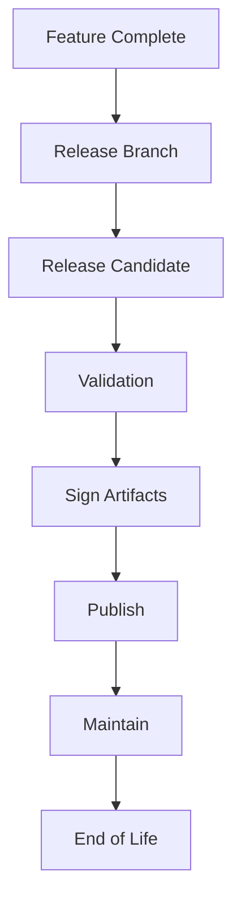
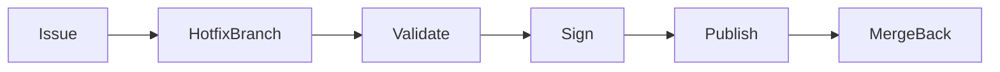

# Release Engineering

## Executive Summary

Release Engineering provides the operational framework for transforming validated source code into officially supported Hermes AIOS releases. It standardizes versioning, release branching, artifact signing, validation, publication, maintenance, and retirement while ensuring traceability from source commit to distributed artifact.

---

# Objectives

The release engineering process shall:

- Produce reliable releases
- Maintain semantic versioning
- Preserve build reproducibility
- Sign release artifacts
- Generate release documentation
- Support hotfixes
- Define maintenance policies
- Enable rollback
- Maintain traceability
- Support long-term stability

---

# Design Principles

- Release from immutable artifacts
- Build once, deploy many
- Reproducible releases
- Automated validation
- Explicit approval
- Complete traceability
- Security-first publishing
- Documentation accompanies every release

---

# Release Lifecycle

```
Feature Complete
       │
Release Branch
       │
Release Candidate
       │
Validation
       │
Artifact Signing
       │
Publication
       │
Maintenance
       │
End of Life
```

---

# Versioning Strategy

Hermes AIOS follows Semantic Versioning.

Format:

```
MAJOR.MINOR.PATCH
```

Examples:

```
1.0.0
1.1.0
1.1.1
2.0.0
```

Pre-release identifiers:

```
-alpha
-beta
-rc
```

---

# Release Branches

Repository branches:

```
main
develop
release/*
hotfix/*
feature/*
```

Rules:

- `main` always reflects the latest stable release.
- `develop` receives integrated feature work.
- `release/*` branches stabilize upcoming versions.
- `hotfix/*` branches address production issues.

---

# Release Candidate Process

Release candidate workflow:

```
Create Release Branch
        │
Freeze Features
        │
Execute Full Test Suite
        │
Security Review
        │
Performance Validation
        │
Documentation Review
        │
Generate RC
```

Only release candidates passing all gates proceed to publication.

---

# Release Validation

Mandatory validation includes:

- All CI checks pass
- No critical security findings
- Test coverage meets targets
- Documentation updated
- Build reproducibility verified
- SBOM generated
- Artifact integrity verified

Validation evidence is retained with the release.

---

# Artifact Signing

Release artifacts should include:

- Cryptographic signatures
- Checksums
- SBOM
- Build metadata

Signing keys are managed through the Secret Manager and never embedded in build scripts.

---

# Release Package

Typical release contents:

```text
hermes-aios-<version>/
├── wheel/
├── source/
├── docs/
├── plugins/
├── sbom/
├── checksums/
├── signatures/
├── release-notes.md
└── build-metadata.yaml
```

---

# Changelog Generation

Every release includes:

- New features
- Bug fixes
- Breaking changes
- Security fixes
- Dependency updates
- Migration notes

Changelogs are generated from reviewed commit history and release notes.

---

# Publication

Official publication targets may include:

- GitHub Releases
- Python package index (when applicable)
- Documentation site
- Plugin registry (future)

Publication occurs only after successful validation and signing.

---

# Hotfix Workflow

Hotfix process:

```
Identify Issue
      │
Create Hotfix Branch
      │
Implement Fix
      │
Run Validation
      │
Sign Artifacts
      │
Publish Patch Release
      │
Merge Back to Main and Develop
```

Hotfixes receive the same quality and security validation as standard releases.

---

# Long-Term Support (LTS)

LTS releases:

- Receive security updates
- Receive critical bug fixes
- Maintain compatibility guarantees
- Exclude non-essential feature additions

Support duration is defined by project governance.

---

# End-of-Life Policy

A release may reach end-of-life due to:

- Successor LTS availability
- Unsupported dependencies
- Security limitations
- Platform deprecation

End-of-life announcements include migration guidance.

---

# Rollback Strategy

Rollback procedure:

```
Identify Previous Stable Release
        │
Verify Artifact Integrity
        │
Redeploy Signed Artifact
        │
Validate Health
```

Rollback artifacts must originate from official releases.

---

# Traceability

Each release links:

- Git commit
- Build metadata
- SBOM
- Checksums
- Signatures
- Release notes
- Documentation version

This enables complete lifecycle traceability.

---

# Failure Handling

Failure categories:

- Validation failure
- Signing failure
- Publication failure
- Documentation mismatch
- Integrity verification failure

Responses:

- Abort release
- Preserve diagnostics
- Notify maintainers
- Retain release candidate
- Prevent publication

---

# Observability

Metrics include:

- Release frequency
- Lead time for changes
- Deployment success rate
- Rollback count
- Hotfix frequency
- Artifact verification failures
- Mean time to recovery

These metrics integrate with the Observability subsystem.

---

# Mermaid Release Lifecycle



---

# Mermaid Hotfix Flow



---

# Architecture Decisions

## Immutable Release Artifacts

Release artifacts are built once, signed, validated, and promoted without modification.

## Security-Centric Publishing

Artifact signing, SBOM generation, and integrity verification are mandatory before publication.

## Release Traceability

Every distributed artifact can be traced back to the originating source commit and build metadata.

## Structured Maintenance

Standard, hotfix, and LTS releases follow documented lifecycle policies to reduce operational risk.

## Documentation as a Release Artifact

Release notes and updated architecture documentation are treated as required deliverables rather than optional additions.

---

# Future Enhancements

- Sigstore integration
- SLSA provenance attestations
- Automated release notes generation
- Multi-platform binary releases
- Canary release channels
- Progressive rollout automation
- Release health dashboards
- AI-assisted release readiness analysis

---

# Cross References

Previous:

- `docs/development/08_6_CI_CD_PIPELINE.md`

Next:

- `docs/development/08_8_CONTRIBUTOR_HANDBOOK.md`
