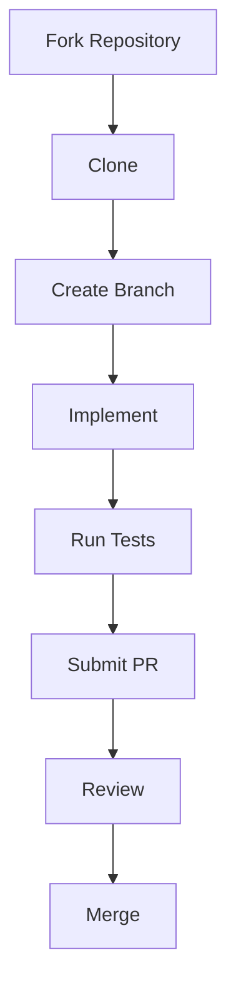
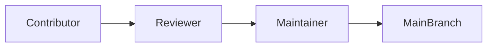

# Contributor Handbook

## Executive Summary

Hermes AIOS is designed as a long-lived, modular open-source project. This handbook defines how contributors participate in the project while preserving architectural consistency, code quality, security, and maintainability.

Every contribution—documentation, code, tests, infrastructure, or design—is expected to follow the standards established throughout Phases 1–6.

---

# Objectives

The contributor process shall:

- Provide a consistent onboarding experience
- Preserve architectural integrity
- Encourage small, reviewable changes
- Maintain documentation quality
- Promote respectful collaboration
- Support transparent decision making
- Enforce quality gates
- Simplify long-term maintenance
- Protect project security
- Enable sustainable community growth

---

# Core Principles

- Architecture First
- Documentation as Code
- Security by Default
- Small Incremental Changes
- Test Before Merge
- Respect Stable Interfaces
- Open Collaboration
- Constructive Review

---

# Contributor Journey

```
Fork Repository
      │
Clone
      │
Setup Development Environment
      │
Select Issue
      │
Create Branch
      │
Implement
      │
Run Quality Checks
      │
Submit Pull Request
      │
Review
      │
Merge
```

---

# Onboarding Checklist

New contributors should:

- Read the architecture documentation
- Read the Development Guide
- Configure the local development environment
- Execute the complete test suite
- Review coding standards
- Understand security policies
- Build the project successfully
- Review open issues before beginning work

---

# Branch Naming

Use descriptive prefixes:

```
feature/
fix/
docs/
refactor/
test/
security/
ci/
```

Examples:

```
feature/capability-router
docs/workflow-engine
fix/provider-timeout
```

---

# Commit Standards

Follow Conventional Commits.

Examples:

```
feat(memory): add retrieval cache

fix(policy): correct authorization evaluation

docs(kernel): update lifecycle documentation

test(runtime): add sandbox tests
```

Commits should be focused on a single logical change.

---

# Pull Request Requirements

Each pull request should include:

- Problem statement
- Solution summary
- Test results
- Documentation updates
- Breaking change notice (if applicable)
- Related issue references

Large changes should be split into multiple pull requests where practical.

---

# Review Guidelines

Reviewers verify:

- Architectural compliance
- Code readability
- Test coverage
- Security implications
- Documentation updates
- Dependency impact
- Performance considerations
- Backward compatibility

Reviews should focus on technical improvements rather than personal preferences.

---

# Documentation Contributions

Documentation updates are required when changing:

- Public APIs
- Configuration
- Architecture
- Workflows
- Build process
- Security behavior
- User-visible functionality

Documentation should be merged with the corresponding implementation whenever feasible.

---

# Issue Management

Issue categories:

- Bug
- Feature
- Documentation
- Security
- Performance
- Refactoring
- Question

Each issue should include:

- Description
- Expected behavior
- Current behavior
- Reproduction steps
- Environment
- Labels
- Priority

---

# Architecture Governance

Changes affecting architecture require:

- Architecture rationale
- Impact assessment
- Compatibility analysis
- Documentation updates
- Review by project maintainers

Architectural decisions should remain aligned with the approved Hermes AIOS blueprint.

---

# Security Contributions

Security-related changes require:

- Threat assessment
- Security testing
- Policy review
- Documentation updates
- Responsible disclosure where appropriate

Security vulnerabilities should not be disclosed publicly until remediation is available.

---

# Testing Expectations

Before submitting:

```bash
ruff format --check .
ruff check .
basedpyright
pytest
```

All required quality gates must pass.

---

# Communication

Preferred communication characteristics:

- Respectful
- Technical
- Evidence-based
- Solution-oriented
- Transparent

Design discussions should reference documented architecture where applicable.

---

# Decision Making

Technical decisions prioritize:

1. Architecture consistency
2. Security
3. Maintainability
4. Correctness
5. Performance
6. Developer convenience

---

# Recognition

Contributions include:

- Code
- Documentation
- Testing
- Design
- Security
- Performance
- Community support

All meaningful contributions are acknowledged through project history and release notes where appropriate.

---

# Code of Conduct

Participants are expected to:

- Treat others respectfully
- Welcome constructive feedback
- Avoid harassment
- Resolve disagreements professionally
- Focus discussions on technical merit

The project should maintain a separate CODE_OF_CONDUCT.md.

---

# Governance

Project roles may include:

| Role | Responsibilities |
|------|------------------|
| Maintainer | Project direction, releases |
| Reviewer | Technical review |
| Contributor | Implementation and documentation |
| Security Reviewer | Security assessment |

Responsibilities are assigned according to project governance.

---

# Observability

Project health metrics include:

- Active contributors
- Pull request cycle time
- Review turnaround
- Merge success rate
- Documentation coverage
- Test pass rate
- Release frequency

These metrics support continuous process improvement.

---

# Mermaid Contribution Workflow



---

# Mermaid Governance Flow



---

# Architecture Decisions

## Documentation-Driven Collaboration

Contributors update architecture and implementation documentation alongside code changes to keep the repository as the authoritative source of truth.

## Small Incremental Changes

Small pull requests simplify review, reduce merge conflicts, and improve release quality.

## Architecture Preservation

Major design changes require documented rationale and architectural review before implementation.

## Automated Quality Enforcement

All contributions must satisfy formatting, linting, typing, testing, and security requirements before merge.

## Transparent Governance

Technical decisions, reviews, and releases are documented to preserve project history and institutional knowledge.

---

# Future Enhancements

- Contributor mentoring program
- Automated onboarding validation
- Architecture decision record (ADR) templates
- Community roadmap voting
- Contributor analytics dashboard
- Automated documentation coverage checks
- AI-assisted pull request review
- Contributor certification workflow

---

# Cross References

Previous:

- `docs/development/08_7_RELEASE_ENGINEERING.md`

Next:

- `docs/implementation/09_IMPLEMENTATION_ROADMAP.md`
