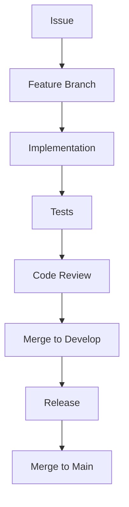
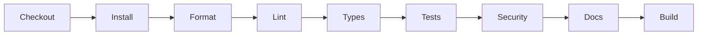

# Development Guide

## Executive Summary

The Development Guide defines the engineering practices used to build Hermes AIOS. Every implementation should be reproducible, modular, testable, observable, and aligned with the architecture defined in previous phases.

Architecture documents describe *what* Hermes AIOS is. This guide defines *how* Hermes AIOS is built.

---

# Objectives

The development process shall:

- Maintain architectural consistency
- Encourage modular implementation
- Support incremental delivery
- Enforce coding standards
- Promote automated testing
- Enable reproducible builds
- Minimize technical debt
- Support open-source collaboration
- Simplify onboarding
- Maintain documentation quality

---

# Engineering Principles

- Architecture First
- Code Second
- Test Everything
- Small Pull Requests
- Fail Fast
- Automate Repetitive Tasks
- Documentation as Code
- Configuration over Hardcoding
- Keep Components Loosely Coupled
- Security by Default

---

# Repository Structure

```
docs/
src/
tests/
scripts/
configs/
plugins/
examples/
tools/
assets/
.github/
```

Each top-level directory has a single, well-defined responsibility.

---

# Source Layout

```
src/
├── kernel/
├── workflow/
├── routing/
├── policy/
├── providers/
├── memory/
├── runtime/
├── scheduler/
├── plugins/
├── observability/
├── storage/
├── security/
├── api/
└── shared/
```

Cross-module dependencies should flow inward toward stable abstractions.

---

# Dependency Rules

Allowed:

```
Kernel
  ↓
Workflow
  ↓
Capability Router
  ↓
Providers / Tools
```

Not allowed:

- Circular dependencies
- Direct provider coupling
- Direct database access outside storage services
- Hidden runtime dependencies

---

# Technology Stack

Core recommendations:

| Layer | Technology |
|--------|------------|
| Language | Python 3.13+ |
| Package Manager | uv |
| Virtual Environment | uv venv |
| Formatting | Ruff |
| Linting | Ruff |
| Type Checking | BasedPyright |
| Testing | Pytest |
| Async Runtime | asyncio |
| API | FastAPI |
| Configuration | Pydantic Settings |
| Local Database | SQLite |
| Vector Store | ChromaDB |
| Local Models | Ollama |
| Cloud Gateway | OpenRouter-compatible adapters |

Implementation details remain configuration-driven where practical.

---

# Branch Strategy

```
main
│
├── develop
│
├── feature/*
│
├── fix/*
│
└── release/*
```

Rules:

- `main` is always releasable.
- Feature work is isolated.
- Releases are tagged.

---

# Commit Convention

```
feat:
fix:
docs:
test:
refactor:
perf:
build:
ci:
chore:
security:
```

Examples:

```
feat(router): add capability scoring

docs(memory): update retrieval pipeline

fix(runtime): prevent duplicate retries
```

---

# Coding Standards

General requirements:

- Explicit type hints
- Small functions
- Dependency injection
- Immutable configuration
- Descriptive naming
- Minimal side effects
- Clear error handling
- Structured logging

Avoid:

- Global mutable state
- Hidden imports
- Magic constants
- Deep inheritance
- Tight coupling

---

# Configuration Management

Configuration:

- Environment-specific
- Schema validated
- Version controlled
- Secret-free
- Hot-reload where supported

Runtime behavior should be configurable rather than hard-coded.

---

# Testing Strategy

Testing pyramid:

```
Unit
   │
Integration
   │
System
   │
End-to-End
```

Every new feature should include automated tests.

---

# Quality Gates

Before merge:

- Formatting passes
- Lint passes
- Type checks pass
- Tests pass
- Documentation updated
- Architecture review completed (when applicable)
- Security review completed (when applicable)

No direct commits to `main`.

---

# Documentation Standards

Every major module should include:

- README
- Architecture notes
- Public API documentation
- Configuration reference
- Examples

Architecture changes must update the corresponding documents.

---

# Error Handling

Preferred pattern:

```
Validate
   ↓
Execute
   ↓
Catch
   ↓
Normalize
   ↓
Log
   ↓
Return Structured Error
```

Errors should never expose secrets or internal implementation details.

---

# Logging Standards

Every log entry should include:

- Timestamp
- Component
- Correlation ID
- Severity
- Message
- Context

Logs should be structured for machine processing.

---

# Performance Guidelines

Optimize for:

- Readability first
- Correctness second
- Performance third

Measure before optimizing.

Avoid premature optimization.

---

# Security During Development

Developers shall:

- Never commit secrets
- Use the Secret Manager
- Validate inputs
- Follow least privilege
- Review dependency changes
- Run security checks before release

---

# Continuous Integration

CI pipeline stages:

```
Checkout
   ↓
Dependency Install
   ↓
Format Check
   ↓
Lint
   ↓
Type Check
   ↓
Unit Tests
   ↓
Integration Tests
   ↓
Security Scan
   ↓
Documentation Validation
   ↓
Build
```

Pipeline failures block merging.

---

# Release Process

```
Feature Complete
      │
Quality Gates
      │
Release Candidate
      │
Regression Testing
      │
Tag Release
      │
Publish
```

Each release includes release notes and updated documentation.

---

# Mermaid Development Workflow



---

# Mermaid CI Pipeline



---

# Architecture Decisions

## Documentation-Driven Development

Architectural documents are completed before implementation to reduce rework and improve consistency.

## Modular Codebase

Components are implemented as independently testable modules with stable interfaces.

## Automated Quality Gates

Formatting, linting, typing, testing, and security checks are mandatory before integration.

## Configuration-Driven Behavior

Runtime behavior should be modified through configuration rather than source code whenever feasible.

## Incremental Delivery

Features should be developed in small, independently reviewable increments aligned with the implementation roadmap.

---

# Future Enhancements

- Automated architecture conformance checks
- Dependency graph validation
- Performance benchmarking pipeline
- Continuous documentation generation
- AI-assisted code review
- Automated API compatibility checks
- Build reproducibility verification
- Contributor mentoring workflow

---

# Cross References

Previous:

- `docs/security/07_7_THREAT_MODEL.md`

Next:

- `docs/development/08_1_DEVELOPMENT_ENVIRONMENT.md`
