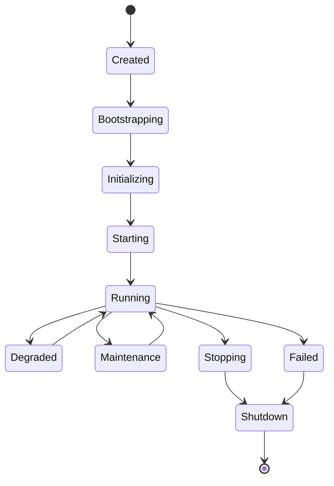
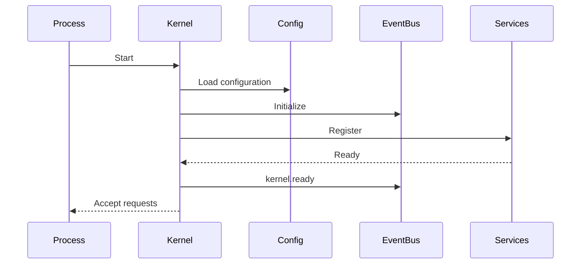

# Kernel Execution Lifecycle

## Executive Summary

The Hermes Kernel is the runtime coordinator of Hermes AIOS. It owns the application lifecycle, initializes services, validates dependencies, supervises runtime components, orchestrates graceful shutdown, and provides the execution environment for every workflow.

The Kernel itself performs minimal business logic. Instead, it coordinates specialized subsystems through dependency injection, stable interfaces, and the Event Bus.

---

# Objectives

The Kernel lifecycle is responsible for:

- Bootstrapping Hermes AIOS
- Loading configuration
- Initializing infrastructure
- Registering services
- Validating dependencies
- Supervising runtime services
- Managing lifecycle events
- Coordinating shutdown
- Recovering from failures
- Publishing lifecycle telemetry

---

# Lifecycle Principles

- Deterministic startup
- Explicit dependency ordering
- Fail-fast initialization
- Graceful degradation
- Service isolation
- Idempotent lifecycle operations
- Observable execution
- Configuration-driven behavior

---

# Lifecycle States

```
Created

↓

Bootstrapping

↓

Initializing

↓

Starting

↓

Running

↓

Degraded

↓

Maintenance

↓

Stopping

↓

Shutdown

or

Failed
```

State transitions are recorded by the Event Bus.

---

# Startup Sequence

```
Hermes Process

↓

Load Configuration

↓

Initialize Logging

↓

Initialize Event Bus

↓

Initialize Storage

↓

Initialize Memory

↓

Initialize Provider Registry

↓

Initialize Policy Engine

↓

Initialize Capability Registry

↓

Initialize Workflow Planner

↓

Initialize Tool Runtime

↓

Initialize Scheduler

↓

Initialize API

↓

Accept Requests
```

The Kernel will not enter the **Running** state until all mandatory services report readiness.

---

# Boot Phase

Responsibilities:

- Read configuration
- Resolve environment variables
- Verify schema versions
- Establish runtime directories
- Load feature flags

Failure during boot prevents startup.

---

# Service Registration

Each service registers with the Kernel.

Registration metadata:

```yaml
service:
version:
dependencies:
health_endpoint:
lifecycle_hooks:
capabilities:
```

Registration is complete before any service starts processing requests.

---

# Dependency Validation

The Kernel validates:

- Required services present
- Interface compatibility
- Configuration completeness
- Storage availability
- Provider registry integrity
- Event Bus availability

Validation failures halt startup.

---

# Initialization

Each service implements:

```python
initialize()
```

Initialization responsibilities:

- Allocate resources
- Establish connections
- Register events
- Validate configuration
- Perform internal checks

Initialization must be idempotent.

---

# Start Phase

After initialization:

```python
start()
```

The Kernel:

- Starts background workers
- Enables schedulers
- Activates event subscriptions
- Opens API listeners
- Enables workflow acceptance

---

# Readiness

A service becomes **Ready** only after:

- Initialization succeeds
- Health checks pass
- Dependencies are ready
- Configuration is valid

The Kernel reports global readiness only when all mandatory services are ready.

---

# Running State

While running, the Kernel supervises:

- Workflow execution
- Background jobs
- Provider health
- Tool Runtime
- Scheduler
- Event Bus
- Observability

Runtime supervision is continuous.

---

# Health Supervision

Health levels:

| State | Meaning |
|--------|---------|
| Healthy | Fully operational |
| Warning | Reduced capability |
| Degraded | Functionality limited |
| Failed | Service unavailable |

Health changes generate lifecycle events.

---

# Dynamic Configuration Reload

Supported configuration changes:

- Logging levels
- Feature flags
- Provider priorities
- Monitoring thresholds

Unsafe changes require restart.

---

# Failure Detection

Failures may originate from:

- Storage
- Providers
- Tool Runtime
- Memory
- Scheduler
- Configuration
- Internal exceptions

The Kernel classifies failures before selecting a recovery strategy.

---

# Recovery Strategy

Possible actions:

- Retry initialization
- Restart service
- Disable optional service
- Fail over to alternative provider
- Enter degraded mode
- Initiate shutdown

Recovery decisions are recorded for observability.

---

# Graceful Shutdown

Shutdown sequence:

```
Stop Request Intake

↓

Pause Scheduler

↓

Drain Active Workflows

↓

Persist Checkpoints

↓

Flush Event Bus

↓

Close Providers

↓

Close Storage

↓

Stop Observability

↓

Terminate Process
```

The shutdown process prioritizes data integrity.

---

# Emergency Shutdown

Triggered by:

- Unrecoverable corruption
- Critical security event
- Fatal dependency failure

Emergency shutdown attempts to:

- Persist checkpoints
- Flush audit logs
- Emit final lifecycle event

---

# Restart Behavior

On restart, the Kernel:

1. Validates persistent state
2. Loads checkpoints
3. Restores scheduler state
4. Replays pending events
5. Resumes eligible workflows
6. Returns to Running state

---

# Lifecycle Events

Representative events:

```
kernel.boot

kernel.initialized

kernel.ready

kernel.degraded

kernel.recovery.started

kernel.recovery.completed

kernel.shutdown.started

kernel.shutdown.completed
```

All lifecycle events are immutable.

---

# Supervision Loop

The supervision loop performs:

- Health polling
- Dependency monitoring
- Resource monitoring
- Configuration watching
- Lifecycle enforcement

The interval is configurable through the Configuration System.

---

# Resource Management

The Kernel tracks:

- CPU usage
- Memory usage
- Thread pool utilization
- Queue depth
- Active workflows
- Provider availability

Threshold violations trigger alerts.

---

# Mermaid State Diagram



---

# Mermaid Sequence Diagram



---

# Architecture Decisions

## Fail-Fast Startup

Mandatory dependency failures prevent the system from entering the Running state, avoiding undefined behavior.

## Dependency-Aware Initialization

Services initialize only after their declared dependencies are available.

## Continuous Supervision

The Kernel remains responsible for service health and lifecycle management throughout execution.

## Graceful Degradation

Optional services may be disabled while preserving core functionality whenever possible.

## Deterministic Shutdown

Shutdown follows a fixed sequence to maximize data consistency and checkpoint integrity.

---

# Future Enhancements

- Hot-swappable services
- Multi-process supervision
- Distributed Kernel federation
- Adaptive startup optimization
- Self-healing service restarts
- Predictive health monitoring
- Runtime plugin isolation
- Live dependency graph visualization

---

# Cross References

Previous:

- `docs/execution/06_EXECUTION_ARCHITECTURE.md`

Next:

- `docs/execution/06_2_WORKFLOW_EXECUTION_ENGINE.md`
