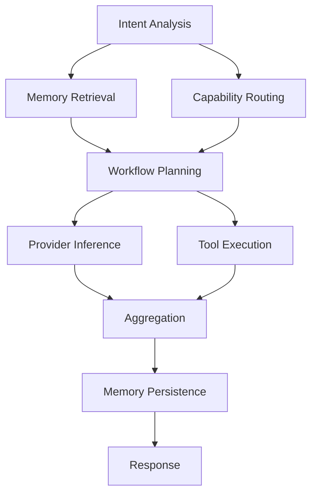
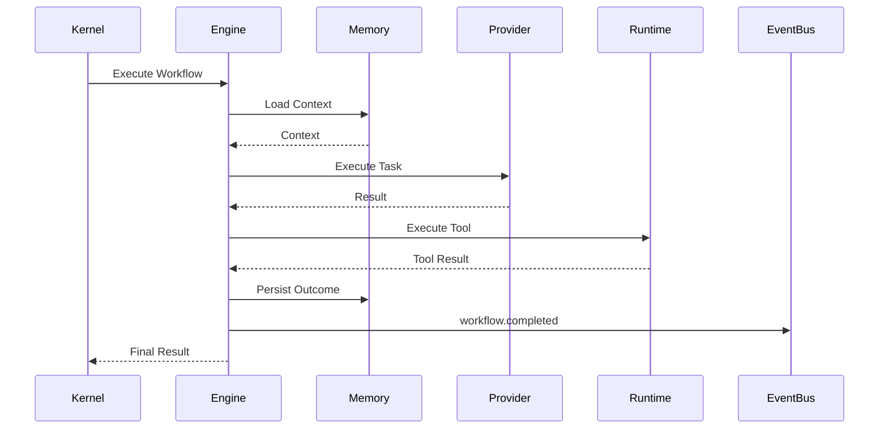

# Workflow Execution Engine

## Executive Summary

The Workflow Execution Engine transforms validated workflow plans into executable task graphs. It coordinates task scheduling, dependency resolution, provider invocation, tool execution, checkpoint creation, retries, cancellation, and result aggregation while remaining independent of individual providers and tools.

The engine executes workflows deterministically using a Directed Acyclic Graph (DAG) model and integrates with the Event Bus, Policy Engine, Memory Manager, and Observability subsystem.

---

# Objectives

The engine is responsible for:

- Executing workflow plans
- Scheduling runnable tasks
- Managing task dependencies
- Supporting parallel execution
- Persisting checkpoints
- Recovering interrupted workflows
- Aggregating outputs
- Reporting progress
- Coordinating retries
- Publishing execution events

---

# Design Principles

- Deterministic execution
- Capability-first orchestration
- Asynchronous scheduling
- Idempotent task execution
- Checkpoint-driven recovery
- Provider independence
- Tool isolation
- Event-driven coordination

---

# Execution Pipeline

```
Workflow Plan
      │
      ▼
Validate DAG
      │
      ▼
Create Execution Context
      │
      ▼
Schedule Runnable Tasks
      │
      ▼
Execute Tasks
      │
      ▼
Collect Results
      │
      ▼
Persist Checkpoint
      │
      ▼
Resolve Dependencies
      │
      ▼
Repeat Until Complete
      │
      ▼
Aggregate Final Output
```

---

# Workflow Model

Each workflow consists of:

- Metadata
- Execution graph
- Task nodes
- Dependency edges
- Execution policies
- Retry policies
- Checkpoints
- Final outputs

Workflow metadata is immutable after execution begins.

---

# Task States

Each task transitions through the following states:

```
Created
   │
Ready
   │
Queued
   │
Running
   │
Succeeded

or

Failed

or

Cancelled

or

Skipped
```

State transitions are recorded by the Event Bus.

---

# Dependency Resolution

A task becomes runnable only when:

- All parent tasks have completed successfully
- Required checkpoints exist
- Policy approval has been granted
- Required capabilities are available

Cycles are rejected during validation.

---

# Scheduling

The scheduler evaluates:

- Dependency readiness
- Capability availability
- Resource limits
- Provider health
- Policy constraints
- Task priority

Runnable tasks are placed into execution queues.

---

# Parallel Execution

Independent branches of the DAG execute concurrently when:

- Dependencies are satisfied
- Policy permits parallelism
- Required resources are available

Synchronization occurs before downstream tasks begin.

---

# Execution Context

Each task receives:

- Workflow ID
- Task ID
- Request ID
- Capability requirements
- Memory context
- Configuration snapshot
- Logger
- Metrics collector
- Cancellation token

The execution context is immutable except for task-local state.

---

# Task Types

Supported task categories:

- Provider inference
- Tool execution
- Memory retrieval
- Memory persistence
- Event publication
- Validation
- Aggregation
- User approval
- Plugin execution

Additional task types may be introduced through the Plugin SDK.

---

# Retry Policy

Each task declares:

- Maximum retries
- Retry interval
- Backoff strategy
- Retryable error classes

Example:

```yaml
retry:
  max_attempts: 3
  strategy: exponential
  initial_delay: 2s
```

Permanent failures terminate the task immediately.

---

# Checkpointing

Checkpoints are created:

- Before external provider calls
- After successful provider responses
- After tool completion
- Before aggregation
- Before workflow completion

Checkpoint contents include:

- Completed task IDs
- Execution context
- Intermediate outputs
- Memory references
- Event offsets

---

# Cancellation

Cancellation sources:

- User request
- Policy decision
- Timeout
- Dependency failure
- Kernel shutdown

Cancellation behavior:

1. Stop scheduling new tasks
2. Signal running tasks
3. Persist checkpoint
4. Publish cancellation events
5. Release resources

---

# Result Aggregation

After all terminal tasks complete:

- Normalize outputs
- Merge provider responses
- Resolve conflicts
- Validate completeness
- Generate final workflow result

Aggregation rules are deterministic.

---

# Progress Reporting

Progress metrics include:

- Total tasks
- Completed tasks
- Failed tasks
- Active tasks
- Estimated completion
- Elapsed time

Progress events are emitted continuously.

---

# Event Integration

Representative events:

```
workflow.started

task.ready

task.queued

task.started

task.completed

task.failed

checkpoint.created

workflow.progress

workflow.completed

workflow.failed
```

---

# Memory Integration

The engine interacts with the Memory Manager to:

- Retrieve execution context
- Store intermediate summaries
- Persist final outcomes
- Index long-term knowledge

Memory writes are coordinated with checkpoint creation.

---

# Tool Runtime Integration

Tool tasks are delegated through the Tool Runtime.

The engine:

- Requests execution
- Waits asynchronously
- Receives structured results
- Applies retry policy if appropriate

Tool implementations remain isolated from workflow scheduling.

---

# Provider Integration

Provider tasks execute through the Provider Adapter.

The engine never invokes providers directly.

Provider execution includes:

- Capability validation
- Streaming support
- Timeout enforcement
- Health-aware failover

---

# Failure Handling

Failure classes:

- Validation
- Provider
- Tool
- Memory
- Policy
- Timeout
- Infrastructure

Recovery actions:

- Retry
- Provider failover
- Task skip
- Workflow cancellation
- Checkpoint restoration

---

# Observability

Metrics:

- Queue depth
- Active workflows
- Task latency
- Retry count
- Success rate
- Checkpoint frequency
- Parallel execution ratio

Each workflow receives a unique trace identifier.

---

# Mermaid DAG Example



---

# Mermaid Sequence Diagram



---

# Architecture Decisions

## DAG-Based Execution

Workflow execution is modeled as a directed acyclic graph to support deterministic scheduling, dependency management, and parallel execution.

## Immutable Execution Context

Each task receives a stable snapshot of execution context, simplifying debugging and replay.

## Checkpoint-Oriented Recovery

Frequent checkpoints minimize repeated work after interruptions and enable deterministic resumption.

## Provider and Tool Isolation

The engine delegates execution through adapters, ensuring workflow logic remains independent of provider implementations.

## Event-Centric Telemetry

Every significant lifecycle transition generates immutable events, enabling complete traceability.

---

# Future Enhancements

- Adaptive scheduling
- Cost-aware execution planning
- Dynamic parallelism
- Distributed worker pools
- Predictive checkpoint optimization
- Workflow replay debugger
- Speculative execution
- Multi-node orchestration

---

# Cross References

Previous:

- `docs/execution/06_1_KERNEL_EXECUTION_LIFECYCLE.md`

Next:

- `docs/execution/06_3_CAPABILITY_ROUTING_RUNTIME.md`
