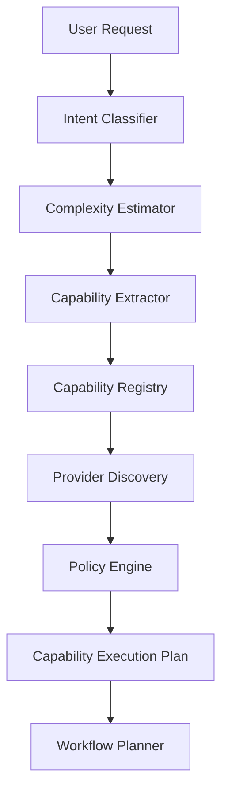
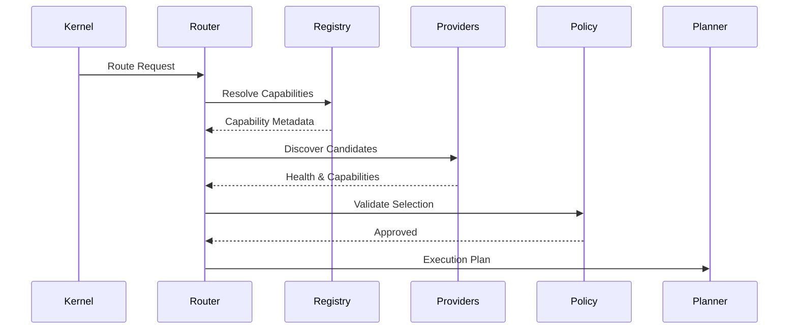

# Capability Routing Runtime

## Executive Summary

The Capability Routing Runtime is responsible for transforming a validated user request into a capability-driven execution strategy. Rather than selecting a specific model directly, Hermes AIOS determines *what capabilities are required* and then dynamically assigns the most appropriate local models, cloud models, tools, or hybrid execution paths.

This architecture enables automatic multi-model orchestration while insulating higher-level components from provider-specific details.

---

# Objectives

The Capability Router shall:

- Interpret user intent
- Determine required capabilities
- Estimate request complexity
- Select execution strategies
- Match providers to capabilities
- Balance local and remote execution
- Support hybrid workflows
- Optimize cost, latency, and quality
- Recover from provider failures
- Produce deterministic routing decisions

---

# Routing Principles

- Capability-first
- Provider-independent
- Local-first by default
- Policy-aware
- Cost-aware
- Latency-aware
- Observable
- Deterministic
- Extensible

---

# Runtime Pipeline

```
User Request
      │
      ▼
Intent Classification
      │
      ▼
Complexity Estimation
      │
      ▼
Capability Extraction
      │
      ▼
Capability Registry Lookup
      │
      ▼
Provider Discovery
      │
      ▼
Policy Evaluation
      │
      ▼
Execution Strategy
      │
      ▼
Workflow Planner
```

---

# Intent Classification

Intent categories include:

- Conversation
- Coding
- Research
- Writing
- Image generation
- Audio
- Video
- Automation
- Planning
- Retrieval
- Data analysis
- System administration

Multiple intents may be identified within a single request.

---

# Complexity Estimation

Complexity dimensions:

- Context size
- Number of required capabilities
- Required reasoning depth
- Expected execution time
- Tool requirements
- Parallelization potential
- External dependencies

Example output:

```yaml
complexity:
  level: high
  estimated_steps: 12
  parallelizable: true
```

---

# Capability Extraction

Capabilities describe *what must be accomplished*, not *how*.

Examples:

- reasoning
- planning
- coding
- retrieval
- summarization
- image_generation
- browser
- shell
- filesystem
- translation
- memory_lookup
- documentation

Capabilities are normalized before routing.

---

# Capability Registry

Each capability record contains:

- Identifier
- Description
- Version
- Required permissions
- Candidate providers
- Tool support
- Estimated cost
- Preferred execution mode

The registry is configuration-driven.

---

# Provider Discovery

The Provider Adapter supplies metadata for each provider:

- Supported capabilities
- Health status
- Current availability
- Latency estimate
- Cost profile
- Streaming support
- Context limits
- Tool support

The router never hard-codes provider names.

---

# Routing Scores

Candidate providers are scored using weighted criteria:

| Criterion | Description |
|-----------|-------------|
| Capability match | Required functionality |
| Health | Current availability |
| Latency | Estimated response time |
| Cost | Relative execution cost |
| Local preference | Local execution priority |
| Policy compliance | Permission and governance |
| Context support | Required context window |

The highest-scoring provider (or provider set) is selected.

---

# Multi-Model Orchestration

Complex workflows may use multiple specialists.

Example:

```
Research
      │
      ├── Retrieval
      ├── Reasoning
      ├── Code Generation
      ├── Verification
      └── Formatting
```

Each branch may execute on a different provider while sharing a common workflow context.

---

# Local-First Strategy

Routing preference:

1. Local provider
2. Local tool
3. Cached result
4. Remote provider
5. Human approval (if required)

Cloud execution occurs only when local capabilities cannot satisfy the request or policy explicitly permits it.

---

# Hybrid Execution

Hybrid workflows may combine:

- Local inference
- Cloud reasoning
- Tool execution
- Plugin execution
- Memory retrieval

The Workflow Planner coordinates synchronization points.

---

# Policy Integration

Before execution the router verifies:

- Provider permissions
- Data residency rules
- Network policy
- User approval requirements
- Cost limits
- Security constraints

Policy may alter routing decisions.

---

# Failure Handling

Failure scenarios include:

- Provider unavailable
- Timeout
- Capability mismatch
- Policy rejection
- Tool failure

Recovery options:

- Retry
- Alternate provider
- Local fallback
- Workflow decomposition
- Graceful degradation

---

# Runtime Optimization

The router continuously optimizes based on:

- Provider health
- Historical latency
- Success rate
- Token consumption
- Cache availability
- Current system load

Optimization policies are configurable.

---

# Execution Plan

The router produces a capability execution plan:

```yaml
workflow:
  capabilities:
    - retrieval
    - reasoning
    - coding
    - verification

assignments:
  retrieval:
    mode: local
  reasoning:
    mode: cloud
  coding:
    mode: local
  verification:
    mode: cloud
```

The Workflow Planner consumes this plan directly.

---

# Event Integration

Representative events:

```
intent.classified

complexity.estimated

capability.extracted

provider.discovered

provider.selected

routing.completed

routing.failed

routing.optimized
```

All routing events are published to the Event Bus.

---

# Observability

Metrics:

- Routing latency
- Capability resolution time
- Provider selection frequency
- Local vs remote execution ratio
- Failover count
- Cost estimate
- Routing success rate

These metrics feed the Observability subsystem for dashboards and trend analysis.

---

# Mermaid Flow Diagram



---

# Mermaid Sequence Diagram



---

# Architecture Decisions

## Capability-Centric Routing

Routing decisions are based on required capabilities rather than model identities, allowing providers to be replaced without changing workflow logic.

## Dynamic Provider Selection

Provider choice is deferred until runtime, enabling health-aware and policy-aware optimization.

## Hybrid Orchestration

Multiple providers and tools may participate in a single workflow, coordinated through a unified execution plan.

## Configuration-Driven Registry

Capabilities and routing policies are defined through configuration, allowing expansion without modifying the router.

## Local-First Execution

Local resources are preferred to improve privacy, reduce cost, and maintain offline functionality.

---

# Future Enhancements

- Learning-based routing optimization
- Predictive provider benchmarking
- GPU-aware scheduling
- Adaptive cost optimization
- Federated capability registries
- Reinforcement learning for routing
- Energy-aware execution policies
- Cross-device orchestration

---

# Cross References

Previous:

- `docs/execution/06_2_WORKFLOW_EXECUTION_ENGINE.md`

Next:

- `docs/execution/06_4_MEMORY_EXECUTION_PIPELINE.md`
