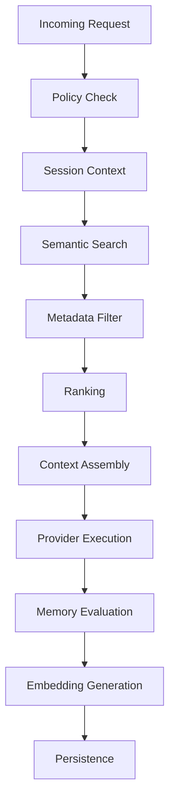
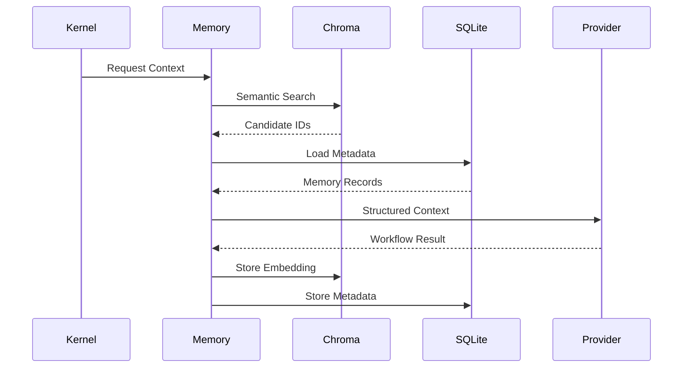

# Memory Execution Pipeline

## Executive Summary

The Memory Execution Pipeline enables Hermes AIOS to maintain context across requests, workflows, and sessions. It assembles short-term and long-term knowledge into an optimized execution context before provider invocation and persists newly created knowledge after workflow completion.

The pipeline separates transactional metadata from semantic embeddings while exposing a unified interface through the Memory Manager.

---

# Objectives

The Memory Execution Pipeline shall:

- Retrieve relevant context
- Assemble execution context
- Perform semantic search
- Rank and filter memories
- Respect privacy and policy constraints
- Optimize context windows
- Generate embeddings
- Persist new memories
- Support checkpoint recovery
- Remain storage-engine independent

---

# Design Principles

- Retrieval before generation
- Local-first storage
- Stable identifiers
- Metadata and vector separation
- Policy-aware access
- Incremental context assembly
- Asynchronous embedding generation
- Deterministic memory updates

---

# Memory Categories

## Short-Term Memory

Scope:

- Current request
- Active workflow
- Recent conversation
- Temporary execution state

Storage:

- Execution context
- SQLite

Lifetime:

- Workflow duration

---

## Long-Term Memory

Scope:

- User-approved memories
- Project knowledge
- Documentation
- Historical workflows
- Learned preferences
- Indexed documents

Storage:

- SQLite metadata
- ChromaDB embeddings

Lifetime:

- Persistent

---

## Ephemeral Memory

Temporary runtime data:

- Intermediate reasoning
- Tool outputs
- Cached provider responses
- Planner scratch space

Automatically discarded unless promoted.

---

# Pipeline Overview

```
Incoming Request
       │
       ▼
Memory Policy Check
       │
       ▼
Retrieve Session Context
       │
       ▼
Semantic Search
       │
       ▼
Metadata Filtering
       │
       ▼
Ranking
       │
       ▼
Context Window Assembly
       │
       ▼
Provider Execution
       │
       ▼
Memory Evaluation
       │
       ▼
Embedding Generation
       │
       ▼
Persistence
```

---

# Memory Retrieval

Sources include:

- Active workflow
- Conversation history
- Project memory
- User preferences
- Documentation
- Imported knowledge
- Plugin-provided memory
- Scheduler state

Each source contributes independently to the final context.

---

# Semantic Search

The Memory Manager performs semantic retrieval by:

1. Creating an embedding for the incoming query
2. Searching ChromaDB collections
3. Returning candidate memories
4. Enriching candidates with SQLite metadata

Similarity thresholds are configurable.

---

# Metadata Filtering

Candidates are filtered by:

- User ownership
- Project
- Workflow
- Tags
- Age
- Trust level
- Privacy classification
- Policy restrictions

Filtering occurs before ranking.

---

# Ranking

Candidate memories are scored using:

- Semantic similarity
- Recency
- Frequency
- Explicit importance
- User pinning
- Project relevance
- Workflow relevance

The ranking strategy is configurable.

---

# Context Window Assembly

The Memory Manager constructs an execution context from:

- System instructions
- Active workflow state
- Retrieved memories
- Current conversation
- Project documents
- User preferences
- Tool state

Context is assembled within provider-specific token limits.

---

# Context Optimization

Optimization strategies include:

- Duplicate removal
- Summary substitution
- Chunk prioritization
- Compression
- Token budgeting
- Low-value memory pruning

The objective is to maximize useful context.

---

# Provider Integration

The assembled context is passed to the Provider Adapter as a structured context package.

The Provider Adapter is responsible for translating this package into provider-specific request formats.

---

# Memory Evaluation

After workflow execution, the Memory Manager evaluates outputs to determine whether information should be retained.

Candidate categories:

- User preferences
- Project facts
- Documentation updates
- Workflow outcomes
- Tool results

Retention policies are configurable.

---

# Embedding Generation

Embeddings are generated for approved memories.

Process:

1. Normalize content
2. Generate embedding
3. Store vector in ChromaDB
4. Store metadata in SQLite
5. Link using a shared identifier

Embedding generation may execute asynchronously.

---

# Persistence

Persisted records include:

- Metadata
- Vector references
- Tags
- Provenance
- Confidence
- Schema version
- Access policy

Writes are coordinated through the Storage Service.

---

# Privacy and Policy

Before retrieval or persistence, the Policy Engine validates:

- Ownership
- Access permissions
- Retention rules
- Export restrictions
- Sensitive data classification

Policy violations prevent memory access.

---

# Checkpoint Integration

Checkpoints capture:

- Memory references
- Context snapshot
- Retrieval parameters
- Pending embedding operations

This supports deterministic workflow recovery.

---

# Event Integration

Representative events:

```
memory.retrieve.started

memory.retrieve.completed

memory.rank.completed

context.assembled

memory.persist.requested

embedding.generated

memory.persist.completed
```

Events are immutable and traceable.

---

# Failure Handling

Failure classes:

- Storage unavailable
- Embedding generation failed
- Vector index unavailable
- Policy rejection
- Context overflow

Recovery options:

- Retry
- Reduced context
- Metadata-only operation
- Deferred embedding generation
- Graceful degradation

---

# Observability

Metrics:

- Retrieval latency
- Semantic search duration
- Context size
- Token utilization
- Memory hit rate
- Embedding queue depth
- Persistence success rate

These metrics integrate with the Observability subsystem.

---

# Mermaid Flow Diagram



---

# Mermaid Sequence Diagram



---

# Architecture Decisions

## Retrieval-Augmented Execution

Execution always begins with context retrieval, reducing redundant reasoning and improving consistency.

## Polyglot Persistence

Semantic vectors and relational metadata are stored separately while remaining linked through stable identifiers.

## Policy-Governed Memory

All retrieval and persistence operations pass through the Policy Engine to enforce privacy and governance.

## Token-Aware Context Assembly

Context construction is optimized for provider limits while preserving the highest-value information.

## Asynchronous Embeddings

Embedding generation is decoupled from workflow completion where possible to minimize response latency.

---

# Future Enhancements

- Hierarchical memory summaries
- Temporal decay policies
- Multi-user shared workspaces
- Cross-device synchronization
- Adaptive ranking models
- Memory quality scoring
- Automated deduplication
- Incremental embedding refresh

---

# Cross References

Previous:

- `docs/execution/06_3_CAPABILITY_ROUTING_RUNTIME.md`

Next:

- `docs/execution/06_5_TOOL_EXECUTION_LIFECYCLE.md`
