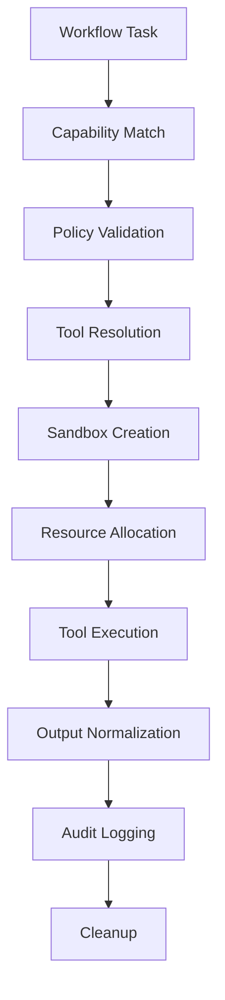
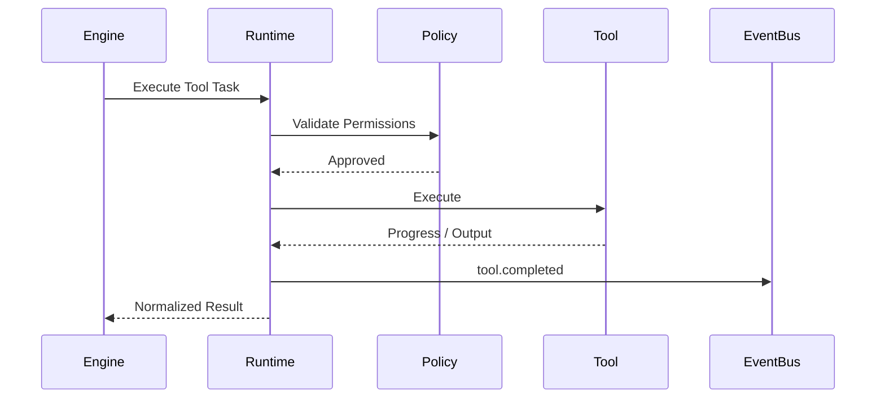

# Tool Execution Lifecycle

## Executive Summary

The Tool Runtime enables Hermes AIOS to safely execute external actions such as shell commands, Python code, filesystem operations, web requests, Git interactions, and plugin-provided tools. Every tool invocation is governed by policy, isolated through sandboxing, monitored by the Observability subsystem, and coordinated by the Workflow Execution Engine.

The Tool Runtime abstracts individual tool implementations behind a stable execution interface, allowing new tools to be added without changing workflow logic.

---

# Objectives

The Tool Runtime shall:

- Discover available tools
- Match tools to required capabilities
- Validate permissions
- Create isolated execution environments
- Execute tools asynchronously
- Stream progress
- Normalize outputs
- Record audit events
- Recover from failures
- Clean up resources

---

# Design Principles

- Capability-first selection
- Secure by default
- Least privilege
- Sandboxed execution
- Deterministic behavior
- Observable execution
- Provider independence
- Plugin extensibility

---

# Execution Pipeline

```
Workflow Task
      │
      ▼
Capability Match
      │
      ▼
Policy Validation
      │
      ▼
Tool Resolution
      │
      ▼
Sandbox Creation
      │
      ▼
Resource Allocation
      │
      ▼
Tool Execution
      │
      ▼
Progress Streaming
      │
      ▼
Output Normalization
      │
      ▼
Audit Logging
      │
      ▼
Cleanup
```

---

# Tool Discovery

Tool sources include:

- Built-in runtime tools
- Plugin-provided tools
- Provider-assisted tools
- Future remote workers

Every tool registers:

- Identifier
- Version
- Supported capabilities
- Required permissions
- Input schema
- Output schema
- Resource requirements

---

# Capability Matching

The Workflow Execution Engine requests a tool by capability.

Example capabilities:

- filesystem.read
- filesystem.write
- shell
- python
- git
- browser
- network
- archive
- search
- image_processing

The Tool Registry resolves the most appropriate implementation.

---

# Policy Validation

Before execution the Policy Engine verifies:

- Required permissions
- User authorization
- Filesystem scope
- Network restrictions
- Plugin trust level
- Resource quotas
- Execution timeout

Possible outcomes:

- Allow
- Deny
- Require approval
- Restrict execution parameters

---

# Sandbox Creation

Each execution receives an isolated environment containing:

- Temporary workspace
- Environment variables
- Resource limits
- Mounted files
- Read-only runtime assets
- Structured logging channel

Sandboxes are destroyed after completion unless retained for debugging.

---

# Resource Allocation

The Tool Runtime reserves:

- CPU quota
- Memory quota
- Disk workspace
- Network permissions
- GPU access (if permitted)

Resource limits are configurable.

---

# Execution Context

Each tool receives:

- Request ID
- Workflow ID
- Task ID
- Execution context
- Configuration snapshot
- Logger
- Metrics collector
- Cancellation token

The execution context is immutable except for tool-local state.

---

# Execution Modes

Supported modes:

- One-shot
- Streaming
- Interactive (future)
- Long-running
- Background task

Mode selection is declared by the tool.

---

# Progress Streaming

Streaming events include:

```
tool.started

tool.progress

tool.output

tool.warning

tool.completed
```

Progress updates are forwarded to the Workflow Execution Engine.

---

# Output Normalization

Tool outputs are converted into a standard structure:

```yaml
status:
stdout:
stderr:
artifacts:
metrics:
exit_code:
duration:
```

Normalization allows workflow steps to consume results consistently.

---

# Error Handling

Error categories:

- Validation
- Permission denied
- Timeout
- Resource exhaustion
- Runtime exception
- Sandbox failure
- Dependency unavailable

Each error includes:

- Code
- Message
- Recoverable flag
- Retry recommendation

---

# Retry Strategy

Retryable failures may use:

- Immediate retry
- Fixed delay
- Exponential backoff
- Alternate implementation

Non-idempotent tools are never retried automatically unless explicitly marked as safe.

---

# Cleanup

Upon completion the runtime:

1. Flushes logs
2. Releases resources
3. Removes temporary files
4. Closes handles
5. Publishes completion events
6. Destroys sandbox
7. Persists execution metadata

Cleanup executes even after failures.

---

# Audit Logging

Every execution records:

- Tool identifier
- Version
- Caller workflow
- User identity (subject to policy)
- Permissions granted
- Resources consumed
- Start and end timestamps
- Exit status

Audit records are immutable.

---

# Observability

Metrics include:

- Execution latency
- Success rate
- Failure rate
- Resource utilization
- Sandbox startup time
- Queue depth
- Retry count

Each execution is linked to the workflow trace.

---

# Security Considerations

The Tool Runtime enforces:

- Least-privilege permissions
- Filesystem isolation
- Network policy
- Environment sanitization
- Secret redaction
- Execution timeouts
- Resource quotas

Sensitive values must never be written to logs.

---

# Mermaid Flow Diagram



---

# Mermaid Sequence Diagram



---

# Architecture Decisions

## Stable Tool Interface

All tools implement a common execution contract, allowing the Workflow Engine to remain independent of tool-specific behavior.

## Sandboxed Execution

Every tool runs in an isolated environment with explicit resource and permission boundaries.

## Capability-Based Resolution

The runtime selects tools based on declared capabilities rather than implementation identity.

## Deterministic Cleanup

Resource cleanup is guaranteed through a fixed shutdown sequence, regardless of success or failure.

## Unified Telemetry

Every tool invocation emits standardized events, logs, and metrics to support tracing and diagnostics.

---

# Future Enhancements

- Remote tool workers
- GPU-aware scheduling
- Interactive terminal sessions
- Distributed execution pools
- Tool capability benchmarking
- WASM-based sandboxing
- Live resource dashboards
- Automatic sandbox snapshots

---

# Cross References

Previous:

- `docs/execution/06_4_MEMORY_EXECUTION_PIPELINE.md`

Next:

- `docs/execution/06_6_PROVIDER_EXECUTION_PIPELINE.md`
