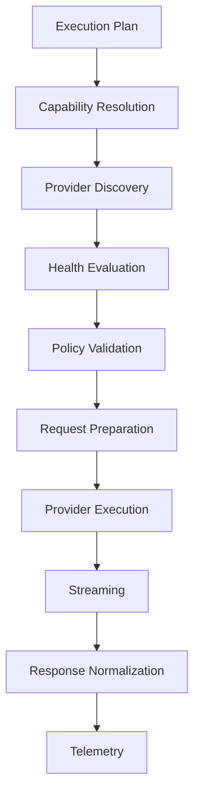
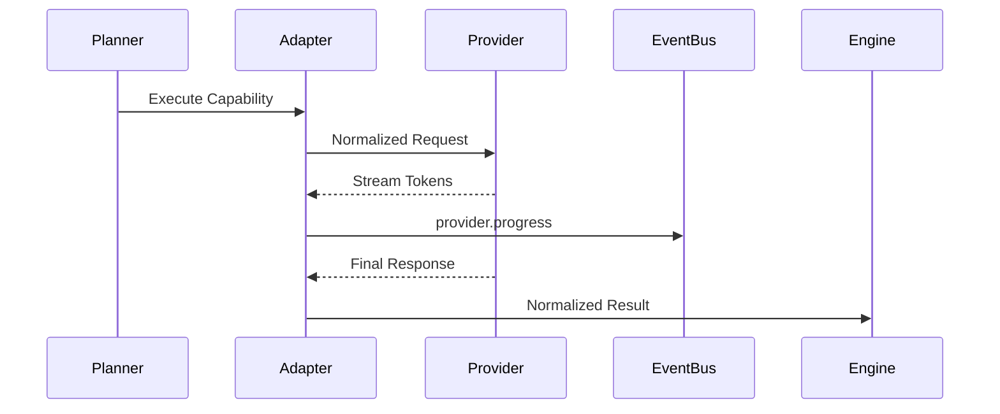

# Provider Execution Pipeline

## Executive Summary

The Provider Execution Pipeline governs every interaction between Hermes AIOS and language, vision, audio, embedding, and future AI providers. It abstracts provider-specific APIs behind the Provider Adapter so that workflows depend only on capabilities rather than vendor implementations.

The pipeline supports local inference, cloud providers, hybrid execution, streaming responses, health-aware routing, failover, and provider telemetry.

---

# Objectives

The Provider Pipeline shall:

- Discover providers
- Register capabilities
- Prepare provider requests
- Select execution targets
- Support local-first execution
- Execute streaming inference
- Normalize responses
- Monitor provider health
- Recover from provider failures
- Report execution metrics

---

# Design Principles

- Capability-first routing
- Provider abstraction
- Local-first preference
- Configuration-driven behavior
- Streaming by default where supported
- Health-aware execution
- Observable performance
- Deterministic response normalization

---

# Runtime Pipeline

```
Execution Plan
      │
      ▼
Capability Resolution
      │
      ▼
Provider Discovery
      │
      ▼
Health Evaluation
      │
      ▼
Policy Validation
      │
      ▼
Request Preparation
      │
      ▼
Inference Execution
      │
      ▼
Streaming Processing
      │
      ▼
Response Normalization
      │
      ▼
Telemetry Collection
```

---

# Provider Registry

Each provider registers:

- Provider identifier
- Version
- Supported capabilities
- Supported modalities
- Context window
- Streaming support
- Health endpoint
- Authentication method
- Cost profile
- Priority

Registration occurs during Kernel initialization.

---

# Capability Advertisement

Providers advertise capabilities rather than model names.

Example:

```yaml
provider: local_runtime

capabilities:
  - reasoning
  - coding
  - summarization
  - embeddings
```

The Capability Router consumes these declarations when building execution plans.

---

# Provider Discovery

Candidate providers are filtered by:

- Capability match
- Availability
- Policy
- Authentication status
- Context size
- Required modality

Discovery returns a ranked candidate list rather than a single provider.

---

# Health Evaluation

Health dimensions:

- Reachability
- Authentication
- Average latency
- Success rate
- Queue depth
- Resource utilization
- Recent failures

Health states:

- Healthy
- Warning
- Degraded
- Unavailable

Unhealthy providers are excluded unless explicitly required.

---

# Policy Validation

Before execution the Policy Engine validates:

- Network permissions
- Data residency
- Cost limits
- User approval requirements
- Provider trust level
- Sensitive data restrictions

The policy may reject or modify provider selection.

---

# Local-First Strategy

Selection order:

1. Local inference engine
2. Local cached response
3. Approved cloud provider
4. Secondary cloud provider
5. Human approval (if required)

Cloud execution is avoided when local capability satisfies the request.

---

# Request Preparation

The Provider Adapter constructs a provider-neutral request containing:

- Request ID
- Workflow ID
- Capability requirements
- Context package
- System instructions
- User content
- Tool definitions (if enabled)
- Execution constraints

The adapter translates this into provider-specific formats.

---

# Streaming Execution

Supported stream events:

```
provider.started

provider.token

provider.progress

provider.warning

provider.completed
```

Streaming is normalized regardless of provider implementation.

---

# Response Normalization

Provider responses are converted into a common structure:

```yaml
status:
content:
tool_calls:
usage:
latency:
provider:
model:
finish_reason:
warnings:
```

Downstream components consume only this normalized format.

---

# Multi-Provider Execution

A workflow may assign different capabilities to different providers.

Example:

```
Retrieval  → Local embeddings

Reasoning → Cloud reasoning provider

Coding → Local coding model

Verification → Cloud review model
```

The Workflow Execution Engine coordinates synchronization and aggregation.

---

# Timeout Handling

Each provider declares default limits:

```yaml
connect_timeout:
request_timeout:
stream_timeout:
```

Timeout actions:

- Retry
- Failover
- Partial completion
- Workflow cancellation

---

# Failover Strategy

When a provider fails:

1. Mark provider state
2. Publish failure event
3. Select next ranked candidate
4. Replay request if safe
5. Continue workflow

Non-retryable requests are surfaced to the Workflow Engine for policy-based handling.

---

# Authentication

Supported methods:

- Local execution (none)
- API keys
- OAuth
- Service accounts
- Future delegated credentials

Secrets are obtained through the Secret Manager and never embedded in workflow definitions.

---

# Telemetry

Collected metrics include:

- Request count
- Success rate
- Error rate
- Average latency
- Token usage
- Estimated cost
- Stream duration
- Failover frequency

Metrics are tagged by provider and capability.

---

# Event Integration

Representative events:

```
provider.discovered

provider.selected

provider.started

provider.stream

provider.completed

provider.failed

provider.failover

provider.health.changed
```

All events are immutable and traceable.

---

# Error Categories

- Authentication failure
- Timeout
- Network failure
- Rate limit
- Invalid request
- Capability mismatch
- Provider unavailable
- Internal provider error

Each error includes retry guidance and recovery recommendations.

---

# Observability

The Observability subsystem records:

- End-to-end latency
- Queue time
- Provider health history
- Cost trends
- Capability utilization
- Streaming throughput
- Failure distribution

Every provider interaction is correlated with the workflow trace identifier.

---

# Mermaid Flow Diagram



---

# Mermaid Sequence Diagram



---

# Architecture Decisions

## Provider-Neutral Contracts

All provider interactions occur through the Provider Adapter, ensuring workflow logic remains independent of vendor APIs.

## Dynamic Candidate Ranking

Provider selection is performed at runtime using capability, health, policy, and resource information rather than fixed priorities.

## Local-First Execution

Local inference is preferred to improve privacy, reduce operational cost, and preserve offline functionality.

## Normalized Responses

Downstream components receive a consistent response schema regardless of the originating provider.

## Telemetry-Driven Optimization

Execution metrics feed future routing and optimization decisions without coupling routing logic to individual providers.

---

# Future Enhancements

- Adaptive provider benchmarking
- Cost-aware scheduling
- Energy-aware routing
- Federated provider registries
- Multi-region provider selection
- Automatic capability certification
- Predictive failover
- Distributed inference pools

---

# Cross References

Previous:

- `docs/execution/06_5_TOOL_EXECUTION_LIFECYCLE.md`

Next:

- `docs/execution/06_7_EVENT_PROCESSING_RUNTIME.md`
