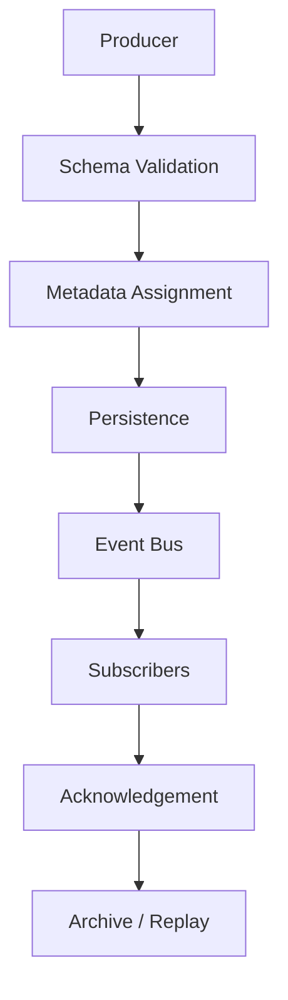
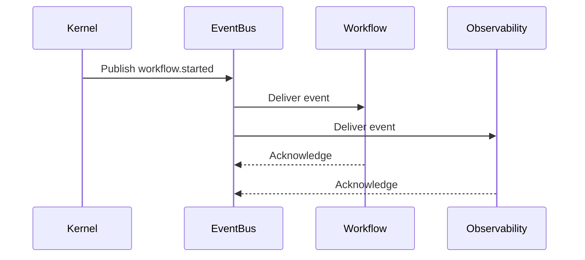

# Event Processing Runtime

## Executive Summary

The Hermes Event Processing Runtime provides reliable, asynchronous communication between runtime components. Events are immutable, versioned messages that represent state transitions and operational activities. The Event Bus decouples producers from consumers, improves scalability, supports replay, and provides the foundation for observability and recovery.

The Event Bus is an internal subsystem. External integrations interact through public APIs rather than publishing internal events directly.

---

# Objectives

The Event Bus shall:

- Enable asynchronous communication
- Preserve event ordering where required
- Support durable persistence
- Allow replay after interruption
- Provide delivery guarantees
- Support filtering and subscriptions
- Integrate with observability
- Support future distributed execution
- Minimize producer/consumer coupling
- Preserve auditability

---

# Design Principles

- Immutable events
- Append-only event log
- Versioned schemas
- At-least-once delivery
- Idempotent consumers
- Capability-independent messaging
- Configuration-driven routing
- Observable event lifecycle

---

# Event Lifecycle

```
Producer
   │
   ▼
Create Event
   │
   ▼
Validate Schema
   │
   ▼
Assign Metadata
   │
   ▼
Persist Event
   │
   ▼
Route to Subscribers
   │
   ▼
Acknowledge Delivery
   │
   ▼
Archive / Replay
```

---

# Event Structure

Every event includes:

```yaml
event_id:
event_type:
schema_version:
timestamp:
workflow_id:
request_id:
producer:
correlation_id:
payload:
metadata:
```

The payload contains only domain-specific data.

---

# Event Categories

Primary categories:

- Lifecycle
- Workflow
- Planning
- Routing
- Memory
- Provider
- Tool
- Scheduler
- Plugin
- Policy
- Configuration
- Observability
- Security

Additional categories may be introduced through future extensions.

---

# Producers

Core producers include:

- Kernel
- Workflow Engine
- Capability Router
- Memory Manager
- Provider Adapter
- Tool Runtime
- Policy Engine
- Scheduler
- Plugin Manager

Every producer must publish only documented event types.

---

# Consumers

Primary consumers include:

- Observability
- Memory Manager
- Scheduler
- Workflow Engine
- Plugin Manager
- Policy Engine
- Recovery Manager

Consumers subscribe through stable interfaces rather than direct producer references.

---

# Delivery Guarantees

Default guarantee:

```
At-Least-Once
```

Consumer requirements:

- Idempotent processing
- Duplicate detection
- Safe retry

Future profiles may support:

- At-Most-Once
- Exactly-Once (where practical)

---

# Ordering Semantics

Ordering is guaranteed within:

- A workflow
- A request
- A partition

Global ordering is not required.

Ordering keys:

- workflow_id
- request_id

---

# Subscription Model

Subscription options:

- Exact event type
- Event category
- Wildcard pattern
- Capability group

Examples:

```
workflow.*

provider.*

memory.persist.*
```

Subscriptions are registered during service initialization.

---

# Event Persistence

Persisted attributes:

- Header
- Payload
- Timestamp
- Delivery status
- Retry count
- Correlation identifiers

Persistence supports replay and auditing.

---

# Replay

Replay is used for:

- Workflow recovery
- Diagnostics
- Testing
- State reconstruction

Replay rules:

- Preserve original ordering
- Preserve timestamps
- Prevent duplicate side effects
- Honor schema versions

---

# Backpressure

The Event Bus monitors:

- Queue depth
- Consumer lag
- Publish latency
- Delivery latency

Backpressure strategies:

- Buffer
- Throttle
- Prioritize
- Shed non-critical events

Critical lifecycle events are never discarded.

---

# Dead-Letter Queue

Failed events exceeding retry limits are moved to a dead-letter queue.

Stored information:

- Original event
- Failure reason
- Retry attempts
- Timestamp
- Consumer identifier

Dead-letter events require operator review or automated recovery policies.

---

# Schema Versioning

Every event references:

- event_type
- schema_version

Rules:

- Additive changes preserve compatibility
- Breaking changes require a new major schema version
- Deprecated schemas remain readable during migration windows

---

# Security

The Event Bus enforces:

- Event validation
- Payload size limits
- Sensitive field masking
- Authorization for subscriptions
- Audit logging

Events must never contain plaintext secrets.

---

# Observability

Metrics include:

- Publish rate
- Delivery latency
- Queue depth
- Retry count
- Replay count
- Consumer lag
- Dead-letter count
- Schema validation failures

Every event is traceable using its correlation identifiers.

---

# Failure Handling

Failure scenarios:

- Consumer unavailable
- Persistence failure
- Schema validation failure
- Queue overflow
- Delivery timeout

Recovery actions:

- Retry
- Alternate consumer
- Dead-letter routing
- Graceful degradation
- Alert generation

---

# Integration Points

The Event Bus integrates with:

- Kernel lifecycle
- Workflow Execution Engine
- Capability Router
- Memory Execution Pipeline
- Tool Runtime
- Provider Adapter
- Scheduler
- Observability
- Recovery Manager

No runtime subsystem communicates through private event channels.

---

# Mermaid Flow Diagram



---

# Mermaid Sequence Diagram



---

# Architecture Decisions

## Immutable Events

Events are append-only records that represent historical facts and are never modified after publication.

## At-Least-Once Delivery

Reliable delivery is prioritized over eliminating duplicates; consumers are responsible for idempotent processing.

## Partitioned Ordering

Ordering guarantees are limited to workflow and request boundaries, improving scalability without sacrificing determinism.

## Persistent Event Log

Durable storage enables replay, diagnostics, auditing, and deterministic recovery.

## Schema Governance

Versioned event schemas allow long-term evolution while maintaining compatibility across runtime components.

---

# Future Enhancements

- Distributed event brokers
- Cross-node event replication
- Event compression
- Event snapshots
- Adaptive routing
- Event prioritization policies
- Visual event tracing
- Event contract validation tooling

---

# Cross References

Previous:

- `docs/execution/06_6_PROVIDER_EXECUTION_PIPELINE.md`

Next:

- `docs/execution/06_8_FAILURE_RECOVERY_RUNTIME.md`
