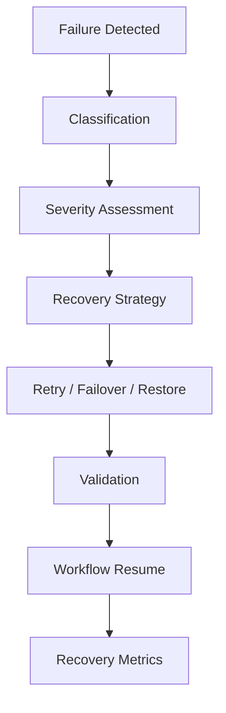
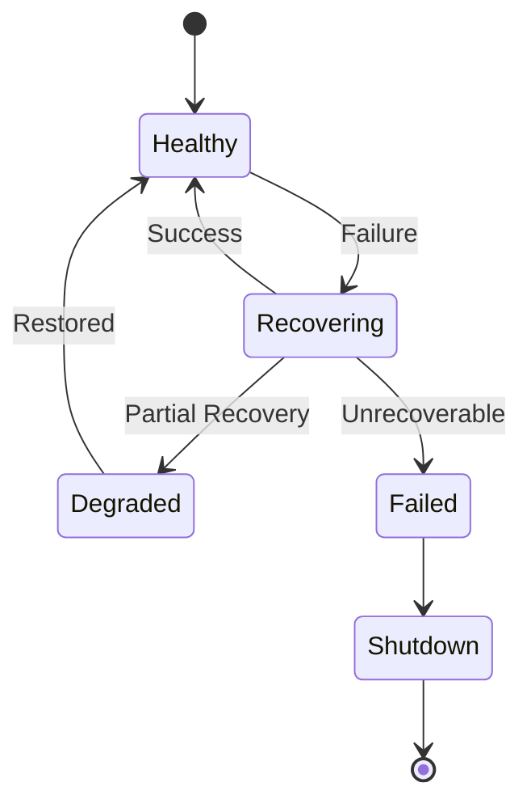

# Failure Recovery Runtime

## Executive Summary

Hermes AIOS is designed to continue operating in the presence of failures whenever safe to do so. The Failure Recovery Runtime coordinates failure detection, classification, checkpoint restoration, retry policies, provider failover, tool recovery, workflow resumption, and graceful degradation.

Recovery decisions are deterministic, observable, and policy-aware.

---

# Objectives

The recovery subsystem shall:

- Detect failures quickly
- Classify failure types
- Isolate failed components
- Recover automatically where appropriate
- Resume interrupted workflows
- Prevent cascading failures
- Preserve workflow consistency
- Maintain complete auditability
- Support graceful degradation
- Enable disaster recovery integration

---

# Recovery Principles

- Fail fast
- Recover safely
- Preserve user data
- Prefer checkpoint restoration
- Retry only idempotent operations
- Degrade gracefully
- Record every recovery decision
- Never hide unrecoverable failures

---

# Failure Classification

Failures are grouped into:

### Infrastructure

- Disk unavailable
- Network outage
- Database unavailable
- Memory exhaustion
- GPU unavailable

---

### Provider

- Timeout
- Authentication failure
- Rate limiting
- Invalid response
- Provider unavailable

---

### Tool Runtime

- Sandbox failure
- Permission denied
- Resource exhaustion
- Tool crash
- Dependency missing

---

### Workflow

- Invalid dependency graph
- Task failure
- Checkpoint corruption
- Aggregation failure

---

### Memory

- Retrieval failure
- Embedding generation failure
- Vector index unavailable
- Metadata inconsistency

---

### Policy

- Permission denied
- Budget exceeded
- Restricted capability
- Security violation

---

# Recovery Pipeline

```
Failure Detected
       │
       ▼
Classification
       │
       ▼
Severity Assessment
       │
       ▼
Recovery Strategy Selection
       │
       ▼
Execute Recovery
       │
       ▼
Validation
       │
       ▼
Resume Workflow
       │
       ▼
Record Outcome
```

---

# Severity Levels

| Level | Description |
|--------|-------------|
| Informational | No recovery required |
| Warning | Local recovery possible |
| Error | Workflow impact |
| Critical | System impact |
| Fatal | Kernel shutdown required |

Severity influences escalation and recovery strategy.

---

# Detection Sources

Failures may be detected by:

- Kernel supervision
- Health checks
- Event Bus
- Provider Adapter
- Tool Runtime
- Memory Manager
- Scheduler
- Observability alerts

Each detector publishes structured failure events.

---

# Retry Policy

Retry is allowed only when:

- Operation is idempotent
- Failure is transient
- Policy permits retry
- Retry budget remains

Strategies:

- Immediate retry
- Fixed interval
- Exponential backoff
- Jittered exponential backoff

Example:

```yaml
retry:
  max_attempts: 5
  strategy: exponential_jitter
  initial_delay: 1s
  max_delay: 60s
```

---

# Circuit Breakers

Circuit breakers protect unstable dependencies.

States:

```
Closed
   │
Open
   │
Half-Open
```

Behavior:

- Closed → normal execution
- Open → requests rejected or rerouted
- Half-Open → limited health probes

Circuit state changes generate lifecycle events.

---

# Provider Failover

When a provider becomes unavailable:

1. Publish failure event
2. Mark provider unavailable
3. Select next ranked provider
4. Replay request if safe
5. Resume workflow

Failover decisions honor policy and capability requirements.

---

# Tool Recovery

Tool recovery options:

- Restart sandbox
- Retry execution
- Switch implementation
- Skip optional tool
- Escalate failure

Non-idempotent tools require explicit recovery policies.

---

# Memory Recovery

If memory services fail:

- Use cached context if available
- Retry retrieval
- Continue with reduced context
- Defer embedding generation
- Queue persistence for later replay

The system favors availability while preserving consistency.

---

# Checkpoint Restoration

Checkpoint contents:

- Completed tasks
- Pending tasks
- Execution context
- Memory references
- Event offsets
- Provider assignments

Restoration process:

1. Validate checkpoint integrity
2. Restore execution context
3. Replay required events
4. Resume runnable tasks
5. Continue workflow

---

# Workflow Resumption

A resumable workflow must satisfy:

- Valid checkpoint
- Consistent dependency graph
- Available required capabilities
- Policy approval
- Non-expired execution window

Otherwise, the workflow transitions to a terminal failed state.

---

# Graceful Degradation

Optional subsystems may be disabled while preserving core execution.

Examples:

- Disable semantic retrieval, continue with conversation history
- Disable cloud providers, continue with local models
- Disable non-essential plugins
- Reduce observability sampling rate

Degradation is recorded and surfaced to operators.

---

# Disaster Recovery Integration

Recovery artifacts include:

- Database backups
- Event log
- Checkpoints
- Configuration revisions
- Plugin manifests

Recovery order:

1. Restore configuration
2. Restore storage
3. Restore Event Bus
4. Restore checkpoints
5. Resume workflows

---

# Recovery Events

Representative events:

```
failure.detected

failure.classified

recovery.started

retry.scheduled

provider.failover

checkpoint.restored

workflow.resumed

recovery.completed

recovery.failed
```

---

# Observability

Metrics:

- Recovery duration
- Retry count
- Circuit breaker state
- Workflow resumptions
- Checkpoint restores
- Failover frequency
- Recovery success rate
- Mean time to recovery (MTTR)

These metrics support operational dashboards and trend analysis.

---

# Security Considerations

Recovery operations must:

- Preserve audit trails
- Avoid privilege escalation
- Protect secrets
- Validate restored state
- Verify checkpoint integrity

Recovery actions are subject to Policy Engine authorization where applicable.

---

# Mermaid Flow Diagram



---

# Mermaid State Diagram



---

# Architecture Decisions

## Deterministic Recovery

Recovery follows predefined strategies to ensure consistent outcomes across identical failure scenarios.

## Checkpoint-First Resumption

Workflow checkpoints are the primary mechanism for minimizing repeated work and preserving execution state.

## Circuit Breakers

Circuit breakers isolate unstable dependencies and prevent cascading failures across the runtime.

## Graceful Degradation

Optional capabilities may be reduced while preserving essential functionality whenever policy permits.

## Comprehensive Telemetry

Every recovery action generates structured events, metrics, and audit records to support diagnostics and continuous improvement.

---

# Future Enhancements

- Predictive failure detection
- AI-assisted recovery recommendations
- Cross-node workflow migration
- Distributed checkpoint replication
- Self-healing dependency orchestration
- Chaos engineering validation
- Automated recovery playbooks
- Recovery simulation environment

---

# Cross References

Previous:

- `docs/execution/06_7_EVENT_PROCESSING_RUNTIME.md`

Next:

- `docs/security/07_SECURITY_MODEL.md`
