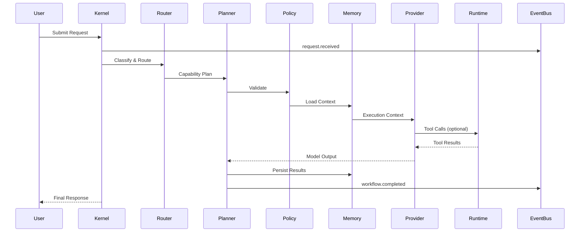

# Execution Architecture

## Executive Summary

The Execution Architecture specifies how Hermes AIOS operates at runtime. Unlike previous documents, which describe static components and infrastructure, this document defines the dynamic behavior of the system.

Every user request follows a deterministic lifecycle coordinated by the Hermes Kernel. Supporting components remain independent while collaborating through stable interfaces and the Event Bus.

---

# Runtime Goals

The runtime architecture must:

- Execute requests deterministically
- Support capability-based orchestration
- Remain provider-independent
- Execute workflows asynchronously
- Support interruption and recovery
- Operate offline where possible
- Provide complete observability
- Enable future distributed execution

---

# High-Level Request Flow

```
User
  │
  ▼
CLI / API / Desktop
  │
  ▼
Kernel
  │
  ▼
Workflow Context
  │
  ▼
Intent Classification
  │
  ▼
Capability Analysis
  │
  ▼
Workflow Planning
  │
  ▼
Policy Evaluation
  │
  ▼
Memory Retrieval
  │
  ▼
Provider Selection
  │
  ▼
Execution
  │
  ▼
Memory Update
  │
  ▼
Response
```

---

# Runtime Components

The runtime execution path consists of:

- Kernel
- Workflow Context
- Intent Classifier
- Capability Router
- Workflow Planner
- Policy Engine
- Memory Manager
- Provider Adapter
- Tool Runtime
- Event Bus
- Observability

Each component performs a single responsibility and communicates through published interfaces.

---

# Request Lifecycle

## Phase 1 — Request Acceptance

The Kernel receives a request from:

- CLI
- Desktop UI
- REST API
- Plugin
- Scheduler

Responsibilities:

- Generate Request ID
- Create Workflow Context
- Validate request format
- Publish `request.received`

---

## Phase 2 — Intent Classification

The Intent Classifier determines:

- User intent
- Required capabilities
- Estimated complexity
- Multi-step requirement

Outputs:

- Intent
- Confidence score
- Candidate capabilities

---

## Phase 3 — Capability Routing

The Capability Router:

- Resolves required capabilities
- Filters available providers
- Checks local capabilities
- Applies policy constraints

Output:

```
Capability Plan
```

---

## Phase 4 — Workflow Planning

The Workflow Planner constructs an execution graph.

Tasks include:

- Dependency resolution
- Parallelization
- Retry strategy
- Recovery checkpoints
- Resource estimation

Output:

```
Workflow Graph
```

---

## Phase 5 — Policy Evaluation

The Policy Engine validates:

- Permissions
- Tool access
- Network access
- Provider usage
- Plugin permissions

Possible outcomes:

- Allow
- Deny
- Require approval
- Modify execution plan

---

## Phase 6 — Memory Assembly

The Memory Manager gathers context from:

- Conversation history
- Project memory
- Semantic search
- User preferences
- Workflow state

The assembled context is injected into the workflow before execution.

---

## Phase 7 — Provider Selection

The Provider Adapter selects the most appropriate provider using:

- Required capabilities
- Availability
- Health
- Cost policy
- Latency
- Local-first preference

The planner remains unaware of vendor-specific implementations.

---

## Phase 8 — Tool Execution

When required, the Tool Runtime:

- Validates permissions
- Creates an isolated execution context
- Executes tools
- Streams progress
- Captures outputs
- Publishes execution events

---

## Phase 9 — Result Aggregation

Results from providers and tools are normalized.

The Workflow Planner:

- Validates outputs
- Resolves dependencies
- Performs post-processing
- Detects incomplete work

---

## Phase 10 — Memory Persistence

The Memory Manager persists:

- Conversation summary
- Workflow outcomes
- Retrieved knowledge
- User-approved long-term memory
- Metrics

Embeddings are generated asynchronously where possible.

---

## Phase 11 — Response Delivery

The Kernel returns:

- Final response
- Workflow metadata
- Optional execution metrics
- Streaming completion signal

---

# Execution State Machine

```
Created
   │
Validated
   │
Planned
   │
Executing
   │
Paused
   │
Resumed
   │
Completed

or

Failed

or

Cancelled
```

Every state transition is published through the Event Bus.

---

# Event Flow

Representative events:

```
request.received

workflow.created

planner.completed

memory.loaded

provider.selected

tool.started

tool.completed

provider.completed

workflow.completed

memory.persisted

response.sent
```

Events are immutable and timestamped.

---

# Failure Handling

Failures are categorized as:

- Validation
- Provider
- Tool
- Policy
- Storage
- Timeout
- Cancellation

Recovery strategies include:

- Retry
- Provider failover
- Workflow rollback
- Checkpoint resume
- Graceful degradation

---

# Streaming Model

Streaming stages:

```
Workflow Started

↓

Planner Updates

↓

Provider Tokens

↓

Tool Progress

↓

Memory Updates

↓

Final Response
```

Streaming is provider-independent.

---

# Concurrency Model

Independent workflow branches may execute concurrently when:

- Dependencies are satisfied
- Resources are available
- Policy permits parallel execution

Synchronization occurs before aggregation.

---

# Checkpointing

Long-running workflows create checkpoints after:

- Planning
- Provider completion
- Tool execution
- Memory persistence

Each checkpoint includes sufficient state for deterministic resumption.

---

# Observability

The runtime emits:

- Structured logs
- Metrics
- Distributed traces
- Health updates
- Event timelines

Every workflow is traceable from request acceptance to completion.

---

# Mermaid Sequence Diagram



---

# Architecture Decisions

## Kernel as Orchestrator

The Kernel coordinates execution but delegates specialized work to independent components.

## Capability-Driven Execution

Execution is based on required capabilities rather than provider identity, preserving provider independence.

## Event-Driven Coordination

Subsystems communicate asynchronously through immutable events whenever synchronous execution is unnecessary.

## Context Before Execution

Memory is assembled prior to provider invocation to maximize response quality and minimize redundant retrieval.

## Deterministic Recovery

Workflow checkpoints and immutable events enable reliable recovery after interruptions.

---

# Future Enhancements

- Distributed workflow execution
- Multi-node scheduling
- Adaptive planning
- Dynamic provider benchmarking
- Predictive prefetching
- Workflow optimization using historical telemetry
- Cooperative multi-agent execution
- Real-time execution visualization

---

# Cross References

Previous:

- `docs/implementation/05_7_CONTRIBUTOR_GUIDE.md`

Next:

- `docs/execution/06_1_KERNEL_EXECUTION_LIFECYCLE.md`
