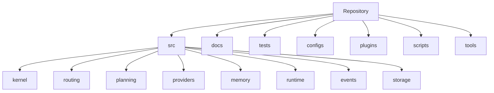

# Repository Structure

## Executive Summary

This document defines the canonical repository layout for Hermes AIOS. It establishes clear package boundaries, ownership rules, dependency directions, documentation conventions, and development standards so that the project remains modular and maintainable as it grows.

The repository is organized around architectural responsibilities rather than implementation technologies.

---

# Design Principles

- Architecture mirrors repository structure
- One responsibility per package
- Stable public interfaces
- Internal implementation isolation
- Documentation lives with the code
- Tests mirror source layout
- Configuration separated from implementation
- Plugins remain external to the core

---

# Top-Level Layout

```
hermes-aios/

├── docs/
├── src/
├── tests/
├── configs/
├── plugins/
├── scripts/
├── tools/
├── examples/
├── assets/
├── docker/
├── deployments/
├── .github/
├── pyproject.toml
├── uv.lock
├── README.md
├── LICENSE
└── CONTRIBUTING.md
```

---

# Source Tree

```
src/hermes/

├── __init__.py
├── kernel/
├── routing/
├── planning/
├── policy/
├── providers/
├── memory/
├── runtime/
├── events/
├── plugins/
├── config/
├── observability/
├── api/
├── cli/
├── scheduler/
├── security/
├── storage/
├── models/
├── interfaces/
├── common/
└── utils/
```

---

# Package Responsibilities

## kernel/

Contains:

- Application lifecycle
- Bootstrap
- Dependency injection
- Core runtime
- Service registry

No provider-specific logic.

---

## routing/

Contains:

- Capability Router
- Intent classification
- Model selection
- Request routing

Depends only on public interfaces.

---

## planning/

Contains:

- Workflow Planner
- Execution plans
- Complexity estimation
- Recovery planning

---

## policy/

Contains:

- Authorization
- Approval workflows
- Policy evaluation
- Permission enforcement

---

## providers/

Contains provider adapters only.

Example:

```
providers/

├── ollama/
├── openrouter/
├── openai/
├── huggingface/
└── base.py
```

Each provider implements the common Provider interface.

---

## memory/

Contains:

- Memory Manager
- Retrieval
- Embeddings
- Context assembly

No direct database logic.

---

## storage/

Contains database implementations.

Example:

```
storage/

├── sqlite/
├── chroma/
├── cache/
└── object_store/
```

Storage implementations are hidden behind interfaces.

---

## runtime/

Contains:

- Tool Runtime
- Execution sandbox
- Process management
- Streaming
- Tool registry

---

## events/

Contains:

- Event Bus
- Event schemas
- Publishers
- Subscribers
- Event persistence

---

## plugins/

Contains:

- Plugin loader
- Manifest parser
- Registry
- Compatibility checker

Third-party plugins are **not** stored here.

---

## config/

Contains:

- Configuration loader
- Schema validation
- Environment handling
- Feature flags

---

## observability/

Contains:

- Logging
- Metrics
- Tracing
- Health monitoring

---

## scheduler/

Contains:

- Background jobs
- Timers
- Workflow scheduling
- Retry scheduling

---

## api/

Contains:

- HTTP API
- WebSocket endpoints
- Request validation
- API versioning

---

## cli/

Contains:

- Command-line interface
- Administrative commands
- Developer utilities

---

## interfaces/

Defines stable contracts.

Examples:

- Provider
- Tool
- Memory
- Storage
- Event Bus
- Planner

Concrete implementations depend on these interfaces.

---

## common/

Shared domain models:

- Exceptions
- Constants
- Enumerations
- Value objects
- Shared types

---

# Documentation Layout

```
docs/

├── architecture/
├── infrastructure/
├── implementation/
├── api/
├── developer/
├── operations/
├── decisions/
└── adr/
```

Architecture Decision Records (ADRs) are stored under `docs/adr/`.

---

# Test Layout

```
tests/

├── unit/
├── integration/
├── end_to_end/
├── performance/
├── security/
├── fixtures/
└── data/
```

Every source package has a corresponding unit test package.

---

# Plugin Repository

```
plugins/

├── github/
├── gmail/
├── filesystem/
├── shell/
└── examples/
```

Plugins are versioned independently from the Hermes Core.

---

# Configuration Layout

```
configs/

├── defaults/
├── development/
├── production/
├── providers/
├── security/
├── plugins/
└── feature_flags/
```

---

# Dependency Rules

Allowed dependency direction:

```
CLI/API
    ↓
Kernel
    ↓
Planner
    ↓
Router
    ↓
Interfaces
    ↓
Implementations
```

Rules:

- No circular imports
- Lower layers never import higher layers
- Interfaces remain implementation-agnostic

---

# Naming Conventions

Packages:

- lowercase

Modules:

- snake_case

Classes:

- PascalCase

Functions:

- snake_case

Constants:

- UPPER_SNAKE_CASE

Protocols and abstract interfaces end with:

```
Provider
Storage
Planner
Runtime
```

---

# Build Artifacts

Generated output:

```
dist/
build/
coverage/
site/
```

These directories are excluded from version control.

---

# Git Ignore Categories

Ignore:

- Python caches
- Virtual environments
- Coverage reports
- Build artifacts
- Temporary files
- Local databases
- Local models
- IDE settings

Do not ignore:

- Documentation
- Configuration templates
- Example plugins

---

# Mermaid Diagram



---

# Architecture Decisions

## Architecture Mirrors Packages

Each architectural subsystem maps directly to a repository package, simplifying navigation and ownership.

## Interface-Driven Design

Stable interfaces isolate higher-level modules from implementation details, enabling provider and storage replacement with minimal impact.

## Documentation as Code

Architecture, ADRs, operational guides, and implementation notes are version-controlled alongside the source code.

## Independent Plugin Lifecycle

External plugins remain outside the core source tree, allowing separate release cycles and minimizing core dependencies.

## Test Symmetry

The test hierarchy mirrors the source hierarchy to simplify discovery, coverage analysis, and maintenance.

---

# Future Enhancements

- Monorepo tooling support
- Automatic architecture validation
- Module dependency graph generation
- Code ownership metadata
- Bazel/Nix build support
- Multi-language plugin SDKs
- Repository health dashboards

---

# Cross References

Previous:

- `05_IMPLEMENTATION_ROADMAP.md`

Next:

- `05_2_MODULE_DEPENDENCY_GRAPH.md`
