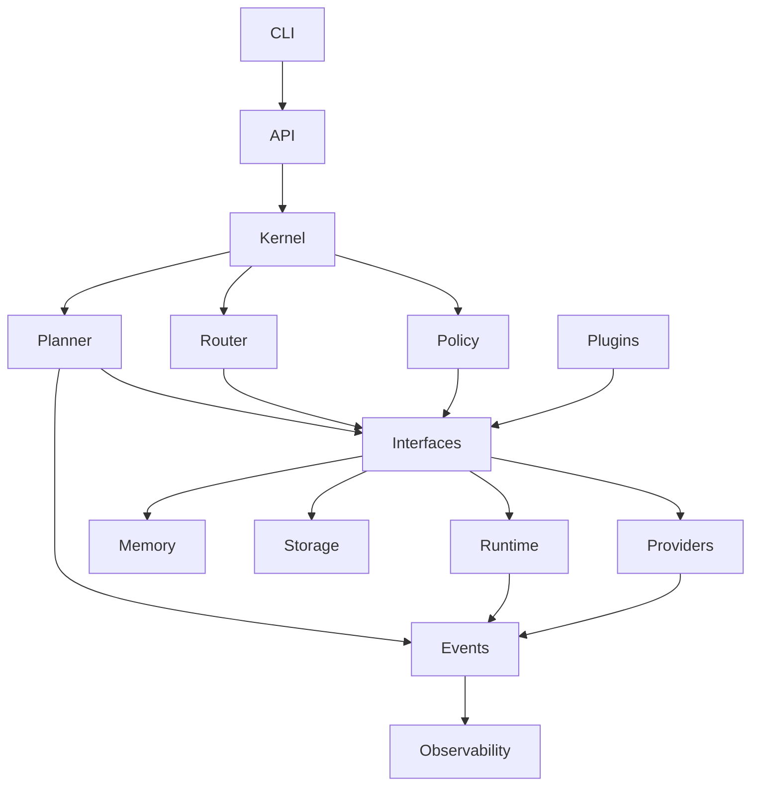

# Module Dependency Graph

## Executive Summary

This document defines the allowed dependency relationships between Hermes AIOS modules. It establishes architectural boundaries, initialization order, dependency inversion rules, and import constraints to ensure the implementation remains modular, testable, and aligned with the approved architecture.

Dependencies flow inward toward stable abstractions. Concrete implementations depend on interfaces rather than on each other wherever practical.

---

# Objectives

The dependency architecture ensures:

- No circular dependencies
- Clear ownership boundaries
- Stable public interfaces
- Independent module testing
- Replaceable implementations
- Predictable initialization
- Maintainable package evolution

---

# Architectural Layers

```
Applications
    │
    ▼
API / CLI
    │
    ▼
Kernel
    │
    ▼
Workflow Planner
    │
    ▼
Capability Router
    │
    ▼
Policy Engine
    │
    ▼
Interfaces
    │
    ▼
Implementations
```

Higher layers may depend only on the layers beneath them.

---

# Core Module Graph

```
                CLI
                 │
                 ▼
             API Gateway
                 │
                 ▼
            Hermes Kernel
                 │
      ┌──────────┼──────────┐
      ▼          ▼          ▼
 Workflow    Capability   Policy
 Planner      Router      Engine
      │          │          │
      └──────┬───┴──────┬───┘
             ▼          ▼
        Event Bus    Configuration
             │          │
             ▼          ▼
          Interfaces (Contracts)
             │
 ┌───────────┼────────────┬────────────┐
 ▼           ▼            ▼            ▼
Providers  Memory      Storage      Runtime
             │            │            │
             └──────┬─────┴─────┬──────┘
                    ▼           ▼
             Observability   Plugins
```

---

# Module Responsibilities

## Kernel

Owns:

- Lifecycle
- Service registry
- Dependency injection
- Bootstrap

Depends on:

- Interfaces
- Configuration
- Event Bus

Never imports concrete provider implementations directly.

---

## Workflow Planner

Depends on:

- Capability Router
- Policy Engine
- Event Bus
- Interfaces

Produces execution plans without direct knowledge of providers.

---

## Capability Router

Depends on:

- Capability registry
- Provider metadata
- Interfaces

Returns capability matches, not provider-specific implementations.

---

## Policy Engine

Depends on:

- Configuration
- Interfaces
- Security services

Must remain free of workflow logic.

---

## Provider Adapter

Implements:

- Provider interface
- Streaming interface
- Health interface

Never imports Planner or Kernel modules.

---

## Memory

Depends on:

- Storage interfaces
- Embedding interfaces
- Configuration

Does not depend on provider implementations.

---

## Storage

Implements:

- SQLite adapter
- Chroma adapter
- Cache adapter
- Object storage adapter

No knowledge of workflows or providers.

---

## Runtime

Depends on:

- Policy Engine
- Event Bus
- Interfaces

Never imports storage implementations directly.

---

## Plugins

Depend on:

- Public SDK
- Stable interfaces
- Plugin manifest schema

Plugins must never import internal modules outside the published SDK.

---

# Allowed Dependency Matrix

| Module | May Depend On |
|---------|---------------|
| CLI | API, Kernel |
| API | Kernel, Interfaces |
| Kernel | Planner, Router, Policy, Events, Config, Interfaces |
| Planner | Router, Policy, Events, Interfaces |
| Router | Interfaces, Config |
| Policy | Config, Interfaces |
| Runtime | Policy, Events, Interfaces |
| Providers | Interfaces |
| Memory | Storage Interfaces, Config |
| Storage | Interfaces |
| Plugins | SDK, Interfaces |
| Observability | Events, Interfaces |

Any dependency outside this matrix requires an Architecture Decision Record (ADR).

---

# Forbidden Dependencies

The following relationships are prohibited:

- Provider → Planner
- Provider → Kernel
- Storage → Workflow Planner
- Storage → Provider Adapter
- Plugin → Internal Kernel APIs
- Runtime → Concrete Database Implementations
- CLI → Provider Implementations
- API → Storage Implementations

These restrictions preserve architectural independence.

---

# Dependency Inversion

Core abstractions are defined under:

```
src/hermes/interfaces/
```

Examples:

```
Provider
MemoryStore
VectorStore
EventPublisher
WorkflowPlanner
ToolRuntime
ConfigurationProvider
```

Implementations depend on these interfaces, not the reverse.

---

# Initialization Order

```
Configuration
      │
      ▼
Logging
      │
      ▼
Event Bus
      │
      ▼
Storage
      │
      ▼
Memory
      │
      ▼
Providers
      │
      ▼
Policy
      │
      ▼
Capability Router
      │
      ▼
Workflow Planner
      │
      ▼
Tool Runtime
      │
      ▼
Kernel
      │
      ▼
API / CLI
```

The Kernel validates all mandatory dependencies before accepting requests.

---

# Service Registration

Each module registers itself with the Service Registry during startup.

Registration includes:

- Service name
- Version
- Interface implemented
- Health endpoint
- Lifecycle hooks
- Dependency declarations

---

# Lifecycle Hooks

Every service supports:

- initialize()
- start()
- ready()
- stop()
- shutdown()

Optional hooks:

- reload()
- health_check()
- migrate()

---

# Event Relationships

Primary publishers:

- Kernel
- Planner
- Runtime
- Providers
- Plugins

Primary subscribers:

- Observability
- Memory
- Scheduler
- Policy Engine
- Plugin Manager

Events are the preferred mechanism for asynchronous coordination.

---

# Build-Time Validation

Continuous integration verifies:

- Circular dependencies
- Layer violations
- Forbidden imports
- Interface compatibility
- Public API stability

Violations fail the build.

---

# Mermaid Diagram



---

# Architecture Decisions

## Layered Dependency Model

Dependencies flow toward stable abstractions, reducing coupling and simplifying testing.

## Interface Ownership

All shared contracts reside in a dedicated interfaces package owned by the architecture team, ensuring consistent evolution.

## Build-Time Enforcement

Architectural constraints are validated automatically during CI to prevent erosion over time.

## Event-Driven Coordination

Modules communicate asynchronously through the Event Bus whenever synchronous responses are unnecessary.

## Public SDK Boundary

External plugins interact only through the published SDK and interfaces, protecting internal implementation details.

---

# Future Enhancements

- Automated dependency graph generation
- Architecture conformance reports
- Module ownership metadata
- Import rule linting
- Visual dependency explorer
- Plugin compatibility analyzer
- Interface version negotiation

---

# Cross References

Previous:

- `05_1_REPOSITORY_STRUCTURE.md`

Next:

- `05_3_API_CONTRACTS.md`
