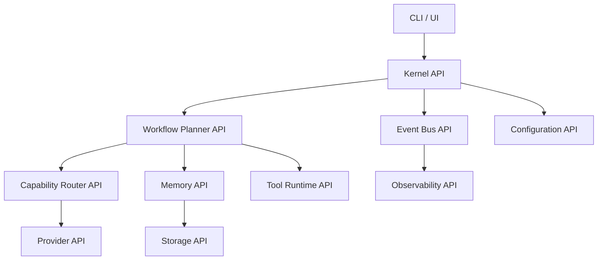

# API Contracts

## Executive Summary

Hermes AIOS is composed of loosely-coupled services that communicate through well-defined contracts. Every subsystem exposes a stable interface independent of its implementation.

These contracts allow:

- Component replacement
- Independent testing
- Plugin development
- Multi-provider support
- Future distributed execution
- Backward compatibility

No module may call another module through private implementation details.

---

# API Design Principles

Hermes APIs follow these principles:

- Interface-first
- Versioned
- Strongly typed
- Async-first
- Capability-oriented
- Transport independent
- Backward compatible
- Explicit error semantics

---

# API Categories

Hermes exposes four classes of APIs.

```
User APIs

↓

Kernel APIs

↓

Internal Service APIs

↓

Provider APIs
```

Each layer depends only on published contracts.

---

# Contract Versioning

Every contract includes:

```yaml
api_version: 1
contract_version: 1.0
compatibility: backward
```

Major versions indicate breaking changes.

Minor versions add optional capabilities.

Patch versions clarify behavior without changing interfaces.

---

# Common Request Structure

Every request contains:

```yaml
request_id:
workflow_id:
user_id:
timestamp:
capabilities:
context:
payload:
metadata:
```

---

# Common Response Structure

Every response returns:

```yaml
status:
request_id:
workflow_id:
result:
errors:
warnings:
metrics:
```

---

# Standard Status Values

```
SUCCESS
FAILED
PARTIAL
DENIED
CANCELLED
TIMEOUT
```

---

# Error Model

Every error contains:

```yaml
code:
category:
message:
details:
recoverable:
retry_after:
```

Example:

```yaml
code: PROVIDER_TIMEOUT
category: Provider
recoverable: true
```

---

# Kernel API

Responsibilities:

- Submit request
- Cancel workflow
- Query workflow
- Retrieve status
- Health

Operations:

```
submit()

cancel()

status()

health()

shutdown()
```

Kernel never exposes provider-specific behavior.

---

# Capability Router API

Input:

```
CapabilityRequest
```

Output:

```
CapabilityPlan
```

Example:

```yaml
required_capabilities:

- reasoning
- coding
- image_generation
```

---

# Workflow Planner API

Operations:

```
plan()

resume()

pause()

cancel()

estimate()

validate()
```

Returns:

```
WorkflowPlan
```

---

# Provider API

Every provider implements:

```
initialize()

generate()

stream()

health()

capabilities()

shutdown()
```

Providers expose capabilities rather than model names.

---

# Memory API

Operations:

```
store()

retrieve()

search()

summarize()

delete()

archive()
```

Memory implementations remain independent of storage engines.

---

# Storage API

Operations:

```
read()

write()

update()

delete()

transaction()

backup()

restore()
```

Storage consumers never interact with SQLite or ChromaDB directly.

---

# Tool Runtime API

Operations:

```
execute()

cancel()

status()

stream()

list_tools()
```

Execution always passes through the Policy Engine.

---

# Event Bus API

Publish:

```
publish(event)
```

Subscribe:

```
subscribe(topic)
```

Replay:

```
replay()
```

Events are immutable.

---

# Plugin API

Plugins implement:

```
initialize()

register()

execute()

shutdown()
```

Optional:

```
upgrade()

migrate()

health()
```

---

# Configuration API

Operations:

```
get()

set()

reload()

validate()

watch()
```

Configuration changes generate Event Bus notifications.

---

# Observability API

Operations:

```
log()

metric()

trace()

health()

alert()
```

Every subsystem reports through this interface.

---

# Authentication Contract

Requests may include:

```yaml
identity:
token:
roles:
permissions:
```

Authorization is evaluated separately by the Policy Engine.

---

# Streaming Contract

Streaming responses follow:

```
BEGIN

↓

TOKEN

↓

TOKEN

↓

EVENT

↓

COMPLETE
```

Supported stream types:

- Text
- Tool output
- Workflow updates
- Progress
- Events

---

# Timeout Contract

Every operation declares:

```yaml
timeout:
retryable:
priority:
```

Default values are configuration-driven.

---

# Compatibility Rules

Allowed:

- Add optional fields
- Add capabilities
- Improve performance

Not allowed:

- Remove required fields
- Change field semantics
- Modify identifiers
- Change response status meanings

Breaking changes require a new major API version.

---

# API Lifecycle

```
Draft

↓

Experimental

↓

Stable

↓

Deprecated

↓

Removed
```

Deprecation includes migration guidance and supported timelines.

---

# Mermaid Diagram



---

# Architecture Decisions

## Stable Contracts

Interfaces remain stable while implementations evolve independently.

## Capability-Oriented Providers

Providers advertise capabilities rather than exposing vendor-specific behavior.

## Transport Independence

Contracts are independent of HTTP, IPC, gRPC, or in-process communication, enabling future deployment flexibility.

## Unified Error Model

A common error structure simplifies retries, logging, monitoring, and user feedback.

## Versioned Evolution

Explicit versioning supports long-term compatibility across core components and plugins.

---

# Future Enhancements

- OpenAPI specifications
- gRPC interface definitions
- Async event schemas
- SDK generation
- API conformance tests
- Contract validation tooling
- Consumer-driven contract testing

---

# Cross References

Previous:

- `05_2_MODULE_DEPENDENCY_GRAPH.md`

Next:

- `05_4_DATABASE_SCHEMA.md`
