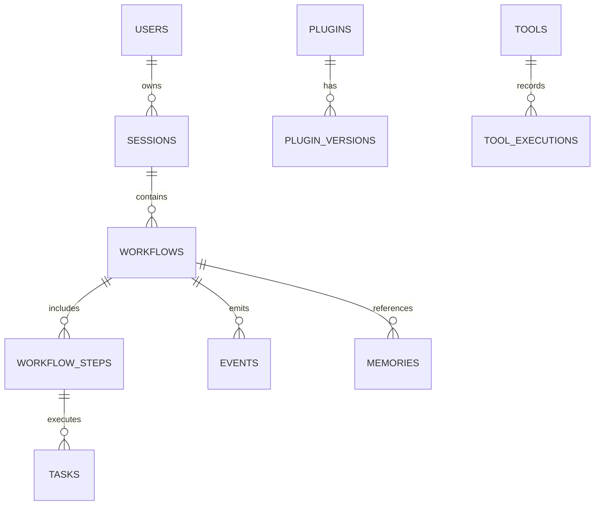

# Database Schema

## Executive Summary

Hermes AIOS separates structured, transactional data from semantic knowledge. Structured entities are persisted in SQLite, semantic embeddings in ChromaDB, and all access is mediated through the Storage Service API.

This separation preserves transactional integrity while enabling efficient semantic retrieval.

---

# Design Goals

- Normalize transactional data
- Keep semantic vectors independent
- Stable identifiers across stores
- Versioned schema migrations
- Explicit ownership of entities
- Minimal coupling between storage engines
- Efficient indexing
- Future backend portability

---

# Persistence Architecture

```
Application
      │
Storage Service API
      │
 ┌────┴─────────────┐
 │                  │
 ▼                  ▼
SQLite          ChromaDB
 │                  │
Structured      Embeddings
Metadata        Semantic Index
Relationships   Similarity Search
```

---

# Entity Overview

Primary relational entities:

- users
- sessions
- workflows
- workflow_steps
- tasks
- providers
- capabilities
- plugins
- plugin_versions
- tools
- tool_executions
- memories
- documents
- events
- configurations
- schedules
- audit_logs

---

# Entity Descriptions

## users

Purpose:

Represents local users of Hermes AIOS.

Fields:

- id (UUID)
- username
- display_name
- created_at
- updated_at
- status

---

## sessions

Tracks active and historical interactions.

Fields:

- id
- user_id
- started_at
- ended_at
- context_version
- metadata

Relationship:

```
User

1

↓

Many Sessions
```

---

## workflows

Represents high-level execution plans.

Fields:

- id
- session_id
- status
- priority
- planner_version
- created_at
- completed_at

---

## workflow_steps

Stores execution stages.

Fields:

- id
- workflow_id
- sequence
- capability
- assigned_provider
- status
- started_at
- completed_at

---

## tasks

Represents executable units.

Fields:

- id
- workflow_step_id
- runtime
- retries
- timeout
- result
- metadata

---

## providers

Registered provider implementations.

Fields:

- id
- name
- version
- endpoint
- capability_profile
- health

---

## capabilities

Canonical capability registry.

Examples:

- reasoning
- coding
- planning
- retrieval
- summarization
- image_generation
- transcription

---

## plugins

Installed plugin metadata.

Fields:

- id
- name
- version
- publisher
- permissions
- status

---

## plugin_versions

Tracks compatibility.

Fields:

- plugin_id
- api_version
- minimum_core
- maximum_core

---

## tools

Registered runtime tools.

Examples:

- shell
- python
- filesystem
- browser
- git

---

## tool_executions

Execution history.

Fields:

- tool_id
- workflow_id
- duration
- exit_code
- resource_usage

---

## memories

Metadata describing semantic memories.

Stored in SQLite:

- id
- collection
- owner
- created_at
- tags

Embedding vectors reside in ChromaDB.

---

## documents

Tracks imported knowledge.

Fields:

- id
- source
- checksum
- mime_type
- size
- ingestion_status

---

## events

Persistent Event Bus history.

Fields:

- id
- event_type
- workflow_id
- timestamp
- payload_reference

---

## configurations

Stores configuration revisions.

Fields:

- id
- version
- environment
- checksum
- activated_at

---

## schedules

Scheduler metadata.

Fields:

- id
- workflow
- trigger
- next_run
- status

---

## audit_logs

Immutable security records.

Fields:

- id
- actor
- action
- resource
- timestamp
- outcome

---

# ChromaDB Collections

Recommended collections:

```
conversation_memory

project_memory

documentation

knowledge

user_preferences

workflow_context

plugin_docs
```

Every vector includes metadata:

```yaml
id:
owner:
workflow:
source:
tags:
created_at:
embedding_model:
schema_version:
```

---

# Relationships

```
User
 │
 ├── Sessions
 │
 └── Workflows
      │
      ├── Workflow Steps
      │       │
      │       └── Tasks
      │
      ├── Events
      │
      └── Memories
```

---

# Identifier Strategy

All persistent entities use UUIDv7 (or the project's chosen monotonic UUID format).

Benefits:

- Globally unique identifiers
- Time ordering
- Distributed compatibility
- Stable cross-store references

---

# Transactions

SQLite transactions are used for:

- Workflow creation
- State transitions
- Configuration activation
- Plugin installation
- Schedule updates
- Audit logging

Vector operations occur outside relational transactions but are coordinated by the Storage Service.

---

# Indexing Strategy

Recommended indexes:

```
workflows(status)

workflows(created_at)

workflow_steps(workflow_id)

tasks(workflow_step_id)

events(workflow_id)

documents(checksum)

audit_logs(timestamp)

providers(name)
```

Vector indexes are maintained by ChromaDB.

---

# Schema Versioning

Each migration records:

- version
- checksum
- applied_at
- description

Schema history is immutable.

---

# Migration Strategy

Rules:

- Forward-only migrations
- Explicit rollback scripts where feasible
- Idempotent migration execution
- Validation after migration
- Automatic backup before migration

---

# Data Lifecycle

```
Create

↓

Validate

↓

Persist

↓

Index

↓

Use

↓

Archive

↓

Delete
```

Deletion follows retention policies defined in the Configuration System.

---

# Backup Integration

The Backup Service persists:

- SQLite database
- ChromaDB collections
- Migration history
- Configuration revisions
- Plugin metadata

Restores preserve identifier consistency across stores.

---

# Performance Considerations

- Batch writes where practical
- Lazy loading for large objects
- Connection pooling (future)
- Prepared statements
- Metadata filtering before vector search
- Asynchronous embedding generation

---

# Mermaid ER Diagram



---

# Architecture Decisions

## Polyglot Persistence

SQLite and ChromaDB each manage the data they are best suited for, while the Storage Service presents a unified API.

## Stable Identifiers

A shared identifier strategy enables reliable cross-references between relational records and semantic embeddings.

## Migration Discipline

Schema evolution is versioned, validated, and coordinated with automated backups to reduce upgrade risk.

## Metadata Separation

Large vectors remain outside the relational database; SQLite stores only metadata and relationships.

## Storage Abstraction

Future backends (e.g., PostgreSQL or Qdrant) can replace current implementations through the Storage Service without changing higher-level modules.

---

# Future Enhancements

- PostgreSQL backend
- Qdrant adapter
- Multi-tenant schemas
- Data partitioning
- Read replicas
- Online schema migration
- Compression policies
- Automated index recommendations

---

# Cross References

Previous:

- `05_3_API_CONTRACTS.md`

Next:

- `05_5_PLUGIN_SDK.md`
