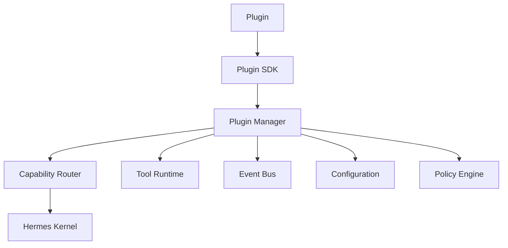

# Plugin SDK

## Executive Summary

The Hermes AIOS Plugin SDK provides a stable, versioned programming interface for extending Hermes AIOS. Plugins can contribute tools, capabilities, workflows, providers, connectors, event handlers, and UI extensions while remaining isolated from the internal implementation of the Hermes Core.

The SDK guarantees backward compatibility within a major version and enables an ecosystem of independently developed extensions.

---

# Objectives

The Plugin SDK provides:

- Stable extension APIs
- Version compatibility
- Plugin lifecycle management
- Capability registration
- Tool registration
- Event integration
- Configuration access
- Permission declarations
- Testing support
- Packaging standards

---

# Design Principles

- SDK-first development
- Stable public interfaces
- No access to internal modules
- Capability-based registration
- Explicit permissions
- Configuration-driven behavior
- Versioned contracts
- Secure by default

---

# SDK Package Layout

```
hermes_sdk/

├── __init__.py
├── plugin.py
├── capabilities.py
├── tools.py
├── events.py
├── configuration.py
├── permissions.py
├── context.py
├── models.py
├── exceptions.py
├── version.py
└── testing.py
```

Plugins import only from `hermes_sdk`.

---

# Plugin Manifest

Each plugin includes a manifest.

Example:

```yaml
id: hermes.github
name: GitHub Connector
version: 1.2.0
sdk_version: 1.0
api_version: 1
author: Hermes Community
license: MIT

permissions:
  - network
  - secrets

capabilities:
  - repository
  - issues
  - pull_requests

entrypoint: plugin.py
```

---

# Lifecycle

The Plugin Manager invokes lifecycle hooks in the following order:

```
Install
   │
Validate
   │
Initialize
   │
Register
   │
Start
   │
Execute
   │
Stop
   │
Unload
```

---

# Base Plugin Interface

Every plugin implements:

```python
class Plugin:

    async def initialize(self):
        ...

    async def register(self):
        ...

    async def shutdown(self):
        ...
```

Optional hooks:

```python
health()

reload()

upgrade()

migrate()
```

---

# Capability Registration

Plugins register capabilities rather than provider-specific features.

Example:

```python
register_capability(
    name="repository_search",
    category="development",
    version="1.0"
)
```

The Capability Router discovers these registrations dynamically.

---

# Tool Registration

Example:

```python
register_tool(
    name="git_clone",
    description="Clone a Git repository",
    permissions=["network"],
    handler=clone_repository
)
```

The Tool Runtime validates permissions before execution.

---

# Event API

Publish:

```python
publish_event(...)
```

Subscribe:

```python
subscribe(
    topic="workflow.completed",
    handler=...
)
```

Events are immutable and versioned.

---

# Configuration API

Plugins access configuration through:

```python
config.get("plugin.setting")

config.watch(...)

config.reload()
```

Plugins never read configuration files directly.

---

# Context Object

Each execution receives a context object containing:

- Request ID
- Workflow ID
- User identity (subject to policy)
- Logger
- Metrics collector
- Configuration interface
- Event publisher
- Cancellation token

The context is read-only except for approved extension points.

---

# Permission Model

Supported permissions include:

- filesystem.read
- filesystem.write
- network
- shell
- clipboard
- camera
- microphone
- secrets
- database
- gpu

Permissions are declared in the manifest and enforced by the Policy Engine.

---

# Provider Extensions

Provider plugins implement:

```python
ProviderPlugin
```

Required methods:

```python
initialize()

generate()

stream()

health()

capabilities()
```

Provider implementations advertise capabilities rather than vendor names.

---

# Workflow Extensions

Workflow plugins may contribute:

- Planner templates
- Recovery strategies
- Scheduling policies
- Execution patterns

Workflow extensions are validated before activation.

---

# UI Extensions

Future UI plugins may contribute:

- Dashboard panels
- Widgets
- Inspectors
- Status views

The SDK reserves extension points for these features.

---

# Packaging

Recommended structure:

```
my_plugin/

├── plugin.py
├── manifest.yaml
├── README.md
├── LICENSE
├── pyproject.toml
└── tests/
```

Each package should include documentation and automated tests.

---

# Compatibility

Manifest fields:

```yaml
minimum_core:

maximum_core:

sdk_version:

api_version:
```

Incompatible plugins are rejected during installation.

---

# Testing Support

The SDK includes testing utilities for:

- Mock context
- Mock configuration
- Mock event bus
- Mock storage
- Permission simulation
- Lifecycle testing

Plugins should pass automated compatibility tests before publication.

---

# Security

Plugin execution is protected by:

- Sandboxing
- Permission enforcement
- Manifest validation
- Signature verification (optional)
- Resource quotas
- Audit logging

Plugins must not access internal Hermes modules directly.

---

# Error Handling

Plugins return structured errors:

```yaml
code:
message:
recoverable:
details:
```

Unhandled exceptions are captured by the Plugin Manager and reported through the Observability subsystem.

---

# Mermaid Diagram



---

# Architecture Decisions

## Stable SDK Boundary

Only the SDK is considered public. Internal modules may evolve without breaking plugins.

## Capability-Based Registration

Plugins register capabilities rather than binding directly to specific providers or workflows, enabling dynamic orchestration.

## Policy Enforcement

All plugin operations are mediated by the Policy Engine to ensure consistent security and permission handling.

## Versioned Compatibility

SDK and API versions are declared explicitly to support long-term ecosystem stability.

## Testable Extensions

The SDK includes mock implementations and compatibility tooling to simplify plugin development and validation.

---

# Future Enhancements

- Plugin marketplace client
- SDK code generators
- Interactive plugin debugger
- Remote plugin deployment
- Digital signature tooling
- Compatibility certification
- Multi-language SDKs
- Live plugin diagnostics

---

# Cross References

Previous:

- `05_4_DATABASE_SCHEMA.md`

Next:

- `05_6_TESTING_HANDBOOK.md`
