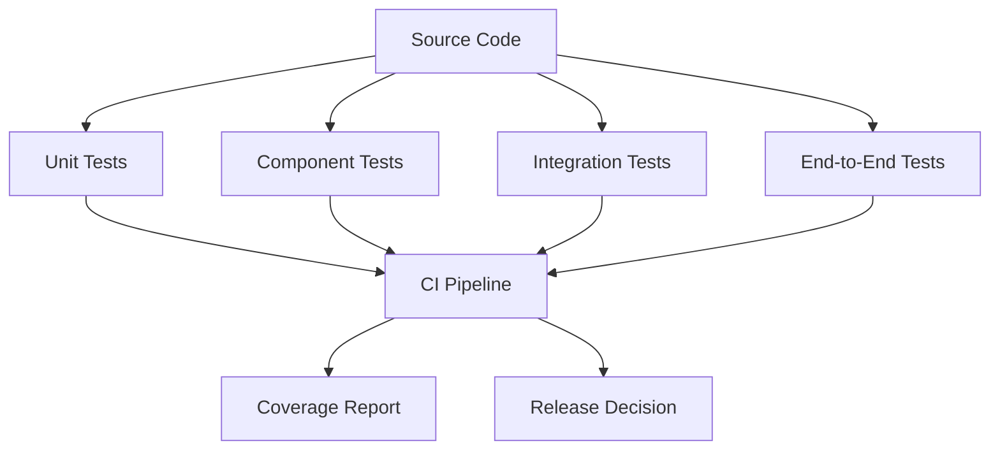

# Testing Handbook

## Executive Summary

Hermes AIOS adopts a layered testing strategy to ensure correctness, stability, security, and maintainability throughout development. Every architectural component defined in Phases 1 and 2 must have corresponding automated tests before being considered production-ready.

Testing is integrated into development from the first implementation milestone rather than added near release.

---

# Objectives

The testing strategy ensures:

- Functional correctness
- Architectural conformance
- Regression prevention
- Stable public APIs
- Plugin compatibility
- Provider abstraction verification
- Security validation
- Performance monitoring
- Continuous quality assurance

---

# Testing Principles

- Test early
- Test automatically
- Test at multiple layers
- Prefer deterministic tests
- Mock external dependencies
- Validate architecture continuously
- Keep tests independent
- Treat failing tests as release blockers

---

# Test Pyramid

```
                End-to-End
              Integration
             Component Tests
             Unit Tests
```

Approximate distribution:

- Unit Tests: 70%
- Component Tests: 15%
- Integration Tests: 10%
- End-to-End Tests: 5%

---

# Test Directory

```
tests/

├── unit/
├── component/
├── integration/
├── end_to_end/
├── performance/
├── security/
├── compatibility/
├── fixtures/
├── data/
└── utilities/
```

Each source package has a corresponding unit test package.

---

# Unit Testing

Every public module requires unit tests.

Targets include:

- Kernel
- Router
- Planner
- Policy
- Provider Adapter
- Memory
- Runtime
- Event Bus
- Configuration
- Plugin Manager

Requirements:

- Deterministic
- Fast execution
- No network access
- Isolated dependencies

---

# Component Testing

Component tests verify internal collaboration within a subsystem.

Examples:

- Planner + Router
- Memory + Storage
- Runtime + Policy
- Configuration + Event Bus

---

# Integration Testing

Integration tests validate interactions between multiple subsystems.

Examples:

- Kernel → Planner → Provider
- Workflow → Runtime → Memory
- Plugin → Event Bus
- Scheduler → Workflow Planner

External services should be mocked unless explicitly testing integrations.

---

# End-to-End Testing

Representative scenarios include:

- User request lifecycle
- Capability routing
- Multi-step workflow execution
- Plugin execution
- Memory retrieval
- Recovery after interruption

Tests execute against a fully initialized Hermes instance.

---

# Performance Testing

Performance validation includes:

- Workflow latency
- Provider response time
- Memory retrieval latency
- Event throughput
- Startup time
- Shutdown time
- Concurrent workflow execution

Performance baselines are tracked across releases.

---

# Security Testing

Security tests verify:

- Authorization
- Permission enforcement
- Secret isolation
- Sandbox integrity
- Configuration protection
- API authentication
- Plugin restrictions

Security regressions block releases.

---

# Compatibility Testing

Compatibility suites validate:

- Plugin SDK compatibility
- Provider Adapter implementations
- Configuration schema versions
- Database migrations
- Public API contracts

All supported versions must pass before release.

---

# Mocking Standards

Mock:

- Cloud providers
- Network APIs
- Time
- File system (where practical)
- External services

Do not mock:

- Core business logic
- Public interfaces under test

---

# Test Fixtures

Reusable fixtures include:

- Test users
- Mock workflows
- Sample memories
- Provider responses
- Configuration sets
- Plugin manifests
- Event streams

Fixtures are version-controlled and documented.

---

# Code Coverage

Minimum coverage targets:

| Area | Target |
|------|--------|
| Overall | 90% |
| Kernel | 95% |
| Planner | 95% |
| Policy | 95% |
| Memory | 90% |
| Runtime | 90% |
| Providers | 85% |
| Plugins | 85% |

Coverage is a quality signal, not a substitute for meaningful tests.

---

# Continuous Integration

Every pull request executes:

1. Ruff
2. Black formatting check
3. MyPy
4. Unit tests
5. Component tests
6. Integration tests
7. API contract validation
8. Architecture dependency checks
9. Documentation build

A failing stage blocks merging.

---

# Regression Testing

Regression suites are maintained for:

- Reported defects
- Critical workflows
- Security fixes
- Performance regressions
- Plugin compatibility issues

Every resolved defect receives a permanent regression test.

---

# Release Validation

A release candidate requires:

- All automated tests passing
- Documentation updated
- No critical vulnerabilities
- Architecture validation successful
- Performance within agreed baselines
- Migration testing completed

---

# Test Data Management

Rules:

- Synthetic data by default
- No production secrets
- Versioned datasets
- Reproducible fixtures
- Clear ownership

---

# Observability During Tests

Capture:

- Structured logs
- Metrics
- Event traces
- Failed assertions
- Execution timing

Artifacts are retained for CI analysis.

---

# Mermaid Diagram



---

# Architecture Decisions

## Shift-Left Testing

Quality assurance begins during implementation rather than after feature completion.

## Layered Verification

Each testing layer validates a distinct level of system behavior, reducing debugging complexity.

## Continuous Enforcement

Architectural rules, API contracts, and documentation integrity are verified automatically in CI.

## Stable Fixtures

Reusable fixtures improve consistency and reduce maintenance overhead.

## Release Gates

Automated quality gates prevent unstable changes from reaching production.

---

# Future Enhancements

- Mutation testing
- Property-based testing
- Chaos engineering
- Load testing clusters
- AI-generated test cases
- Visual regression testing
- Continuous performance benchmarking
- Distributed integration labs

---

# Cross References

Previous:

- `05_5_PLUGIN_SDK.md`

Next:

- `05_7_CONTRIBUTOR_GUIDE.md`
