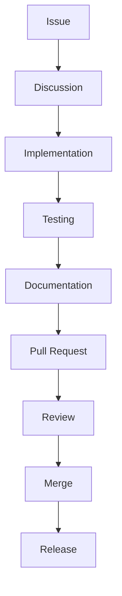

# Contributor Guide

## Executive Summary

This guide defines the contribution workflow for Hermes AIOS. It establishes engineering standards, collaboration processes, documentation expectations, review requirements, and governance practices that preserve the architecture and maintain long-term project quality.

The guide applies equally to first-party maintainers and external contributors.

---

# Objectives

The contributor process should:

- Preserve architectural integrity
- Encourage small, reviewable changes
- Maintain consistent coding standards
- Keep documentation synchronized with implementation
- Prevent architectural drift
- Support community contributions
- Enable predictable releases

---

# Core Principles

- Architecture before implementation
- Documentation is part of the deliverable
- Small, focused pull requests
- Automated validation
- Reproducible development environments
- Respect interface boundaries
- Backward compatibility where practical

---

# Development Workflow

```
Issue

↓

Discussion

↓

Architecture Decision (if required)

↓

Implementation

↓

Testing

↓

Documentation Update

↓

Pull Request

↓

Review

↓

Merge

↓

Release
```

---

# Branching Strategy

| Branch | Purpose |
|---------|----------|
| `main` | Stable production-ready code |
| `develop` | Active integration branch |
| `feature/*` | New features |
| `fix/*` | Bug fixes |
| `docs/*` | Documentation-only changes |
| `release/*` | Release preparation |
| `hotfix/*` | Production fixes |

Rules:

- Never commit directly to `main`
- Rebase feature branches before merging
- Keep branches short-lived

---

# Commit Message Convention

Adopt the Conventional Commits specification.

Examples:

```text
feat(kernel): add service registry

fix(memory): resolve retrieval race condition

docs(architecture): update provider adapter

test(runtime): add sandbox validation

refactor(policy): simplify permission checks

chore(ci): update workflow
```

---

# Pull Request Requirements

Every pull request must include:

- Clear description
- Linked issue (if applicable)
- Testing summary
- Documentation updates
- Breaking-change notes
- Screenshots (when UI changes)
- Checklist completion

Recommended size:

- Prefer fewer than 500 changed lines when practical.

---

# Code Review Standards

Reviewers verify:

- Architectural compliance
- Readability
- Test coverage
- Error handling
- Performance impact
- Security implications
- Documentation accuracy
- Public API compatibility

At least one approval is required before merge.

---

# Documentation Requirements

Any change that affects:

- Architecture
- Public APIs
- Configuration
- CLI behavior
- Plugin SDK
- Deployment

must include corresponding documentation updates.

Documentation changes are reviewed with the same rigor as code.

---

# Architecture Decision Records (ADRs)

Create an ADR when changing:

- Module boundaries
- Public interfaces
- Storage strategy
- Provider abstractions
- Deployment model
- Security model
- Event model

ADR template:

```text
Title
Status
Context
Decision
Consequences
Alternatives Considered
```

Store ADRs under:

```
docs/adr/
```

---

# Coding Standards

All contributions should:

- Use Python type hints
- Follow Ruff formatting and linting rules
- Avoid circular dependencies
- Favor dependency injection
- Use structured logging
- Handle errors explicitly
- Prefer async APIs for I/O-bound work

---

# Testing Expectations

Before submitting a pull request:

- Unit tests pass
- Integration tests pass
- Linting passes
- Type checking passes
- Documentation builds successfully

Changes that reduce test coverage require justification.

---

# Dependency Management

Rules:

- Minimize dependencies
- Prefer standard library when appropriate
- Pin dependency versions
- Remove unused packages promptly
- Evaluate licensing before adoption

---

# Security Review

Changes affecting authentication, authorization, secrets, networking, or plugin execution require an additional security review.

Security-sensitive changes should include threat considerations in the pull request description.

---

# Issue Management

Issue labels:

- bug
- enhancement
- documentation
- architecture
- performance
- security
- testing
- good first issue
- help wanted

Issues should include reproduction steps when reporting defects.

---

# Release Workflow

```
Feature Complete

↓

Release Branch

↓

Regression Testing

↓

Documentation Review

↓

Version Bump

↓

Tag Release

↓

Publish Artifacts

↓

Announce Release
```

---

# Versioning

Hermes AIOS follows Semantic Versioning.

```
MAJOR.MINOR.PATCH
```

Examples:

- 1.0.0
- 1.1.0
- 1.1.1

Breaking changes require a major version increment.

---

# Governance

Project maintainers are responsible for:

- Architectural consistency
- Release approval
- Dependency management
- Security oversight
- ADR acceptance

Contributors are encouraged to discuss significant changes before implementation.

---

# Communication

Recommended channels:

- GitHub Issues
- GitHub Discussions
- Pull Request reviews
- ADRs
- Project documentation

Design decisions should be recorded rather than remaining in chat history.

---

# Mermaid Diagram



---

# Architecture Decisions

## Documentation-Driven Development

Major architectural changes begin with documentation and ADRs before implementation.

## Small Incremental Contributions

Smaller pull requests reduce review complexity and regression risk.

## Continuous Architectural Validation

Automated checks and human review preserve module boundaries and public contracts.

## Shared Ownership

Core maintainers own architectural direction while encouraging external contributions through well-defined processes.

## Process Transparency

All significant technical decisions are documented, version-controlled, and reviewable.

---

# Future Enhancements

- Contributor onboarding tutorials
- Automated ADR templates
- Code ownership files
- Architecture conformance dashboards
- Mentorship program
- Contributor recognition
- Automated release notes
- Governance handbook

---

# Cross References

Previous:

- `05_6_TESTING_HANDBOOK.md`

Next:

- `06_EXECUTION_ARCHITECTURE.md`
