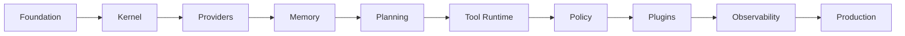

# Implementation Roadmap

## Executive Summary

This roadmap translates the Hermes AIOS architecture into an executable engineering plan. It defines the order in which components should be implemented, identifies project milestones, establishes coding and testing standards, and minimizes technical risk by building from the inside out.

The roadmap is designed for iterative development with a working system available early in the project while allowing advanced capabilities to be layered on incrementally.

---

# Roadmap Principles

Hermes AIOS development follows these principles:

- Build the smallest functional system first
- Deliver working software at every milestone
- Keep components independently testable
- Prefer interfaces before implementations
- Minimize external dependencies
- Automate testing early
- Preserve backward compatibility
- Treat documentation as part of the codebase

---

# Technology Stack

## Language

- Python 3.13+

## Package Management

- uv

## Dependency Management

- pyproject.toml

## Code Quality

- Ruff
- Black
- MyPy
- Pre-commit

## Testing

- pytest
- pytest-asyncio
- coverage.py

## Documentation

- MkDocs Material
- Mermaid

## Local AI

- Ollama

## Cloud Providers

- OpenRouter
- OpenAI
- Anthropic
- Others through Provider Adapter

## Storage

- SQLite
- ChromaDB

---

# Repository Structure

```
hermes-aios/

├── docs/
├── src/
│   └── hermes/
│       ├── kernel/
│       ├── routing/
│       ├── planning/
│       ├── policy/
│       ├── providers/
│       ├── memory/
│       ├── runtime/
│       ├── events/
│       ├── plugins/
│       ├── config/
│       ├── api/
│       ├── cli/
│       └── observability/
│
├── tests/
├── scripts/
├── examples/
├── configs/
├── plugins/
└── tools/
```

---

# Implementation Phases

## Milestone 1 — Foundation

Deliverables:

- Project skeleton
- Configuration loader
- Logging
- Dependency injection
- CLI bootstrap
- Health check
- Development tooling

Outcome:

Hermes boots successfully.

---

## Milestone 2 — Core Kernel

Implement:

- Hermes Kernel
- Capability Registry
- Event Bus
- Workflow context
- Basic lifecycle

Outcome:

Kernel accepts requests.

---

## Milestone 3 — Provider Layer

Implement:

- Provider Adapter
- Ollama integration
- OpenRouter integration
- Provider abstraction
- Streaming interface

Outcome:

Hermes can communicate with multiple LLM providers.

---

## Milestone 4 — Memory

Implement:

- SQLite storage
- ChromaDB
- Memory APIs
- Embeddings
- Retrieval

Outcome:

Persistent memory operational.

---

## Milestone 5 — Planning

Implement:

- Intent classifier
- Capability Router
- Workflow Planner
- Complexity estimator

Outcome:

Automatic capability-based orchestration.

---

## Milestone 6 — Tool Runtime

Implement:

- Tool Registry
- Sandbox
- Python tools
- Shell tools
- Streaming
- Permissions

Outcome:

Hermes executes local tools safely.

---

## Milestone 7 — Policy

Implement:

- Permission system
- RBAC
- Approval workflow
- Secret management

Outcome:

Secure execution model.

---

## Milestone 8 — Plugins

Implement:

- Plugin loader
- Manifest parser
- Registry
- Hot reload
- Version checks

Outcome:

Extensible platform.

---

## Milestone 9 — Observability

Implement:

- Metrics
- Tracing
- Logging
- Dashboard integration

Outcome:

Operational visibility.

---

## Milestone 10 — Production Readiness

Complete:

- Performance optimization
- Security review
- Documentation
- Packaging
- Backup automation
- Recovery testing

Outcome:

Stable v1.0 release candidate.

---

# Cross-Cutting Activities

Performed throughout every milestone:

- Unit testing
- Integration testing
- Static analysis
- Documentation updates
- Performance profiling
- Security review
- Dependency updates

---

# Coding Standards

- Type hints required
- Async-first where appropriate
- Public APIs documented
- Dependency injection preferred
- No hidden global state
- Explicit interfaces
- Structured logging
- Consistent error handling

---

# Testing Strategy

## Unit Tests

Every public component.

## Integration Tests

Subsystem interactions.

## End-to-End Tests

Representative user workflows.

## Performance Tests

Latency and throughput validation.

## Security Tests

Permission enforcement, sandbox isolation, and secret handling.

---

# CI/CD Pipeline

Stages:

1. Lint
2. Format check
3. Type check
4. Unit tests
5. Integration tests
6. Build documentation
7. Package artifacts

Future stages:

- Container builds
- Release signing
- SBOM generation

---

# Risks and Mitigations

| Risk | Mitigation |
|------|------------|
| Scope growth | Incremental milestones |
| Provider API changes | Provider Adapter abstraction |
| Performance bottlenecks | Early profiling |
| Dependency drift | Version pinning |
| Plugin instability | Stable public APIs |

---

# Success Criteria

A milestone is complete when:

- All acceptance tests pass
- Documentation is updated
- Public APIs are stable
- Performance targets are met
- Security checks succeed
- CI pipeline is green

---

# Mermaid Diagram



---

# Architecture Decisions

## Incremental Delivery

Each milestone produces a usable system rather than a partially complete framework.

## Interface-First Development

Public interfaces are defined before implementations to reduce coupling.

## Continuous Verification

Testing and documentation evolve alongside code.

## Local-First Execution

Core functionality remains operational without cloud connectivity.

---

# Future Work

Following implementation planning, subsequent documentation will cover:

- Module specifications
- API contracts
- Database schemas
- Plugin SDK
- Testing handbook
- Contributor guide
- Release process

---

# Cross References

Previous:

- `docs/infrastructure/04_7_SCALING_STRATEGY.md`

Next:

- `docs/implementation/05_1_REPOSITORY_STRUCTURE.md`
