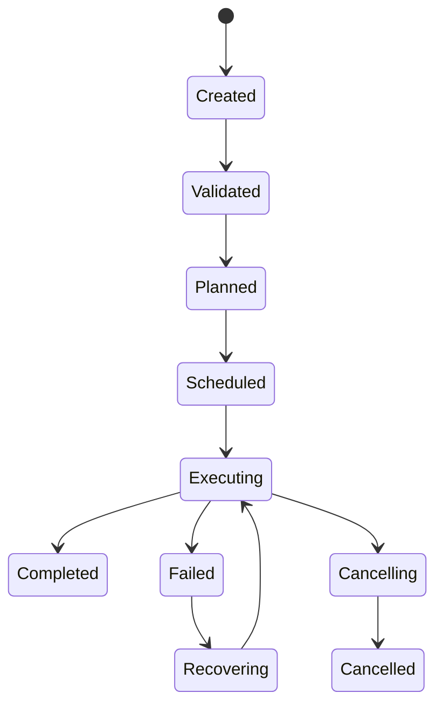
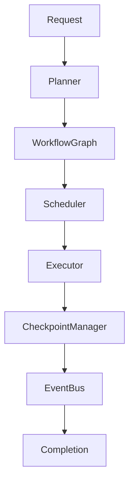
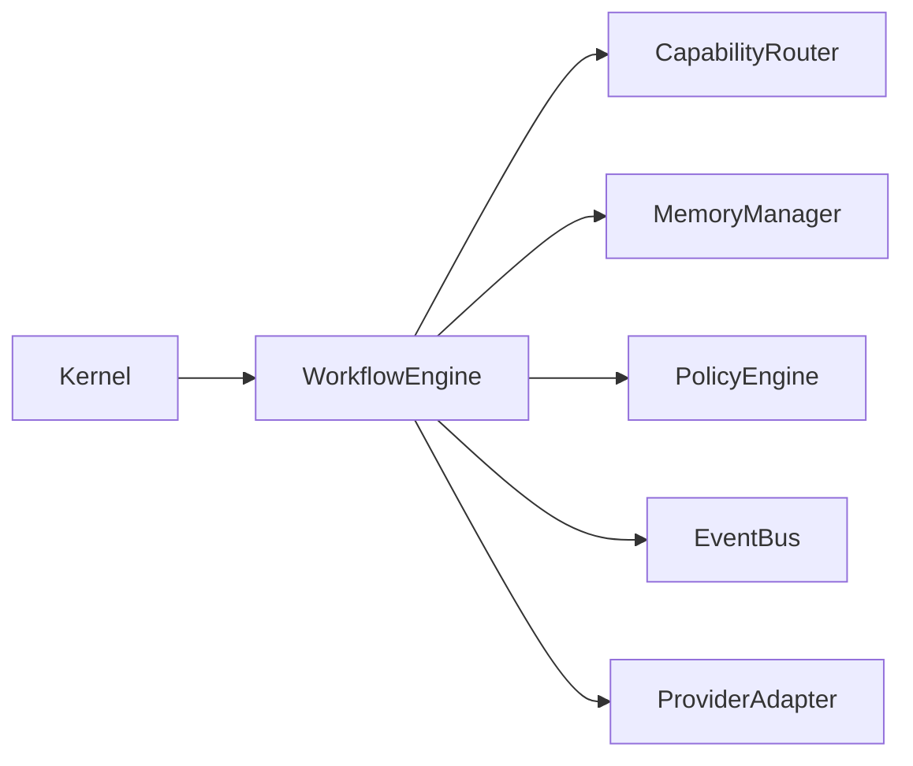

# Workflow Engine Implementation Plan

## Executive Summary

The Workflow Engine is responsible for orchestrating every Hermes AIOS task from initial request to final response. It converts execution plans into directed acyclic graphs (DAGs), schedules work, coordinates model and tool execution, manages checkpoints, supports cancellation and recovery, and exposes execution state to the rest of the platform.

The Workflow Engine is deterministic in orchestration while supporting probabilistic AI components through explicit contracts and policies.

---

# Objectives

The Workflow Engine shall:

- Execute workflow graphs
- Coordinate task scheduling
- Manage execution state
- Support checkpointing
- Enable recovery
- Handle cancellations
- Publish lifecycle events
- Integrate with routing and memory
- Support parallel execution
- Remain fully observable

---

# Responsibilities

The Workflow Engine owns:

- Workflow lifecycle
- DAG execution
- Task scheduling
- Dependency resolution
- Checkpoint creation
- Recovery orchestration
- Cancellation handling
- Retry orchestration
- Execution metrics
- Workflow persistence

The Workflow Engine does **not** own:

- Model selection
- Provider communication
- Tool execution
- Policy evaluation
- Memory storage

Those responsibilities belong to their respective subsystems.

---

# Package Structure

```
src/workflow/

├── __init__.py
├── engine.py
├── planner_adapter.py
├── graph.py
├── scheduler.py
├── executor.py
├── checkpoint.py
├── persistence.py
├── recovery.py
├── state.py
├── events.py
├── validators.py
├── exceptions.py
└── interfaces.py
```

---

# Public Interfaces

```
WorkflowEngine

WorkflowScheduler

WorkflowExecutor

WorkflowGraph

CheckpointManager

RecoveryManager

WorkflowRepository
```

All interfaces are stable and independently testable.

---

# Workflow Lifecycle

```
Created
   │
Validated
   │
Planned
   │
Scheduled
   │
Executing
   │
Completed
```

Failure path:

```
Executing
    │
Failed
    │
Recovering
    │
Executing
```

Cancellation path:

```
Executing
    │
Cancelling
    │
Cancelled
```

---

# Workflow Graph

Each workflow is represented as a DAG.

Node types include:

- Model Task
- Tool Task
- Memory Task
- Policy Check
- Conditional Branch
- Parallel Group
- Aggregation
- Completion

Graph validation prevents:

- Cycles
- Missing dependencies
- Orphan nodes
- Duplicate identifiers

---

# Scheduler

The scheduler is responsible for:

- Ready queue management
- Dependency tracking
- Priority handling
- Parallel execution limits
- Timeout enforcement
- Retry scheduling

Scheduling is event-driven rather than polling-based.

---

# Execution States

Supported states:

```
Pending

Ready

Running

Waiting

Retrying

Completed

Failed

Cancelled
```

State transitions are validated before execution.

---

# Checkpoint Management

Checkpoint contents:

```yaml
workflow_id:
graph_version:
completed_nodes:
pending_nodes:
execution_context:
timestamps:
retry_state:
```

Checkpoints are created:

- Before external provider calls
- Before tool execution
- At configurable intervals
- Prior to workflow completion

---

# Recovery

Recovery process:

```
Load Checkpoint
      │
Validate Integrity
      │
Restore Context
      │
Resume Scheduler
      │
Continue Execution
```

Recovery never re-executes completed idempotent tasks unless explicitly configured.

---

# Retry Strategy

Retry policy supports:

- Fixed delay
- Exponential backoff
- Maximum attempts
- Retry budget
- Failure classification

Retry decisions are informed by the Policy Engine.

---

# Cancellation

Cancellation requirements:

- Cooperative task cancellation
- Resource cleanup
- Checkpoint persistence
- Event publication
- Consistent final state

Cancellation should leave the workflow recoverable where applicable.

---

# Persistence

Workflow metadata includes:

```yaml
workflow_id:
status:
created_at:
updated_at:
priority:
owner:
current_node:
execution_history:
```

Persistence occurs asynchronously where possible.

---

# Event Integration

Published events:

```
workflow.created
workflow.validated
workflow.started
workflow.node_started
workflow.node_completed
workflow.checkpoint_created
workflow.failed
workflow.recovered
workflow.completed
workflow.cancelled
```

Events are emitted through the Kernel Event Bus.

---

# Kernel Integration

Dependencies:

- Lifecycle Manager
- Event Bus
- Dependency Container
- Configuration Manager

The Workflow Engine is registered during Kernel startup.

---

# Capability Router Integration

The engine requests execution plans from the Capability Router.

Responsibilities:

- Submit task requirements
- Receive execution graph
- Execute returned plan
- Report execution metrics

The router remains stateless with respect to workflow execution.

---

# Memory Integration

Workflow interactions:

- Retrieve contextual memory
- Persist approved memories
- Cache intermediate context
- Record provenance

Memory operations follow Policy Engine decisions.

---

# Policy Integration

Before execution:

- Authorization
- Capability validation
- Tool approval
- Provider approval

Policy decisions are cached per workflow where safe.

---

# Error Handling

Exception hierarchy:

```
WorkflowError
├── GraphValidationError
├── SchedulingError
├── ExecutionError
├── CheckpointError
├── RecoveryError
└── CancellationError
```

Errors are classified as recoverable or terminal.

---

# Async Model

The engine uses structured concurrency.

Guidelines:

- Independent branches execute concurrently
- Parent tasks supervise children
- Cancellation propagates downward
- Exceptions propagate upward
- Resource cleanup is guaranteed

---

# Testing Strategy

### Unit

- Graph validation
- Scheduler
- State transitions
- Retry logic
- Checkpoint serialization

### Integration

- Router integration
- Memory integration
- Policy integration
- Event Bus integration

### System

- Complete workflow execution
- Failure recovery
- Parallel task execution
- Cancellation scenarios

Coverage target:

```
≥95%
```

---

# Implementation Phases

## Phase 1

Core Engine

Deliverables:

- Workflow model
- Lifecycle
- State machine

---

## Phase 2

Graph Execution

Deliverables:

- DAG builder
- Validator
- Scheduler

---

## Phase 3

Execution Runtime

Deliverables:

- Executor
- Parallel scheduling
- Retry logic

---

## Phase 4

Checkpointing

Deliverables:

- Persistence
- Recovery
- Resume

---

## Phase 5

Subsystem Integration

Deliverables:

- Kernel
- Capability Router
- Memory
- Policy
- Event Bus

---

## Phase 6

Validation

Deliverables:

- Performance tuning
- Fault injection
- End-to-end testing

---

# Definition of Done

The Workflow Engine milestone is complete when:

- DAG execution is deterministic
- Scheduler handles dependencies correctly
- Checkpointing functions reliably
- Recovery resumes workflows accurately
- Parallel execution is validated
- Cancellation behaves predictably
- Coverage ≥95%
- Documentation updated
- CI passes
- Architecture review approved

---

# Mermaid Workflow Lifecycle



---

# Mermaid Execution Architecture



---

# Mermaid Integration Overview



---

# Architecture Decisions

## Graph-Based Execution

Representing workflows as directed acyclic graphs enables deterministic scheduling, explicit dependency management, and safe parallel execution.

## Event-Driven Scheduling

The scheduler reacts to task completion events rather than polling, reducing latency and improving scalability.

## Checkpoint-First Reliability

Workflow checkpoints are a core execution primitive, enabling resumable execution and graceful recovery after failures.

## Separation of Concerns

The Workflow Engine orchestrates execution but delegates routing, memory management, provider interaction, and policy enforcement to dedicated subsystems.

## Structured Concurrency

The async execution model uses supervised task hierarchies to simplify cancellation, cleanup, and error propagation.

---

# Cross References

Previous:

- `docs/implementation/09_1_KERNEL_IMPLEMENTATION_PLAN.md`

Next:

- `docs/implementation/09_3_CAPABILITY_ROUTER_IMPLEMENTATION_PLAN.md`
