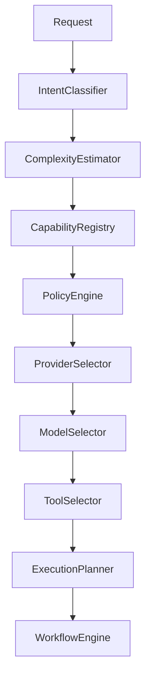
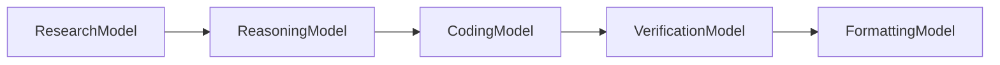
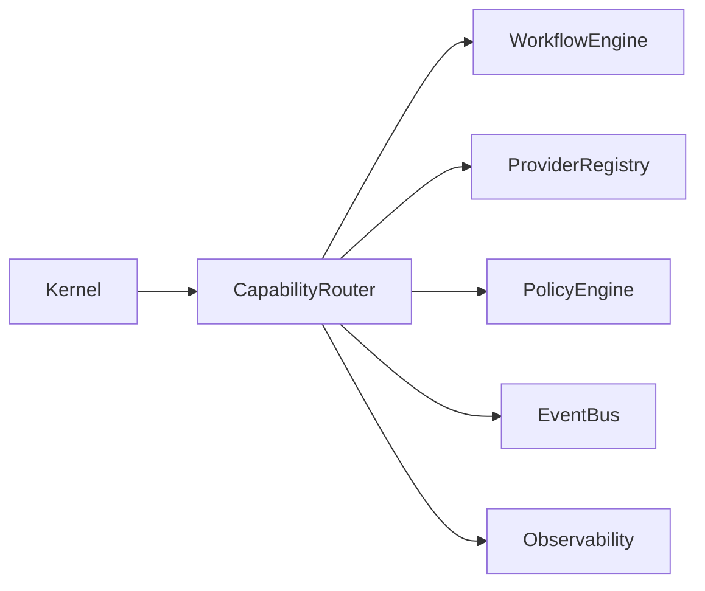

# Capability Router Implementation Plan

## Executive Summary

The Capability Router is the decision engine of Hermes AIOS. It analyzes workflow intent, estimates task complexity, evaluates available capabilities, applies policy constraints, and produces optimized execution plans.

The router does not execute work directly. Instead, it creates an execution plan consumed by the Workflow Engine.

---

# Objectives

The Capability Router shall:

- Classify user intent
- Estimate task complexity
- Match required capabilities
- Select providers and models
- Build execution plans
- Support multi-model workflows
- Enforce routing policies
- Handle provider failures
- Minimize cost and latency
- Remain observable and testable

---

# Responsibilities

The router owns:

- Intent classification
- Capability resolution
- Provider selection
- Model selection
- Tool selection
- Execution strategy
- Fallback planning
- Cost estimation
- Latency estimation
- Routing metrics

The router does **not** own:

- Workflow execution
- Memory persistence
- Tool execution
- Provider communication
- Security enforcement

---

# Package Structure

```
src/routing/

├── __init__.py
├── router.py
├── planner.py
├── intent_classifier.py
├── complexity_estimator.py
├── capability_registry.py
├── model_selector.py
├── provider_selector.py
├── tool_selector.py
├── policy_adapter.py
├── fallback.py
├── scoring.py
├── metrics.py
├── exceptions.py
└── interfaces.py
```

---

# Public Interfaces

```
CapabilityRouter

IntentClassifier

ComplexityEstimator

CapabilityRegistry

ModelSelector

ProviderSelector

ToolSelector

ExecutionPlanner
```

All interfaces are designed for dependency injection and isolated testing.

---

# Routing Pipeline

```
Incoming Request
        │
Intent Classification
        │
Complexity Estimation
        │
Capability Resolution
        │
Policy Validation
        │
Provider Selection
        │
Model Selection
        │
Tool Selection
        │
Execution Planning
        │
Workflow Plan
```

Each stage produces structured outputs for downstream processing.

---

# Intent Classification

Responsibilities:

- Detect user objective
- Identify required workflow type
- Extract execution constraints
- Detect multi-step requests
- Determine required capabilities

Output example:

```yaml
intent:
  type: research
  confidence: 0.94
  capabilities:
    - reasoning
    - retrieval
    - summarization
```

---

# Complexity Estimation

Factors:

- Task length
- Required reasoning depth
- Tool usage
- External providers
- Parallelism
- Memory requirements

Complexity levels:

```
Low
Medium
High
Critical
```

Complexity influences provider selection and workflow topology.

---

# Capability Registry

Each capability entry contains:

```yaml
capability:
provider_support:
model_support:
tool_support:
cost_weight:
latency_weight:
quality_weight:
```

The registry is configuration-driven and hot-reloadable where supported.

---

# Provider Selection

Selection inputs:

- Capability support
- Availability
- Health status
- Cost
- Latency
- Policy constraints
- User preferences (if applicable)

Provider selection returns an ordered candidate list rather than a single result.

---

# Model Selection

Selection criteria:

- Required capabilities
- Context window
- Reasoning strength
- Tool-calling support
- Structured output support
- Token cost
- Historical performance

Multiple models may be assigned to different workflow stages.

---

# Tool Selection

The router determines:

- Required tools
- Execution order
- Permission requirements
- Failure handling

Tool execution remains the responsibility of the Tool Runtime.

---

# Execution Planning

Generated plan includes:

```yaml
workflow_id:
tasks:
dependencies:
providers:
models:
tools:
parallel_groups:
fallbacks:
estimated_cost:
estimated_latency:
```

Plans are deterministic given the same inputs and configuration.

---

# Multi-Model Orchestration

The router supports:

- Specialized reasoning models
- Research models
- Coding models
- Validation models
- Formatting models

Example execution:

```
Research
     │
Reasoning
     │
Code Generation
     │
Verification
     │
Formatting
```

The Workflow Engine coordinates execution of the generated plan.

---

# Fallback Strategy

Failure handling:

```
Primary Provider
        │
Unavailable
        │
Secondary Provider
        │
Unavailable
        │
Local Model
        │
Unavailable
        │
Graceful Failure
```

Fallback decisions preserve capability compatibility.

---

# Policy Integration

Before finalizing a plan:

- Validate provider approval
- Validate tool permissions
- Check cost constraints
- Verify security policies
- Apply organizational rules

Policy decisions are authoritative.

---

# Kernel Integration

Dependencies:

- Configuration Manager
- Dependency Container
- Event Bus
- Health Registry

The router is initialized during Kernel startup.

---

# Workflow Engine Integration

The Workflow Engine submits routing requests and receives an immutable execution plan.

Interfaces remain versioned to avoid tight coupling.

---

# Provider Registry Integration

The router queries the Provider Registry for:

- Available providers
- Health status
- Supported models
- Current capabilities
- Runtime availability

Provider communication occurs through the Provider Adapter layer.

---

# Observability

Routing metrics include:

- Classification accuracy
- Routing latency
- Provider selection frequency
- Model utilization
- Fallback count
- Estimated vs actual cost
- Estimated vs actual latency

Metrics are exported through the Observability subsystem.

---

# Error Handling

Exception hierarchy:

```
RoutingError
├── ClassificationError
├── CapabilityResolutionError
├── ProviderSelectionError
├── ModelSelectionError
├── ToolSelectionError
└── PlanningError
```

Errors are categorized as recoverable or terminal.

---

# Async Model

The router performs concurrent evaluation where appropriate:

- Provider health queries
- Capability scoring
- Cost estimation

Planning remains deterministic despite concurrent internal evaluation.

---

# Testing Strategy

### Unit

- Intent classification
- Complexity estimation
- Scoring algorithms
- Selection policies

### Integration

- Workflow Engine
- Provider Registry
- Policy Engine
- Configuration Manager

### System

- End-to-end routing
- Multi-model orchestration
- Fallback scenarios
- Policy enforcement

Coverage target:

```
≥95%
```

---

# Implementation Phases

## Phase 1

Core routing engine

Deliverables:

- Router
- Interfaces
- Configuration

---

## Phase 2

Intent analysis

Deliverables:

- Classifier
- Complexity estimator

---

## Phase 3

Selection engine

Deliverables:

- Capability registry
- Provider selector
- Model selector
- Tool selector

---

## Phase 4

Execution planning

Deliverables:

- Planner
- Cost estimation
- Latency estimation
- Fallback planning

---

## Phase 5

Subsystem integration

Deliverables:

- Workflow Engine integration
- Kernel integration
- Policy integration
- Observability

---

## Phase 6

Validation

Deliverables:

- Performance testing
- Fault injection
- Benchmarking
- Documentation updates

---

# Definition of Done

The Capability Router milestone is complete when:

- Intent classification is operational
- Complexity estimation is validated
- Capability resolution is deterministic
- Multi-model plans are generated correctly
- Provider fallback works
- Policy constraints are enforced
- Coverage ≥95%
- Documentation updated
- CI passes
- Architecture review approved

---

# Mermaid Routing Pipeline



---

# Mermaid Multi-Model Execution



---

# Mermaid Integration Overview



---

# Architecture Decisions

## Capability-First Routing

Routing decisions are based on required capabilities rather than hard-coded task categories, enabling flexible orchestration across providers and models.

## Multi-Model Execution

Execution plans may assign different models to different workflow stages, improving quality while balancing latency and cost.

## Configuration-Driven Intelligence

Routing policies, capability mappings, and provider metadata are externalized into configuration, allowing updates without code changes.

## Deterministic Planning

Given identical inputs and configuration, the router produces the same execution plan, improving predictability and testability.

## Layered Decision Pipeline

Intent analysis, capability resolution, policy enforcement, and execution planning remain distinct stages, simplifying maintenance and extension.

---

# Cross References

Previous:

- `docs/implementation/09_2_WORKFLOW_ENGINE_IMPLEMENTATION_PLAN.md`

Next:

- `docs/implementation/09_4_MEMORY_SYSTEM_IMPLEMENTATION_PLAN.md`
