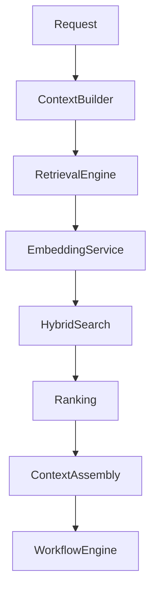
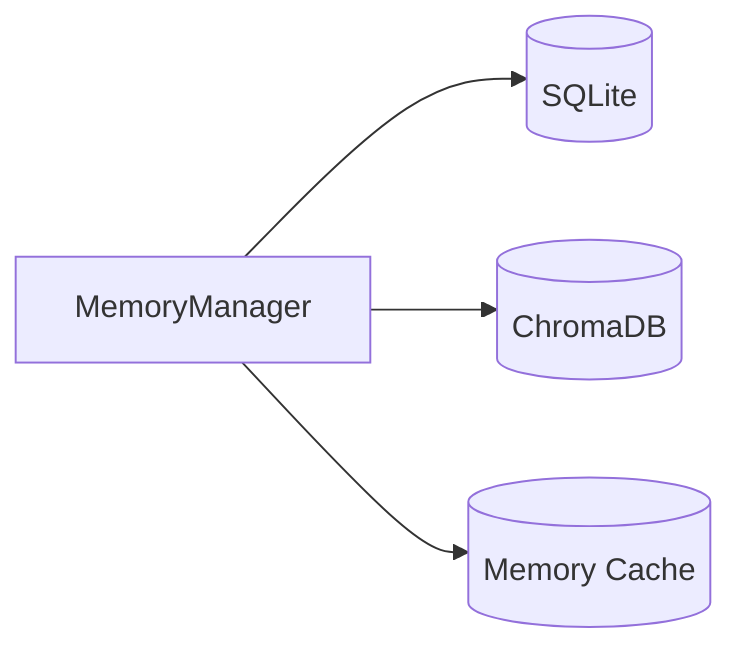
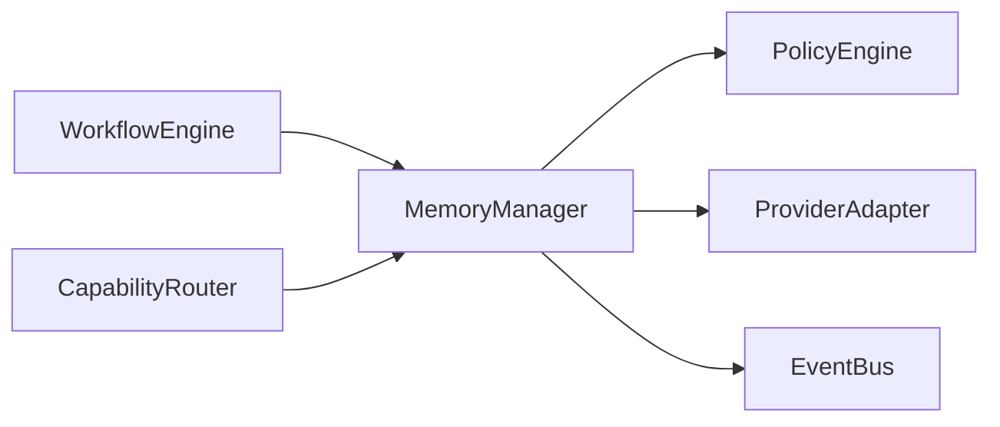

# Memory System Implementation Plan

## Executive Summary

The Memory System provides Hermes AIOS with persistent, contextual, and searchable knowledge across sessions. It combines structured metadata storage with semantic retrieval, enabling the platform to remember previous interactions, workflows, tool results, and operational knowledge while enforcing policy and security constraints.

The Memory System supports both local-first operation and optional synchronized remote backends through the Provider Adapter layer.

---

# Objectives

The Memory System shall:

- Persist long-term knowledge
- Support semantic retrieval
- Build execution context
- Manage embeddings
- Enforce retention policies
- Support provenance tracking
- Enable incremental updates
- Provide deterministic retrieval
- Integrate with policy enforcement
- Remain observable and testable

---

# Responsibilities

The Memory System owns:

- Memory persistence
- Embedding management
- Semantic search
- Context assembly
- Metadata indexing
- Retention lifecycle
- Provenance recording
- Cache coordination
- Synchronization orchestration
- Memory metrics

The Memory System does **not** own:

- Workflow execution
- Provider routing
- Policy decisions
- Tool execution
- User authentication

---

# Package Structure

```
src/memory/

├── __init__.py
├── manager.py
├── repository.py
├── embeddings.py
├── retrieval.py
├── context_builder.py
├── retention.py
├── synchronization.py
├── cache.py
├── metadata.py
├── events.py
├── validators.py
├── exceptions.py
└── interfaces.py
```

---

# Public Interfaces

```
MemoryManager

EmbeddingService

RetrievalEngine

ContextBuilder

RetentionManager

SynchronizationManager

MemoryRepository
```

All interfaces support dependency injection and isolated testing.

---

# Memory Architecture

```
Request
    │
Context Builder
    │
Retrieval Engine
    │
Embedding Service
    │
Hybrid Search
    │
Rank Results
    │
Assemble Context
    │
Workflow Engine
```

---

# Memory Types

Supported categories:

- Conversation memory
- Workflow memory
- Tool output memory
- Knowledge memory
- Configuration memory
- Operational memory
- Cached context
- User-approved long-term memory

Each category defines its own retention and indexing strategy.

---

# Storage Model

Primary stores:

| Purpose | Technology |
|----------|------------|
| Metadata | SQLite |
| Semantic vectors | ChromaDB |
| Cache | In-memory |
| Snapshots | Configurable |

Metadata and vector storage remain synchronized through stable identifiers.

---

# Memory Record Schema

```yaml
memory_id:
type:
owner:
created_at:
updated_at:
embedding_version:
metadata:
content:
classification:
provenance:
retention_policy:
checksum:
```

Checksums support integrity validation.

---

# Embedding Pipeline

```
Raw Content
      │
Normalize
      │
Policy Validation
      │
Embedding Generation
      │
Store Vector
      │
Update Metadata
```

Embedding models are selected through configuration.

---

# Retrieval Pipeline

```
Incoming Query
       │
Normalize
       │
Generate Query Embedding
       │
Semantic Search
       │
Metadata Filter
       │
Ranking
       │
Policy Filter
       │
Context Assembly
```

Retrieval is deterministic for identical inputs and configuration.

---

# Ranking Strategy

Ranking signals include:

- Semantic similarity
- Recency
- Access frequency
- Provenance confidence
- Workflow relevance
- Policy score

Weighting is configurable.

---

# Context Assembly

Context builder responsibilities:

- Merge retrieved memories
- Remove duplicates
- Enforce token budgets
- Preserve provenance
- Maintain ordering

Context assembly should be deterministic and reproducible.

---

# Retention Policies

Policies include:

- Session
- Short-term
- Long-term
- Permanent
- Time-based expiration
- Capacity-based pruning

Retention actions are auditable.

---

# Synchronization

Synchronization supports:

- Local-first persistence
- Optional remote replication
- Conflict detection
- Checksum verification
- Retry handling

Synchronization never bypasses Policy Engine decisions.

---

# Cache Management

Cache layers:

- Query cache
- Embedding cache
- Context cache

Eviction policies:

- Least Recently Used (LRU)
- Time-to-live (TTL)
- Capacity thresholds

---

# Integration

## Workflow Engine

- Retrieve execution context
- Store workflow outputs
- Record execution provenance

## Capability Router

- Supply historical capability usage
- Support routing heuristics

## Policy Engine

- Authorize retrieval
- Enforce retention
- Filter protected content

## Provider Adapter

- Generate embeddings
- Support remote memory services (optional)

---

# Event Integration

Published events:

```
memory.created
memory.updated
memory.deleted
embedding.generated
retrieval.completed
context.assembled
retention.executed
synchronization.completed
```

Events are emitted through the Kernel Event Bus.

---

# Error Handling

Exception hierarchy:

```
MemoryError
├── RetrievalError
├── EmbeddingError
├── ContextAssemblyError
├── SynchronizationError
├── RetentionError
└── RepositoryError
```

Recoverable failures are retried according to policy.

---

# Async Model

Concurrent operations include:

- Embedding generation
- Semantic search
- Cache refresh
- Synchronization

Task coordination follows structured concurrency and cancellation propagation.

---

# Testing Strategy

### Unit

- Embedding generation
- Metadata validation
- Ranking
- Context assembly
- Retention logic

### Integration

- SQLite repository
- ChromaDB repository
- Workflow Engine
- Policy Engine

### System

- End-to-end retrieval
- Synchronization
- Recovery
- Cache behavior

Coverage target:

```
≥95%
```

---

# Implementation Phases

## Phase 1

Core repository

Deliverables:

- Metadata persistence
- Stable identifiers
- Repository interfaces

---

## Phase 2

Embedding subsystem

Deliverables:

- Embedding service
- Versioning
- Storage integration

---

## Phase 3

Retrieval engine

Deliverables:

- Semantic search
- Ranking
- Metadata filters

---

## Phase 4

Context builder

Deliverables:

- Context assembly
- Token budgeting
- Provenance preservation

---

## Phase 5

Lifecycle management

Deliverables:

- Retention
- Synchronization
- Cache coordination

---

## Phase 6

Subsystem integration

Deliverables:

- Workflow Engine
- Capability Router
- Policy Engine
- Event Bus

---

# Definition of Done

The Memory System milestone is complete when:

- Metadata persists correctly
- Embeddings are generated and versioned
- Hybrid retrieval is deterministic
- Context assembly respects token budgets
- Retention policies execute correctly
- Synchronization validates integrity
- Coverage ≥95%
- Documentation updated
- CI passes
- Architecture review approved

---

# Mermaid Memory Pipeline



---

# Mermaid Storage Architecture



---

# Mermaid Integration Overview



---

# Architecture Decisions

## Hybrid Storage

Structured metadata and semantic vectors are stored separately but linked through stable identifiers, enabling efficient querying and scalable retrieval.

## Deterministic Context Assembly

Context generation produces consistent results for identical inputs by applying fixed ranking, deduplication, and token-budget rules.

## Local-First Design

Primary persistence occurs locally, with optional synchronization to remote backends under explicit policy control.

## Policy-Aware Memory

Every retrieval, update, retention, and synchronization operation is filtered through the Policy Engine to enforce security and governance.

## Provenance Preservation

All stored memories maintain provenance metadata to support traceability, auditability, and explainable retrieval.

---

# Cross References

Previous:

- `docs/implementation/09_3_CAPABILITY_ROUTER_IMPLEMENTATION_PLAN.md`

Next:

- `docs/implementation/09_5_TOOL_RUNTIME_IMPLEMENTATION_PLAN.md`
