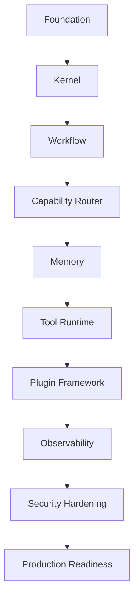

# Implementation Roadmap

> **Superseded for implementation:** Do not execute milestones M0–M9 from this legacy HERMES plan. Current ZHOOR work is dependency-gated in `../planning/zhoor-adoption/README.md` and `../planning/zhoor-adoption/WORK_BOARD.md`.

## Executive Summary

Phases 1–6 defined what Hermes AIOS is and how it should be engineered. Phase 7 defines how Hermes AIOS will be built.

The roadmap prioritizes a functional, end-to-end vertical slice before expanding capabilities. Each milestone delivers an independently testable increment while preserving architectural integrity.

The implementation sequence follows dependency order rather than documentation order.

---

# Objectives

The roadmap shall:

- Define implementation order
- Identify component dependencies
- Reduce integration risk
- Deliver incremental value
- Support continuous validation
- Preserve architectural consistency
- Enable parallel development where safe
- Define acceptance criteria
- Track implementation progress
- Support release planning

---

# Guiding Principles

- Vertical slices over isolated layers
- Kernel first
- Infrastructure before features
- Security from day one
- Configuration before hard-coding
- Observable by default
- Test every milestone
- Keep the system runnable after each milestone

---

# High-Level Milestones

| Milestone | Goal | Status |
|------------|------|--------|
| M0 | Development foundation | Complete |
| M1 | Kernel operational | Planned |
| M2 | Workflow execution | Planned |
| M3 | Provider routing | Planned |
| M4 | Memory integration | Planned |
| M5 | Tool runtime | Planned |
| M6 | Plugin framework | Planned |
| M7 | Observability | Planned |
| M8 | Security hardening | Planned |
| M9 | Production readiness | Planned |

---

# Dependency Graph

```
Kernel
   │
Workflow Engine
   │
Capability Router
   │
Provider Adapter
   │
Memory Manager
   │
Tool Runtime
   │
Plugin Framework
   │
Observability
   │
Production Hardening
```

Each milestone depends only on completed predecessors.

---

# Milestone M0

## Development Foundation

Scope:

- Repository
- Toolchain
- Build system
- Testing
- CI/CD
- Documentation

Deliverables:

- Working development environment
- Automated pipeline
- Build reproducibility
- Engineering standards

Status:

Complete

---

# Milestone M1

## Hermes Kernel

Components:

- Kernel
- Lifecycle manager
- Dependency injection
- Configuration loader
- Event bus
- Component registry
- Startup sequence

Acceptance Criteria:

- Kernel boots successfully
- Components register dynamically
- Configuration validates
- Event bus operational
- Graceful shutdown supported

Definition of Done:

- Tests pass
- Documentation updated
- CI green
- Architecture conformance verified

---

# Milestone M2

## Workflow Engine

Components:

- Workflow model
- Planner integration
- Task graph
- Scheduler interface
- Checkpoint manager
- Recovery hooks

Acceptance Criteria:

- Workflow executes deterministically
- Checkpoint creation works
- Recovery restores state
- Cancellation supported

---

# Milestone M3

## Capability Router

Components:

- Intent classifier
- Complexity estimator
- Capability registry
- Model selector
- Routing policies

Acceptance Criteria:

- Correct provider selected
- Multi-model orchestration functional
- Fallback routing works
- Routing metrics exported

---

# Milestone M4

## Memory System

Components:

- Memory Manager
- SQLite storage
- ChromaDB
- Embeddings
- Retrieval
- Context builder

Acceptance Criteria:

- Long-term memory persists
- Semantic search operational
- Context assembly deterministic
- Retention policy enforced

---

# Milestone M5

## Tool Runtime

Components:

- Tool registry
- Execution sandbox
- Capability enforcement
- Timeout management
- Resource quotas

Acceptance Criteria:

- Tools execute safely
- Permissions enforced
- Timeouts handled
- Failures isolated

---

# Milestone M6

## Plugin Framework

Components:

- Plugin loader
- Manifest validation
- Signing verification
- Sandbox integration
- Lifecycle management

Acceptance Criteria:

- Plugins install safely
- Signatures validated
- Isolation enforced
- Revocation supported

---

# Milestone M7

## Observability

Components:

- Logging
- Metrics
- Tracing
- Health endpoints
- Dashboards

Acceptance Criteria:

- End-to-end traces available
- Metrics exported
- Health checks pass
- Audit integration complete

---

# Milestone M8

## Security Hardening

Activities:

- Threat mitigation review
- Secret management validation
- Policy testing
- Penetration testing
- Dependency audit

Acceptance Criteria:

- Security tests pass
- No critical vulnerabilities
- Policy enforcement verified
- Threat model updated

---

# Milestone M9

## Production Readiness

Activities:

- Performance tuning
- Documentation freeze
- Release validation
- Disaster recovery verification
- Operational runbooks

Acceptance Criteria:

- Production checklist complete
- Release candidate approved
- Rollback verified
- Observability baseline established

---

# Parallel Work Streams

Where dependencies allow, development may proceed in parallel:

| Stream | Scope |
|---------|-------|
| Core | Kernel, Workflow |
| AI | Routing, Providers |
| Data | Memory, Storage |
| Runtime | Tools, Plugins |
| Platform | CI/CD, Observability |
| Security | Policy, Secrets, Audit |

Parallel work must not violate dependency boundaries.

---

# Risk Register

| Risk | Mitigation |
|------|------------|
| Architecture drift | Architecture reviews |
| Dependency churn | Version pinning |
| Provider API changes | Adapter abstraction |
| Performance regressions | Continuous benchmarking |
| Security regressions | Automated security testing |
| Integration complexity | Vertical slice milestones |

Risks are reviewed at each milestone.

---

# Validation Gates

Every milestone requires:

- Architecture review
- Code review
- Security review
- Test completion
- Documentation update
- CI/CD success
- Performance check (where applicable)

No milestone advances without passing all gates.

---

# Definition of Done

A milestone is complete only when:

- Functional requirements implemented
- Tests passing
- Documentation updated
- CI green
- Security review complete
- Performance acceptable
- No unresolved blocker defects

---

# Mermaid Milestone Flow



---

# Mermaid Dependency Overview


---

# Architecture Decisions

## Vertical Slice Delivery

Each milestone delivers a runnable system increment rather than isolated infrastructure, reducing integration risk and enabling earlier validation.

## Dependency-Driven Sequencing

Implementation order follows technical dependencies instead of documentation order, ensuring stable foundations before higher-level capabilities.

## Continuous Verification

Every milestone includes architecture, testing, security, and documentation gates to prevent quality regressions.

## Configuration-First Implementation

Runtime behavior should remain configurable throughout implementation, preserving flexibility without architectural changes.

## Incremental Production Readiness

Operational capabilities such as observability, security hardening, and release validation are integrated progressively rather than deferred to the end.

---

# Future Enhancements

- Milestone burndown dashboards
- Automated roadmap progress tracking
- Architecture conformance reporting
- Cross-team dependency visualization
- AI-assisted implementation planning
- Critical path forecasting
- Risk heat maps
- Automated milestone readiness scoring

---

# Cross References

Previous:

- `docs/development/08_8_CONTRIBUTOR_HANDBOOK.md`

Next:

- `docs/implementation/09_1_KERNEL_IMPLEMENTATION_PLAN.md`
