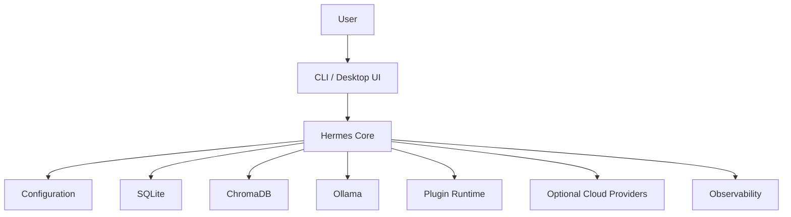

# Deployment Architecture

## Executive Summary

This document defines how Hermes AIOS is deployed across supported environments. It translates the logical architecture into executable deployment topologies while preserving the project's core design principles:

- Local-first
- Provider-independent
- Capability-driven orchestration
- Modular services
- Configuration-driven deployment

The deployment architecture supports development on a single laptop today while remaining compatible with future multi-node and enterprise deployments.

---

# Deployment Goals

The deployment architecture should:

- Support local development
- Support production use on a personal workstation
- Require minimal infrastructure
- Allow optional cloud AI providers
- Enable offline operation
- Support incremental scaling
- Maintain consistent deployment patterns

---

# Supported Deployment Profiles

## Profile 1 — Development

Purpose:

- Active feature development
- Debugging
- Testing
- Documentation

Target environment:

- Windows 11 + WSL2 (primary)
- Native Linux

Components:

- Hermes Core
- SQLite
- ChromaDB
- Ollama
- Local configuration
- Local logs

Characteristics:

- Single user
- Single process (where practical)
- Debug logging enabled
- Hot reload enabled

---

## Profile 2 — Personal Production

Purpose:

Daily AI assistant and automation platform.

Components:

- Hermes Core
- Scheduler
- Background workers
- SQLite
- ChromaDB
- Ollama
- Optional cloud providers
- Plugin runtime
- Observability

Characteristics:

- Persistent storage
- Automatic backups
- Scheduled workflows
- Long-term memory
- Reduced debug logging

---

## Profile 3 — Team Deployment (Future)

Adds:

- Shared memory
- Multi-user authentication
- Shared event infrastructure
- Role-based permissions
- Central dashboards

---

## Profile 4 — Distributed Deployment (Future)

Adds:

- Remote execution workers
- Distributed scheduling
- Shared vector databases
- High availability
- Horizontal scaling

---

# Deployment Topology

```
                  User

                    │

             Desktop / CLI

                    │

           Hermes API Gateway

                    │

      +---------------------------+

      │       Hermes Core         │

      │                           │

      │ Kernel                    │

      │ Router                    │

      │ Planner                   │

      │ Policy                    │

      │ Memory                    │

      │ Tool Runtime              │

      │ Provider Adapter          │

      │ Event Bus                 │

      │ Observability             │

      +---------------------------+

          │       │        │

          ▼       ▼        ▼

      SQLite  ChromaDB  Ollama

                     │

              Optional Cloud AI
```

---

# Startup Sequence

Recommended startup order:

1. Configuration Service
2. SQLite
3. ChromaDB
4. Observability
5. Event Bus
6. Memory System
7. Provider Adapter
8. Tool Runtime
9. Workflow Planner
10. Hermes Kernel
11. API Gateway
12. Scheduler

The Kernel performs health verification before accepting requests.

---

# Runtime Processes

Core processes:

| Process | Responsibility |
|----------|----------------|
| Hermes Core | Main orchestration runtime |
| Scheduler | Timed workflows |
| Ollama | Local inference |
| ChromaDB | Vector storage |
| SQLite | Structured persistence |
| Plugin Runtime | Dynamic extensions |

Future deployments may split these into independent services.

---

# Service Dependencies

```
Kernel
 │
 ├── Configuration
 ├── Memory
 ├── Event Bus
 ├── Provider Adapter
 └── Tool Runtime

Memory
 │
 ├── SQLite
 └── ChromaDB

Provider Adapter
 │
 ├── Ollama
 └── Cloud Providers
```

---

# Environment Layout

```
Hermes AIOS

├── bin/
├── config/
├── data/
│   ├── sqlite/
│   ├── chroma/
│   ├── cache/
│   └── checkpoints/
├── logs/
├── models/
├── plugins/
├── workflows/
├── backups/
└── temp/
```

---

# Deployment Modes

## Native Linux

Recommended for production.

Advantages:

- Lowest overhead
- Full system integration
- Direct hardware access

---

## Windows + WSL2

Primary development environment.

Advantages:

- Linux tooling
- Windows desktop integration
- Local AI support
- Simple maintenance

---

## Containers

Supported but optional.

Suitable for:

- CI pipelines
- Reproducible environments
- Team deployments

Suggested services:

- Hermes Core
- ChromaDB
- Ollama
- Reverse Proxy

---

# Health Checks

Each service exposes:

- Readiness
- Liveness
- Version
- Build
- Dependencies

The Kernel refuses requests if mandatory dependencies are unavailable.

---

# Failure Recovery

Recovery strategy:

1. Restart failed component
2. Resume from checkpoints
3. Replay pending events
4. Reconnect providers
5. Restore scheduler
6. Continue workflows

---

# Resource Guidelines

| Component | Recommended |
|-----------|-------------|
| CPU | Multi-core |
| RAM | 16 GB minimum, higher preferred |
| Storage | SSD |
| GPU | Optional; local models benefit from acceleration |
| Network | Optional for cloud providers |

---

# Security Boundaries

Separate trust zones:

- User Interface
- Core Runtime
- Plugin Runtime
- Data Stores
- External Providers

All cross-zone communication is validated by the Policy Engine.

---

# Deployment Lifecycle

```
Install

↓

Configure

↓

Initialize

↓

Health Check

↓

Start Services

↓

Accept Requests

↓

Monitor

↓

Update

↓

Backup

↓

Shutdown
```

---

# Update Strategy

Recommended process:

1. Backup data
2. Stop Hermes
3. Apply update
4. Validate configuration
5. Run health checks
6. Resume services

Database and configuration migrations should be versioned and reversible.

---

# Mermaid Diagram



---

# Architecture Decisions

## Local-First Runtime

The primary deployment target remains a personal workstation capable of operating without continuous internet connectivity.

## Progressive Scalability

The deployment model scales by adding services rather than redesigning the architecture.

## Stable Service Boundaries

Logical architecture and deployment topology remain aligned, simplifying operations and future maintenance.

## Configuration-Driven Deployment

Deployment behavior is controlled through configuration rather than code changes.

## Checkpoint-Based Recovery

Long-running workflows recover from persistent checkpoints, reducing work loss after interruptions.

---

# Future Enhancements

- Multi-machine clustering
- Automatic service discovery
- Rolling updates
- Blue/green deployments
- Remote worker pools
- Kubernetes manifests
- Infrastructure-as-Code
- Auto-scaling execution workers

---

# Cross References

Previous:

- `04_INFRASTRUCTURE_OVERVIEW.md`

Next:

- `04_2_STORAGE_ARCHITECTURE.md`
