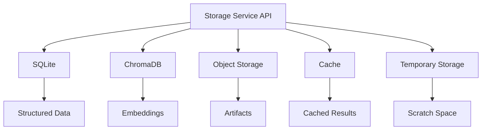

# Storage Architecture

## Executive Summary

The Storage Architecture defines how Hermes AIOS persists structured data, vector embeddings, configuration, workflow state, artifacts, logs, and caches. It separates logical storage responsibilities from physical storage technologies, enabling storage backends to evolve independently while maintaining stable interfaces.

The architecture prioritizes:

- Local-first operation
- Reliability
- Data integrity
- Performance
- Provider independence
- Future scalability

---

# Storage Principles

Hermes AIOS storage follows these principles:

- Single responsibility per datastore
- Durable persistence
- ACID transactions where appropriate
- Separation of structured and vector data
- Explicit lifecycle management
- Backup-friendly layout
- Replaceable storage engines

---

# Storage Layers

```
Application Layer
        │
Storage Service API
        │
├── Structured Storage
├── Vector Storage
├── Object Storage
├── Cache
└── Temporary Storage
```

Applications access storage only through the Storage Service API.

---

# Logical Storage Domains

## Structured Data

Primary datastore:

- SQLite

Stores:

- User preferences
- Configuration metadata
- Workflow state
- Plugin registry
- Scheduler state
- Audit records
- Relationships

Characteristics:

- ACID-compliant
- Embedded
- Transactional
- Indexed

---

## Vector Storage

Primary datastore:

- ChromaDB

Stores:

- Embeddings
- Semantic memories
- RAG documents
- Knowledge collections

Supports:

- Similarity search
- Metadata filtering
- Collection management

---

## Object Storage

Stores:

- Uploaded files
- Generated documents
- Images
- Audio
- Reports
- Exported artifacts

Default implementation:

```
data/objects/
```

Future implementations may support cloud object storage.

---

## Cache

Purpose:

- Reduce repeated computation
- Improve retrieval latency
- Store temporary inference outputs

Examples:

- Embedding cache
- API responses
- Workflow fragments
- Search results

Cache entries are disposable and regenerated when necessary.

---

## Temporary Storage

Used for:

- Tool execution
- Intermediate files
- Downloads
- Upload staging
- Workflow scratch space

All temporary data is automatically cleaned.

---

# Directory Layout

```
data/

├── sqlite/
│   └── hermes.db
│
├── chroma/
│   ├── collections/
│   └── indexes/
│
├── objects/
│   ├── uploads/
│   ├── generated/
│   └── exports/
│
├── cache/
│
├── checkpoints/
│
├── logs/
│
├── backups/
│
└── temp/
```

---

# Database Responsibilities

## SQLite

Responsibilities:

- Relational data
- Metadata
- Transactions
- Workflow execution state
- Scheduling
- Plugin metadata

Not responsible for:

- Large binary objects
- Embeddings

---

## ChromaDB

Responsibilities:

- Vector indexing
- Semantic retrieval
- Embedding collections
- Similarity search

Not responsible for:

- Relational integrity
- Workflow state

---

# Storage Service API

All storage providers implement:

```text
initialize()

read()

write()

update()

delete()

search()

checkpoint()

backup()

restore()

shutdown()
```

This enables future backend replacement with minimal impact.

---

# Checkpoints

Long-running workflows generate checkpoints containing:

- Workflow ID
- Current task
- Variables
- Tool outputs
- Memory references
- Timestamp
- Resume metadata

Checkpoints support interruption recovery.

---

# Lifecycle Management

Data progresses through:

```
Create
   │
Validate
   │
Store
   │
Index
   │
Access
   │
Archive
   │
Delete
```

Retention policies determine archival and deletion.

---

# Retention Policy

| Data Type | Default Retention |
|-----------|-------------------|
| Cache | Days |
| Temporary files | Hours |
| Logs | Configurable |
| Checkpoints | Workflow lifetime |
| User memories | Persistent |
| Configuration history | Persistent |
| Backups | Configurable |

Policies are enforced by background maintenance tasks.

---

# Backup Strategy

Regular backups include:

- SQLite database
- ChromaDB collections
- Configuration
- Plugin metadata
- Workflow definitions

Backups are versioned and timestamped.

---

# Restore Process

Recovery sequence:

1. Validate backup
2. Restore SQLite
3. Restore ChromaDB
4. Restore objects
5. Restore configuration
6. Verify integrity
7. Resume services

---

# Indexing Strategy

SQLite indexes:

- Workflow ID
- User ID
- Timestamp
- Plugin ID
- Configuration version

ChromaDB indexes:

- Embedding vectors
- Collection metadata
- Tags
- Source references

---

# Security

Storage protections include:

- File permissions
- Encryption at rest (optional)
- Integrity validation
- Secret isolation
- Audit logging
- Policy-controlled access

Sensitive information is never exposed directly to AI providers without Policy Engine approval.

---

# Observability

Metrics include:

- Database size
- Query latency
- Cache hit rate
- Backup duration
- Restore success
- Checkpoint count
- Storage utilization

These metrics feed the Observability subsystem.

---

# Mermaid Diagram



---

# Architecture Decisions

## Storage Abstraction

Applications depend on the Storage Service API rather than specific databases.

## Separation of Concerns

Relational, vector, object, and temporary data are stored independently to simplify scaling and maintenance.

## Local-First Persistence

All essential data remains available offline using local storage backends.

## Incremental Evolution

SQLite and ChromaDB serve as the initial storage technologies, with future support for PostgreSQL, Qdrant, Milvus, or cloud object storage through adapter implementations.

## Durable Recovery

Checkpointing and versioned backups minimize data loss during failures or upgrades.

---

# Future Enhancements

- PostgreSQL support
- Qdrant and Milvus adapters
- Incremental backups
- Deduplicated object storage
- Storage tiering
- Automatic compaction
- Cross-device synchronization
- Cloud backup providers

---

# Cross References

Previous:

- `04_INFRASTRUCTURE_OVERVIEW.md`
- `04_1_DEPLOYMENT_ARCHITECTURE.md`

Next:

- `04_3_NETWORKING_ARCHITECTURE.md`
