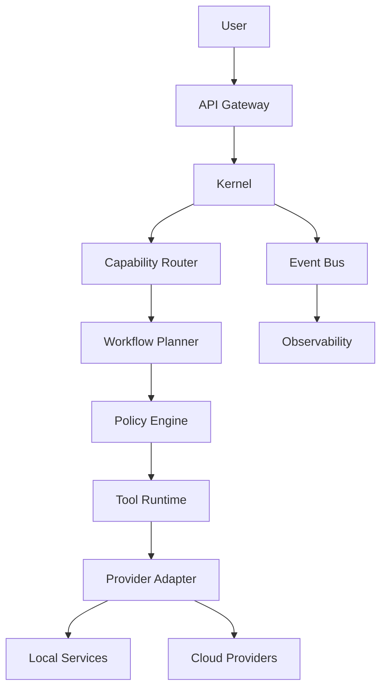

# Networking Architecture

## Executive Summary

The Networking Architecture defines how Hermes AIOS components communicate with each other, external AI providers, plugins, and user interfaces. It establishes transport mechanisms, service boundaries, security zones, API exposure, and future distributed communication patterns while maintaining Hermes AIOS's local-first philosophy.

---

# Objectives

The networking layer is responsible for:

- Internal service communication
- External provider connectivity
- API gateway management
- Service discovery
- Transport abstraction
- Secure communication
- Traffic monitoring
- Future distributed networking

---

# Networking Principles

- Local-first
- Offline capable
- Secure by default
- Transport-independent
- Provider-independent
- Minimal exposed surface
- Observable communication
- Incremental scalability

---

# Network Topology

```
                     User

                      │

          Desktop UI / CLI / API

                      │

              Hermes API Gateway

                      │

        ┌─────────────────────────┐
        │     Internal Network    │
        │                         │
        │  Kernel                 │
        │  Router                 │
        │  Planner                │
        │  Policy                 │
        │  Memory                 │
        │  Event Bus              │
        │  Tool Runtime           │
        │  Provider Adapter       │
        └─────────────────────────┘

             │              │

             ▼              ▼

        Local Services   External AI

        SQLite           OpenRouter

        ChromaDB         OpenAI

        Ollama           Others
```

---

# Communication Layers

## Layer 1 — Internal Communication

Used by Hermes components.

Preferred transports:

- In-process calls
- Shared memory
- Local IPC

Characteristics:

- Low latency
- No network dependency
- Strong typing

---

## Layer 2 — Local Services

Communicates with:

- SQLite
- ChromaDB
- Ollama

Preferred transports:

- Unix sockets (Linux)
- Named pipes (Windows where appropriate)
- Local TCP loopback

---

## Layer 3 — External Services

Communicates with:

- Cloud AI providers
- Web APIs
- Future connectors

Transport:

- HTTPS
- HTTP/2 where supported
- WebSocket for streaming

---

# API Gateway

The API Gateway provides a unified entry point.

Responsibilities:

- Authentication
- Request routing
- Rate limiting
- Request validation
- Response normalization
- API versioning
- Audit logging

No internal component is exposed directly.

---

# Internal Service Communication

Communication follows stable contracts.

```
Kernel
   │
Capability Router
   │
Workflow Planner
   │
Policy Engine
   │
Tool Runtime
   │
Provider Adapter
```

Cross-component communication requiring asynchronous behavior is handled through the Event Bus.

---

# Service Discovery

Current implementation:

- Static configuration

Future support:

- Dynamic registration
- Health-aware routing
- Distributed discovery
- Remote worker discovery

---

# Transport Protocols

| Purpose | Transport |
|----------|-----------|
| Internal execution | In-process |
| Local services | IPC / Loopback TCP |
| Remote APIs | HTTPS |
| Streaming | WebSocket / HTTP streaming |
| Future cluster | gRPC |

---

# Network Security Zones

```
Zone 1

User Interface

↓

Zone 2

Hermes Core

↓

Zone 3

Local Services

↓

Zone 4

External Providers
```

Traffic between zones passes through validated interfaces.

---

# Port Allocation

Example defaults:

| Service | Port |
|----------|------|
| Hermes API | 8080 |
| ChromaDB | 8000 |
| Ollama | 11434 |
| Metrics | 9090 |

Ports are configurable through the Configuration System.

---

# External Provider Communication

The Provider Adapter manages:

- Authentication
- Retry logic
- Timeouts
- TLS
- Rate limiting
- Capability negotiation

Core components never communicate directly with external providers.

---

# Streaming

Supported streaming patterns:

- Token streaming
- Tool progress
- Workflow progress
- Event notifications

Streaming is abstracted behind provider-independent interfaces.

---

# Timeouts

Recommended defaults:

| Operation | Timeout |
|-----------|---------|
| Local IPC | 5 s |
| Tool execution | Configurable |
| Cloud inference | 60 s |
| Health checks | 10 s |

---

# Retry Strategy

Transient failures use:

- Exponential backoff
- Provider failover
- Circuit breaker integration
- Retry budgets

Permanent failures are returned to the Workflow Planner for recovery.

---

# Firewall Guidance

Recommended rules:

Allow:

- Local loopback
- Required outbound HTTPS
- Configured provider endpoints

Deny:

- Unnecessary inbound connections
- Direct database exposure
- Direct plugin access from external networks

---

# Observability

Networking metrics include:

- Request latency
- Throughput
- Error rate
- Retry count
- Active connections
- Bandwidth
- TLS failures

These metrics feed the Observability subsystem.

---

# Mermaid Diagram



---

# Architecture Decisions

## Gateway Pattern

All external requests enter through a single API Gateway to centralize authentication, validation, and routing.

## Local IPC First

Where components reside on the same host, Hermes favors in-process calls or local IPC over network transports to minimize latency.

## Provider Isolation

External AI providers are reachable only through the Provider Adapter, preserving provider independence and simplifying future migrations.

## Transport Abstraction

Networking details are encapsulated so that future transports (e.g., gRPC) can be introduced without affecting higher-level components.

## Security Zones

Trust boundaries are explicit, reducing the attack surface and simplifying policy enforcement.

---

# Future Enhancements

- gRPC transport
- mTLS between services
- Service mesh support
- Distributed event transport
- Dynamic service discovery
- Remote execution workers
- Multi-region networking
- Adaptive traffic routing

---

# Cross References

Previous:

- `04_INFRASTRUCTURE_OVERVIEW.md`
- `04_1_DEPLOYMENT_ARCHITECTURE.md`
- `04_2_STORAGE_ARCHITECTURE.md`

Next:

- `04_4_SECURITY_ARCHITECTURE.md`
